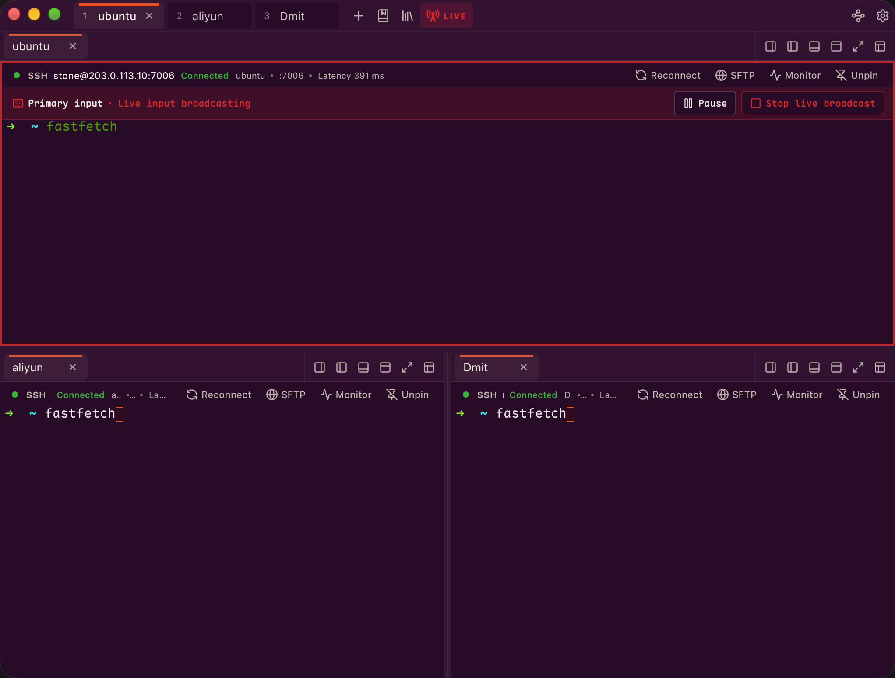
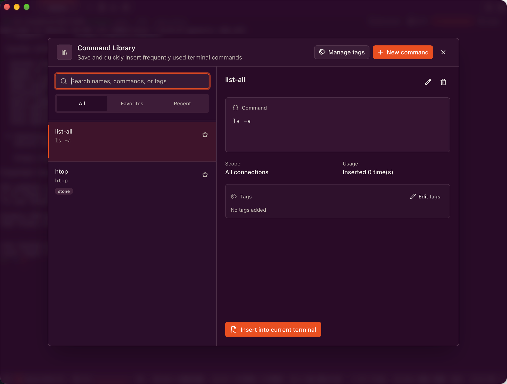
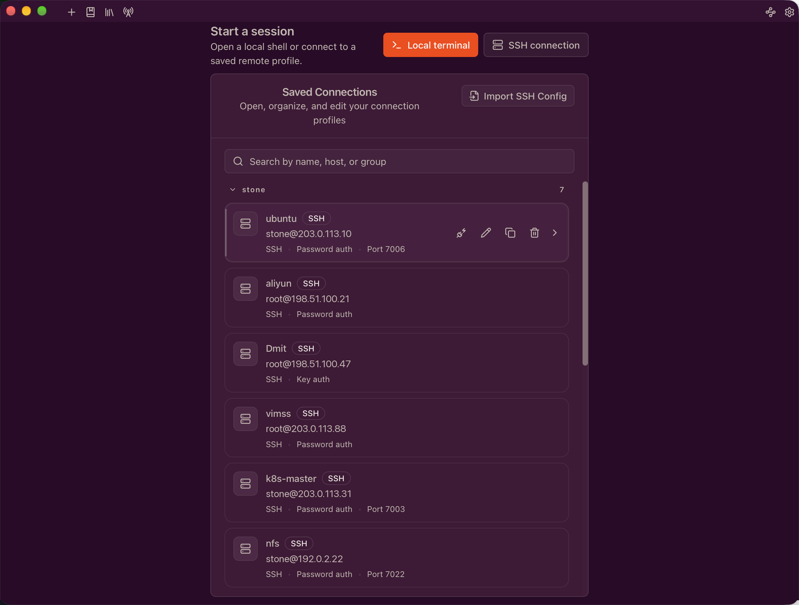
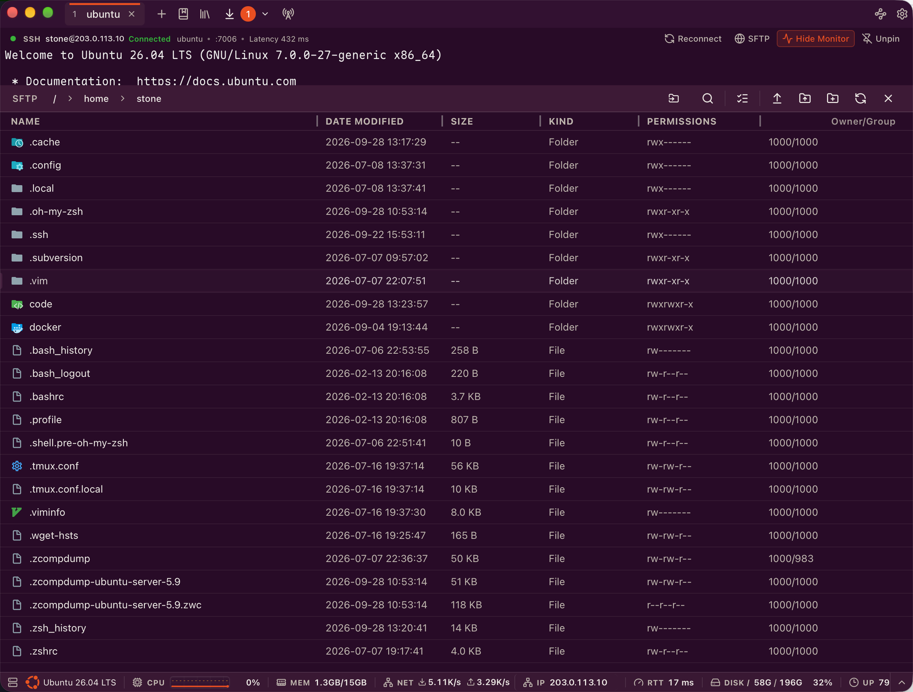
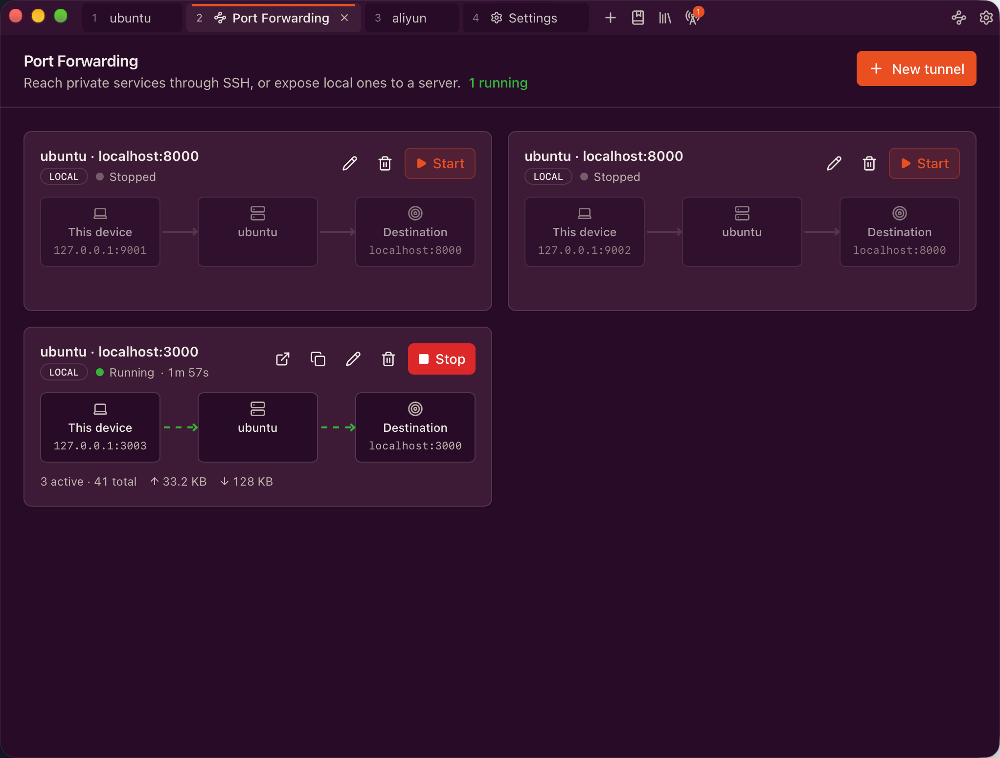
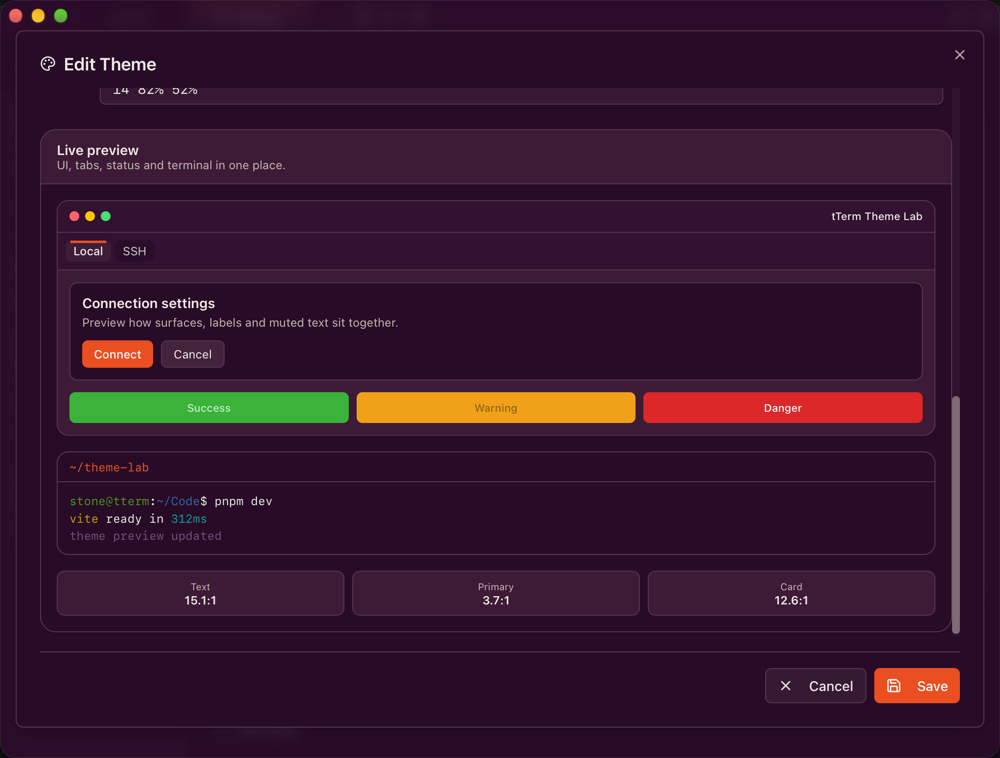

<p align="center">
  
</p>

<h1 align="center">tTerm</h1>

<p align="center">
  <strong>A free, open-source SSH terminal with built-in SFTP.</strong><br>
  A lightweight alternative to Xshell, SecureCRT and Termius for macOS, Windows and Linux.
</p>

<p align="center">
  <a href="https://github.com/330079598/tTerm/releases/latest"></a>
  <a href="https://github.com/330079598/tTerm/releases"></a>
  
  <a href="./LICENSE"></a>
  <a href="https://github.com/330079598/tTerm/stargazers"></a>
</p>

<p align="center">
  <a href="https://github.com/330079598/tTerm/releases/latest"><strong>Download</strong></a> ·
  <a href="#installation">Installation</a> ·
  <a href="#features">Features</a> ·
  <a href="#faq">FAQ</a> ·
  <a href="./README.zh-CN.md">简体中文</a>
</p>



## Why tTerm?

- **Know which AI agent needs you.** Run Claude Code, Codex, OpenCode or pi in several tabs, and each tab shows whether its agent is working or waiting for your answer. You get a notification when one needs you or finishes, even over SSH.
- **Free, open source, no account.** MIT licensed. There is no sign-up, no subscription, and nothing behind a paywall.
- **Your data stays yours.** tTerm has no cloud service. Saved passwords are encrypted locally with AES-256-GCM, and multi-device sync goes through your own WebDAV server, encrypted before upload.
- **Terminal and files in one window.** Open the SFTP drawer from any SSH session. Transfers run over parallel channels, resume after interruption, and respect a bandwidth limit.
- **`rz` / `sz` like Xshell and SecureCRT.** ZMODEM works in local and SSH terminals, for network gear, embedded boards and shell-only bastion hosts.
- **Built for many servers.** Split panes, broadcast input to several terminals, a command library with variables, visual port forwarding, and a server monitor that needs nothing installed on the server.

## Installation

Download the package for your system from the [latest release](https://github.com/330079598/tTerm/releases/latest):

| System                        | File                       |
| ----------------------------- | -------------------------- |
| macOS, Apple Silicon (M1 and later) | `tTerm_x.y.z_aarch64.dmg` |
| macOS, Intel                  | `tTerm_x.y.z_x64.dmg`      |
| Windows                       | `tTerm_x.y.z_x64-setup.exe` |
| Linux                         | `.AppImage`, `.deb` or `.rpm` |

tTerm updates itself from inside the app, on a **Stable** or **Beta Dev** channel.

### macOS: first launch says "tTerm is damaged and can't be opened"

The file is not damaged. tTerm is an open-source project without a paid Apple Developer ID, so its builds are not notarized by Apple, and macOS blocks any un-notarized app downloaded from a browser.

1. Drag `tTerm.app` into **Applications**.
2. Open **Terminal** and run:

   ```bash
   xattr -dr com.apple.quarantine /Applications/tTerm.app
   ```

3. Open tTerm as usual.

You only need to do this once. Updates installed from inside tTerm are not blocked. If you update by downloading a new `.dmg` from the browser instead, run the command again.

### macOS: Keychain asks for your password after every update

By default tTerm keeps the key that unlocks your saved passwords in the macOS Keychain. Without an Apple Developer ID, every new version looks like a different app to the Keychain, so **after each update** macOS asks once:

> "tTerm" wants to use your confidential information stored in "tterm" in your keychain.

Enter your **Mac login password** and click **Always Allow**. tTerm won't ask again until the next update.

- If you click **Deny**, saved passwords stay locked. You can try again from **Settings → Security**.
- To avoid the Keychain prompt entirely, choose **Master password** under **Settings → Security → Unlock method**. tTerm then keeps nothing in the Keychain and asks for your master password instead.

## Features

<details>
<summary><strong>Workspace and tabs</strong>: tabs, split panes, session restore</summary>

- Multiple tabs with drag-and-drop reordering, duplicate, rename, and close others / left / right
- Split panes: split any tab left, right, up, or down, drag tabs between groups, and maximize a group
- Tab search and overview when many tabs are open; adaptive or fixed tab width
- Session and layout restore after restart, optionally connecting only the active tab at startup
- Confirmation before closing tabs with active transfers or quitting with running tunnels

</details>

<details>
<summary><strong>Terminal</strong>: shell integration, custom shortcuts, session logs</summary>

- Local shells: the ones found on the machine (on Windows: cmd, PowerShell, PowerShell 7, WSL, Git Bash) plus your own list of programs with arguments, with a starred default and the rest a pick away in the new tab list
- Search with real-time highlighting
- **Command marks** (shell integration, OSC 133): jump between commands with `Ctrl/Cmd+Up` and `Down`, copy the last command's output, and see succeeded and failed commands on the scrollbar. Local shells on Windows and macOS and SSH sessions with bash, zsh or fish are set up automatically (Settings turns it on for Linux shells, and each connection can turn it off); for other hosts, Settings has a script to add to `~/.bashrc`, `~/.zshrc`, or fish's `config.fish`
- WebGL or Canvas renderer, configurable scrollback (10,000 lines by default)
- Web link detection and clear-history action
- Fully customizable keyboard shortcuts with conflict detection, including warnings when a binding would shadow common shell keys such as `Ctrl+A` or `Ctrl+R`
- On macOS, Option can act as the Meta key (Alt shortcuts in the shell, Emacs, and tmux)
- Optional session logging: raw and/or plain-text logs, file name templates, size-based rotation, and gzip compression of closed files

</details>

<details>
<summary><strong>Broadcast input</strong>: type once, run on many servers</summary>

Run the same thing on several servers at once (`Cmd/Ctrl+Shift+B`). The screenshot at the top shows live mode typing into three split panes.

- **Command mode**: type a command once and send it to the selected terminals, with a confirmation for multi-line input
- **Live mode**: keystrokes and pastes from a primary terminal are mirrored to every target in real time
- Per-target delivery status, and disconnected targets can be reconnected before sending
- Live mode stops automatically when a password prompt appears, so passwords stay in the source terminal

</details>

<details>
<summary><strong>AI coding agents</strong>: Claude Code, Codex, OpenCode and pi</summary>

Running several agents at once? tTerm shows which one is busy and which one is waiting for your answer, so you don't have to click through every tab to find out.

- **One-click setup** in Settings > Notifications: tTerm merges hooks into the Claude Code and Codex settings, or installs a small plugin for OpenCode and pi. Your other settings are left alone, the previous file is kept as `.tterm-bak`, and "Show what is added" previews the change first
- **Tab badges**: an animation while the agent works, and a different mark when it stops to ask for permission or input
- **Notifications** when an agent has been waiting for a few seconds, finishes its turn, or stops on an error. Requests that auto mode approves right away are not announced
- **Works over SSH**: agents report through a terminal escape sequence (OSC 777), so an agent on a remote host works too once you copy the same hooks into its config there. Inside tmux, turn on `set -g allow-passthrough on`
- Choose the badge style (seven working animations, three waiting marks) and its color in Settings > Appearance

</details>

<details>
<summary><strong>Command library</strong>: saved commands with variables</summary>



- Save commands with a name, description, tags, and favorites (`Cmd/Ctrl+Shift+P` to open)
- Scope a command to all connections or to a single saved connection
- Recently executed commands are captured automatically
- Insert a command into the current terminal without executing it, or save the selected terminal text as a new command
- **Command variables**: write a placeholder such as `{{host}}` in a command and a form asks for its value on insert. Text, number, choice, and secret types, with optional defaults and required flags
- Optional "confirm before inserting" for destructive commands, which shows the full command first
- Tag management: create, rename, and delete

</details>

<details>
<summary><strong>SSH connections</strong>: keys, agents, jump hosts, MFA, sudo autofill</summary>



- Password, private key (with passphrase), or SSH agent authentication, including hardware-backed keys (YubiKey, FIDO2) loaded into the agent
- **Keyboard-interactive and multi-step logins**: when a server asks for a one-time code, an MFA token, or a second step after a key, the tab prompts for each answer; a saved password answers the server's password prompt on its own. An "Interactive" method stores no credentials at all
- Optional SSH agent forwarding per connection
- Jump-host chains, opened in order like OpenSSH `ProxyJump`
- HTTP and SOCKS5 proxies, and `ProxyCommand`
- Import hosts from `~/.ssh/config` with a preview, including `LocalForward` / `RemoteForward` / `DynamicForward` rules as tunnels
- Connection groups with drag-and-drop, search, and bulk delete
- Host key confirmation; review and remove trusted hosts under Settings → Security
- Automatic reconnect with capped backoff and a configurable attempt limit
- Per-connection keepalive interval and missed-reply limit
- Per-tab connection header with pinning
- **Sudo password autofill**: when `sudo` or `doas` asks for a password, a bar outside the terminal offers to fill the saved password with one click or `Cmd/Ctrl+Shift+Enter`. Prompts are recognized in English, Chinese, and other locales, and you can add custom patterns. A dedicated sudo password can be saved per connection, which is useful for key or agent logins. Autofill pauses for the session if the password is rejected.

</details>

<details>
<summary><strong>Server monitor</strong>: CPU, memory, network, disk, latency</summary>

- Compact status bar under each SSH session: CPU, memory, network throughput, disk, load, uptime, server IP, and SSH latency. Choose which metrics to show and in what order.
- Expandable detail panel with Overview, CPU, Memory, Network, and Disk tabs and recent trends
- Metrics are read over the existing SSH connection from `/proc`; nothing is installed on the server. Linux hosts only.
- Refresh interval from 1 to 60 seconds

</details>

<details>
<summary><strong>SFTP file manager</strong>: browse, edit, chmod, drag and drop</summary>



- Browse remote directories, jump to a path by typing it, resize columns, and see owner/group and permissions
- Click a column header to sort by name, modified date, size, kind, permissions, or owner; hide dotfiles when you don't need them
- Filter the current folder by text, glob, or regular expression
- Create folders, rename, and delete; batch delete with preview, and a reviewed remote command for very large folders
- Change permissions (chmod) with read/write/execute checkboxes or an octal mode, for one item or the whole selection
- Upload and download files and folders, drag and drop from the desktop, or paste copied local files with `Ctrl+V` / `Cmd+V`
- **Remote file editor**: open a remote file in a built-in editor with syntax highlighting and save it back
- Copy full remote paths

</details>

<details>
<summary><strong>Transfers</strong>: parallel, resumable, rate-limited, ZMODEM</summary>

- Parallel SFTP channels per transfer (1–16, default 4)
- Resume or retry interrupted transfers from where they stopped
- Conflict handling when files already exist: overwrite only if newer, overwrite all, skip, or keep both
- Separate upload and download bandwidth limits that also apply to running transfers
- Progress, speed, and status for every task, with expandable batch/folder groups and a history view
- **ZMODEM (`rz` / `sz`)**: when SFTP isn't available, run `rz` / `sz` right in the terminal, just like SecureCRT and Xshell. Transfers are detected automatically in local terminals and SSH sessions, can be started from the context menu, and show up alongside SFTP tasks. See [docs/zmodem.md](./docs/zmodem.md).

</details>

<details>
<summary><strong>Port forwarding</strong>: local, remote and SOCKS5 tunnels</summary>



- Local, remote, and dynamic (SOCKS5) forwards built on your saved SSH connections, including jump hosts
- Tunnels to the same host share one SSH connection
- Live status, active and total connections, and bytes sent/received
- Automatic reconnect with notifications when a tunnel drops or comes back
- Start tunnels when tTerm opens (skipped when a password would need to be typed)
- Shows the equivalent OpenSSH command, and warns when a tunnel listens on an address reachable from your network
- Copy the listening address or open it in the browser

</details>

<details>
<summary><strong>Personalization</strong>: nearly 700 themes, fonts, window blur</summary>



- Built-in themes and a custom theme editor with live preview
- A theme library of nearly 700 themes, the collection Ghostty ships: search it, browse with the arrow keys while the whole app previews each one, star favorites, and copy any into the editor
- Follow the system appearance with a light and a dark theme of your choice
- Import themes from Ghostty, Windows Terminal, iTerm2 (`.itermcolors`), Alacritty, and kitty; tTerm builds matching interface colors from the terminal palette
- Font settings with a system font picker, and cursor style picker
- Interface text scale from 80% to 200%
- Window background blur (macOS, Windows) with adjustable blur and opacity; acrylic or mica material on Windows
- English and Chinese UI with automatic language detection

</details>

<details>
<summary><strong>Security, backup and sync</strong>: local encryption, WebDAV</summary>

- **Encrypted saved passwords**: SSH, jump-host, and sudo passwords are encrypted with AES-256-GCM in tTerm's local database. Choose how the key is unlocked:
  - **System credential store** (Keychain on macOS, Credential Manager on Windows, Secret Service on Linux)
  - **Master password** (Argon2id), with an optional unlock prompt at startup
  - **Don't save passwords**: keep them for the current session only
- Optional recovery password in case the system credential store loses the key
- **Backup and migration**: export exactly the data you choose (settings, connections and tunnels, workspace, known hosts, commands, themes, logs). Passwords are only included in password-protected backups (Argon2id + AES-256-GCM). Private key files are never included; an import lists the ones missing on the device. Imports are previewed first, can merge or replace, and create a recovery snapshot automatically.
- Scheduled local backups (daily or weekly) with a retention limit. These never contain passwords.
- **WebDAV remote backup**: upload encrypted backups to a WebDAV service (Nextcloud, Synology, AList, Jianguoyun, ...) and restore them on any device
- **Multi-device sync**: devices that share a WebDAV folder merge each other's changes to connections, passwords, commands, known hosts, settings, and themes automatically. The sync file is encrypted before upload, and you choose what is synced.

</details>

## Screenshots

| | |
| --- | --- |
|  |  |
|  |  |

## FAQ

**Is tTerm really free?**
Yes. tTerm is MIT licensed, with no paid tier, no account and no usage tracking.

**Where is my data stored?**
On your own machine, in tTerm's data folder: `~/Library/Application Support/com.stone.tTerm` on macOS, `%APPDATA%\com.stone.tTerm` on Windows, and `~/.config/com.stone.tTerm` on Linux. Nothing leaves the device unless you set up WebDAV backup or sync yourself.

**Can I import my existing hosts?**
Yes, from `~/.ssh/config`, including `ProxyJump` and port-forwarding rules. You can also move everything between computers with an encrypted backup file or WebDAV.

**Why does macOS say the app is damaged, or ask for my Keychain password after updates?**
See [Installation](#installation). Both come from tTerm not having a paid Apple Developer ID; neither means anything is wrong.

**Does the server monitor need anything on the server?**
No. It reads `/proc` over the SSH connection you already have. It works on Linux hosts.

## Contributing

Issues and pull requests are welcome. See [CONTRIBUTING.md](./CONTRIBUTING.md) for how to build tTerm, how the code is organized, and the checks a change must pass.

If tTerm is useful to you, a ⭐ on GitHub helps other people find it.

## License

[MIT](./LICENSE)

The theme library comes from [iTerm2-Color-Schemes](https://github.com/mbadolato/iTerm2-Color-Schemes) (MIT, see `src/assets/themes/LICENSE`); each theme belongs to its author, credited in `src/assets/themes/CREDITS.md`.
