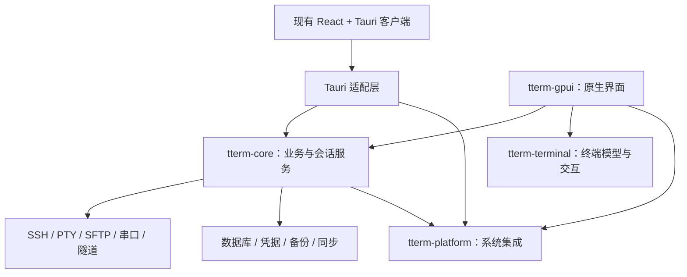

# tTerm 迁移至 Rust + GPUI：路线、收益与难点

> 评估日期：2026-11-01。本文用于技术选型与工作量评估，不代表已经启动迁移。
> **2026-11-05 更新：已决定正式迁移**，界面目标为与现有版本一致（[决策 001](gpui-migration/decisions/001-formal-migration.md)）。选型以[技术选型](gpui-migration/tech-selection.md)为准，界面还原与验收见[界面一致性](gpui-migration/ui-parity.md)与[验收协议](gpui-migration/acceptance.md)；本文第 1 节“先测量再决定”与第 6.0 节的“判断”不再决定是否迁移。
> **2026-11-05 再次更新：不再整体复用 nyaterm 的终端，也不使用任何 nyakang 的分支**（[决策 007](gpui-migration/decisions/007-official-sources-and-terminal-route.md)）。GPUI 与组件库用官方 crates.io 发布（gpui-kit 0.9.0 + `gpui-pre`），终端以官方 `alacritty_terminal 0.26.0` 为内核自己搭建。本文第 3.2、3.5、4、10 节中关于复用 nyaterm 终端与分支的内容以该决策为准。
> 基于 tTerm 本地代码、固定提交的 nyaterm 与 Zed 源码，以及 2026-11-01 查询的 nyaterm issue 和各分支差异；尚未进行组件抽取、编译验证和性能对比。

## 1. 建议与结论

迁移可行。tTerm 已经用 Rust 实现 SSH、PTY、SFTP、串口、隧道、加密、数据库、备份和同步，具备保留业务核心、替换客户端的基础。

**首选路线是：复用并适配 nyaterm 已有的终端实现，保留 tTerm 的协议与业务能力，使用 GPUI 重建应用界面。Zed 主要作为 GPUI 架构和交互设计参考。**

这不是从零编写一个终端，也不是简单替换 Tauri。已有终端代码能够显著减少基础实现工作，但仍需要完成接口适配、功能对齐和跨平台验收。

建议先投入 1–2 周验证组件抽取与关键平台体验，再决定是否全面迁移。迁移期间保留可工作的 Tauri 版本，以共享 Rust 核心支持两个客户端。

需要先说明的三点：

- **性能根因尚未测量。** 迁移的主要动机是 macOS 与 Linux 上的性能，但目前没有剖析数据证明瓶颈在 WebView 本身。P0 首先测量现有 Tauri 版本（见 6.0 节），macOS 上存在可以低成本验证的怀疑点。
- **nyaterm 本身就是一次 Tauri 到 GPUI 的迁移。** 它是同类产品，已在 2026-10 完成切换并发布 v2.0.0，迁移后的问题记录是本计划最直接的风险清单（见 3.1 节）。
- **工作量预算偏乐观。** 可复用的终端 crate 规模不大，但计划要复用的滚动、滚动条与输入法逻辑位于 nyaterm 约 5 万行的桌面终端层中（见 10 节）。

按平台看收益：

| 平台    | 判断       | 理由                                                                 |
| ------- | ---------- | -------------------------------------------------------------------- |
| Linux   | 值得迁移   | WebKitGTK 的渲染与刷新问题无法在应用层解决，nyaterm 旧版也遇到过     |
| macOS   | 先测量     | WKWebView 本身表现尚可，当前透明窗口与模糊效果可能是主要开销         |
| Windows | 无明显收益 | WebView2 表现良好；GPUI 的 D3D11 路径在无 GPU 环境中有已知的严重退化 |

优先顺序：

1. 剖析现有 Tauri 版本，确认 macOS 与 Linux 上的实际瓶颈。
2. 验证 nyaterm 终端组件能否独立运行并接入 tTerm 的数据源。
3. 抽取不依赖 Tauri、GPUI 的共享业务核心。这一步无论最终是否迁移都有价值。
4. 跑通本地与 SSH 终端，验证输入、滚动、选择、搜索和输入法。
5. 重建工作区和业务界面，逐项对齐功能。
6. 完成数据、系统集成、性能和安装更新验收后，再替换正式版本。

## 2. 当前项目基础

本次本地统计如下；行数包含测试、注释和空行，不能直接换算为工作量。

| 项目                        | 统计                     | 对迁移的含义                     |
| --------------------------- | ------------------------ | -------------------------------- |
| 前端 TS、TSX、CSS           | 783 个文件，约 10.7 万行 | 界面、交互与部分业务状态需要移植 |
| Rust 源码                   | 337 个文件，约 8.5 万行  | 大量协议、数据和算法可以保留     |
| 引用 Tauri API 的 Rust 文件 | 112 个                   | 后端存在需要处理的框架耦合       |
| `#[tauri::command]` 声明    | 209 处                   | 可作为服务拆分和功能核对的起点   |

当前主要结构：

```text
React 界面、状态、xterm.js 与终端增强功能
                    ↓
        Tauri invoke / event / Channel
                    ↓
Rust：PTY、SSH、SFTP、串口、隧道、数据库、凭据、备份、同步
```

关键代码边界：

- [应用初始化与命令注册](../src-tauri/src/lib.rs)：运行时、插件与业务状态集中接入。
- [会话状态](../src-tauri/src/core/state.rs)：`ChannelContext` 直接持有 `tauri::AppHandle`。
- [终端输出](../src-tauri/src/terminal/io_batcher.rs)：已有二进制 Channel、批处理、有界队列和解析确认。
- [终端创建](../src/components/TerminalTab/openTerminal.ts)：集成 xterm 插件、OSC、Unicode 和输入法处理。
- [终端会话接入](../src/components/TerminalTab/ptySession.ts)：连接状态、输出与前端处理流程。
- [配置路径](../src-tauri/src/config/paths.rs)：依赖 Tauri 解析并初始化目录。
- [数据库](../src-tauri/src/db/mod.rs)：已有 SQLite 存储与迁移基础。
- [远程文件编辑器](../src/components/CodeMirrorEditor.tsx)：依赖 CodeMirror，原生版本需要替代方案。

不要把迁移理解为“后端原样不动，前端改写”。协议与数据实现复用价值很高，但状态、事件、路径、认证提示和窗口操作需要解耦。

## 3. 如何使用两个参考项目

### 3.1 nyaterm 的迁移经历：先读它的问题记录

nyaterm 与 tTerm 功能高度重叠（SSH、本地终端、串口、SFTP、隧道、同步、AI），并且自己完成过一次 Tauri 到 GPUI 的迁移。[GPUI 切换记录][nya-cutover] 显示旧 Tauri 主线于 2026-10-26 冻结为 `archive/tauri-v1`，GPUI 版 v2.0.0 于 2026-10-28 发布。它的旧版和新版问题记录分别对应“为什么迁”和“迁完会遇到什么”。

旧 Tauri 版在 Linux 上的问题与 tTerm 的迁移动机一致：

- [#877][nya-877]：WebKitGTK 升级到 2.54.1 后出现局部刷新异常、内容残留和显示不完整。

GPUI 版发布前后出现的问题（2026-11-01 查询时的状态）：

| 问题                                                       | issue                            | 对本计划的要求                             |
| ---------------------------------------------------------- | -------------------------------- | ------------------------------------------ |
| Linux fcitx 下切换到其他应用再切回，中文输入失效           | [#1017][nya-1017]（未关闭）      | 输入法焦点切换列入 P0 停止条件             |
| X11 XIM 出错一次后输入法永久失效，候选框不跟随光标         | [#1073][nya-1073]（未关闭）      | X11 与 Wayland 分别验收，覆盖 XIM 错误恢复 |
| 无 GPU 的 Citrix 云桌面中拖动窗口、点击、输入时 CPU 超 80% | [#938][nya-938]                  | 软件渲染与虚拟显示驱动列入验收矩阵         |
| Windows 10 上卡到无法使用，回退 1.3 正常                   | [#1020][nya-1020]                | 同上，并记录实际选中的渲染适配器           |
| 鼠标滚动时历史显示丢失、跳行、不连续                       | [#985][nya-985]、[#923][nya-923] | 复用的滚动模型需要带回归用例接入           |
| 未处于底部时快速输出导致闪烁，与回滚区写满后淘汰旧行有关   | [#1043][nya-1043]（未关闭）      | 回滚区写满后的锚定行为列入终端 MVP 验收    |
| Wayland 使用系统窗口装饰时标题重复、颜色不对               | [#1093][nya-1093]（未关闭）      | 系统装饰与自绘标题栏分别验收               |

结论：GPUI 消除了 WebView 带来的问题，但带来了平台输入法和软件渲染两类新风险。tTerm 的用户经常在虚拟机、远程桌面和堡垒机桌面中工作，这两类风险必须在 P0 中验证，不能留到发布前。

### 3.2 nyaterm：优先复用实际终端实现

nyaterm 当前已有以下分层：

```text
nyaterm-core
nyaterm-transport
nyaterm-store
nyaterm-terminal
nyaterm-terminal-gpui
nyaterm-ui
nyaterm-desktop
```

最有价值的是将终端模型与 GPUI 绘制分离，并在桌面层组织滚动、输入、焦点和会话交互。

此次已核对的可复用能力：

| 部分     | 源码中的实现                                     | 建议处理                             |
| -------- | ------------------------------------------------ | ------------------------------------ |
| 终端模型 | `TerminalCore`、resize、历史容量、搜索、选择文本 | 保留实现并接入 tTerm 会话            |
| 可见区域 | `viewport_snapshot` 系列接口                     | 复用历史偏移、可见区域快照和增量信息 |
| 绘制     | `NyaTerminalElement`、布局缓存、字体和选区绘制   | 适配为 tTerm 终端组件                |
| 滚动     | 小数滚动量累积、边界限制、显示偏移               | 抽取算法和状态，替换应用对象依赖     |
| 滚动条   | 滑块几何、指针到偏移换算、拖拽、搜索标记         | 复用逻辑，调整主题与事件接入         |
| 后台策略 | 后台继续解析，停止实时快照与绘制通知             | 结合 tTerm 分屏和后台任务策略移植    |
| 输入法   | 预编辑绘制、候选框和光标几何                     | 移植后进行真实平台验收               |

对应源码：[终端模型][nya-terminal]、[绘制组件][nya-element]、[滚动逻辑][nya-scroll]、[滚动条][nya-scrollbar]、[输入法][nya-ime]。

**滚动、选区和绘制等基础能力不应重新发明。优先保留已有模型与绘制之间的配合，先接通，再减少不必要的依赖。**

但这些代码还不是可以无适配接入的通用控件：

- `nyaterm-terminal-gpui` 依赖 `nyaterm-core` 与 `nyaterm-ui`。
- 绘制使用 `nyaterm_ui::ThemePalette`，关键词高亮使用其核心类型。
- 一部分滚动、滚动条与输入方法挂在 `NyaTermApp` 上。
- 会话、传输、事件和界面状态采用 nyaterm 自己的数据结构。

需要把这些连接替换成 tTerm 接口，而非重写底层行为。

本次测量的耦合程度：

| 部分                                                 | 规模（含测试） | 与 nyaterm 其他部分的耦合                                                      |
| ---------------------------------------------------- | -------------- | ------------------------------------------------------------------------------ |
| `nyaterm-terminal`                                   | 约 1.3 万行    | 仅用到 `nyaterm_core` 的关键词高亮规则、字符编码、单元格高度和 AI 命令捕获     |
| `nyaterm-terminal-gpui`                              | 约 1.55 万行   | 上述 core 类型，以及 `nyaterm_ui` 的 `ThemePalette` 与 `theme_palette`         |
| 桌面终端层（`features/terminal`、`models/terminal`） | 约 5 万行      | 滚动、滚动条、输入法、搜索、选区运行时都在这里，挂在 `NyaTermApp` 等应用对象上 |

两个终端 crate 的抽取成本较低：替换少量 core 类型和一个主题类型即可。主要成本在桌面终端层，需要从中拆出滚动、滚动条和输入法逻辑，P0 的估算应以这一层为准。

nyaterm-terminal 还包含 sixel 与 kitty 图像协议、命令导航、录制净化等能力，可在终端 MVP 之后按需取用。

### 3.3 Zed：参考 GPUI 的正确使用方式

重点参考：

- Entity、视图和自定义 Element 的状态边界。
- 焦点、快捷键、命令与输入事件组织。
- 文本测量、绘制和终端视图的实现方式。
- UI 执行器与 Tokio 运行时桥接。
- 平台后端与可测试的 UI 结构。

不建议为了终端或远程文件编辑功能引入整个 Zed workspace。它会带来大量应用级依赖，也有不同的许可证要求。

固定提交中的 GPUI 已有以下变化，与 nyaterm 所用分支的状态不一定相同：

- Linux 的 Wayland 与 X11 均通过 `gpui_wgpu` 渲染。
- `gpui` 及各平台后端已接入 accesskit，可作为屏幕阅读器支持的基础。
- `gpui` 以 0.2.2 版本发布到 crates.io，但应用级补丁仍需要通过分支维护（见 3.5 节）。

### 3.4 gpui-kit：界面组件与远程编辑器

原计划没有覆盖组件库。nyaterm 的界面建立在 [gpui-kit][gpui-kit] 之上，它由 longbridge 维护，许可证为 Apache-2.0（仓库中的 `LICENSE-APACHE`）。

它提供输入框、表格、菜单、弹窗、树、列表等组件，以及基于 tree-sitter 的代码编辑器。nyaterm-ui 为编辑器开启了约 30 种语法，并使用 `ropey` 处理文本。远程文件编辑器替代 CodeMirror 时，应首先评估这个编辑器，验证 7.5 节列出的撤销、搜索、大文件、输入法、编码与换行格式。

nyaterm 使用自己的分支 `nyakang/gpui-kit`，比上游多 24 个提交、落后 88 个。gpui-kit 与 GPUI 版本需要成对固定。

### 3.5 依赖与许可证

| 来源                                | 此次核实的许可证 | 处理方式                                       |
| ----------------------------------- | ---------------- | ---------------------------------------------- |
| Zed `gpui`                          | Apache-2.0       | 可作为依赖，保留相应许可声明                   |
| Zed `terminal`                      | GPL-3.0-or-later | 若维持当前分发许可方式，不直接复制或链接该组件 |
| Zed `terminal_view`                 | GPL-3.0-or-later | 同上                                           |
| Zed `gpui_tokio`                    | Apache-2.0       | 可作为依赖或参考                               |
| nyaterm workspace                   | Apache-2.0       | 复用文件保留来源、许可和适用声明               |
| nyaterm 所固定的 Alacritty terminal | Apache-2.0       | 核对实际采用版本及传递依赖                     |
| gpui-kit                            | Apache-2.0       | 可作为依赖，与 GPUI 版本成对固定               |

nyaterm 的 README 徽章写作 MIT，但仓库 `LICENSE` 与 workspace 声明均为 Apache-2.0，以后者为准，复用前再次核对。

不能因项目使用 GPUI，就把它的所有应用层代码都视为 Apache-2.0。复用清单应落实到文件、crate 和固定提交。

nyaterm 当前使用自己的 GPUI/Zed、Alacritty、组件库等分支。初期验证应使用彼此兼容的固定版本，不要混用不同 GPUI 来源而造成类型或接口不一致。

长期需要在两条路线中选择：

| 路线                        | 优点                   | 成本                         |
| --------------------------- | ---------------------- | ---------------------------- |
| 跟随 nyaterm 兼容的依赖组合 | 初期抽取时减少版本冲突 | 需要跟踪其分支变更与维护状态 |
| 迁移到 GPUI 上游及自管补丁  | 可以独立控制升级       | 需要核对、移植实际必需的补丁 |

先验证复用，再决定依赖归属；不在没有证据时同时升级内核、框架和全部业务库。

这个选择的实质是由谁维护分支补丁。2026-11-01 查询的分支状态：

| 分支                | 相对上游              | 主要补丁                                                                                                                                                   | 与 tTerm 的关系                                       |
| ------------------- | --------------------- | ---------------------------------------------------------------------------------------------------------------------------------------------------------- | ----------------------------------------------------- |
| `nyakang/zed`       | 多 26 个，落后 194 个 | macOS file promise、Windows 虚拟文件导出与 Linux 原生文件导出；跨窗口内部拖拽；模态窗口 owner 恢复；图集分配失败可处理；Windows 输入法仅光标更新的组合事件 | SFTP 拖出到 Finder 或资源管理器、多窗口、输入法都需要 |
| `nyakang/alacritty` | 多 6 个，落后 1 个    | 每个 grid 记录随换行推进的 scroll epoch；暴露每个屏幕稳定的 epoch 与 generation                                                                            | `viewport_snapshot` 与滚动锚定依赖它                  |
| `nyakang/gpui-kit`  | 多 24 个，落后 88 个  | 未逐项核对                                                                                                                                                 | 组件与编辑器                                          |

建议：自管一个基于上游 GPUI 的分支，按需挑选 nyaterm 的补丁（其提交信息以 `preserve ...` 标明，并有补丁验证记录），固定 rev 并记录每个补丁的来源和回归用例。Alacritty 只有两个功能补丁，自行携带成本很低。

从分支补丁内容判断，文件拖出不在上游 GPUI 中；若不携带这组补丁，SFTP 拖出需要自己实现三平台原生代码，应在 P0 确定方案。

## 4. 建议目标架构



终端的数据源由 core 管理，GPUI 适配层将输出送入终端模型，并将终端生成的输入和协议回复送回对应会话。图中平台依赖通过能力接口隔离，具体实现由应用启动时注入。

初期可以在 `src-tauri/` 内建立 Cargo workspace，保留现有 Tauri 包，并新增以下主要部分；所有 Cargo 命令继续从 `src-tauri/` 执行。

| 部分             | 职责                                                              |
| ---------------- | ----------------------------------------------------------------- |
| `tterm-core`     | 会话生命周期、认证请求、连接配置、传输任务、存储、备份和同步      |
| `tterm-terminal` | 基于 nyaterm 抽取的终端模型、历史、选择、搜索、输入编码与扩展协议 |
| `tterm-platform` | 目录、系统凭据、剪贴板、通知和系统集成的能力接口与实现            |
| `tterm-gpui`     | 终端 Element、工作区、连接管理、SFTP、设置及弹窗                  |

初期无需把每个领域都拆成独立 crate。终端绘制可先放在 GPUI 包内，边界稳定后再独立拆分。

核心约束：

- core 不依赖 Tauri 或 GPUI。
- 终端模型不依赖 Tauri 或 GPUI，绘制层单独依赖 GPUI。
- UI 不直接操作网络任务、数据库连接或终端进程。
- 会话和传输由服务持有，不以某个视图是否存在决定生命周期。
- 两个客户端共享业务逻辑，各自实现界面与框架适配。

| 当前实现              | 迁移方向                              |
| --------------------- | ------------------------------------- |
| `tauri::State<T>`     | 显式服务参数或 `Arc<AppServices>`     |
| `AppHandle.emit(...)` | 类型化业务事件，由适配层订阅          |
| 认证提示事件          | 请求 ID、提示数据与一次性响应通道     |
| Tauri Channel         | 面向不同消费者的输出接口              |
| Tauri 路径解析        | 启动时注入 `AppPaths`，保持旧目录兼容 |
| React hooks / Context | GPUI Entity 与按职责拆分的状态        |
| DOM / CSS             | GPUI 布局、样式和组件                 |
| xterm.js              | 抽取适配后的 Rust 终端组件            |

## 5. 功能复用与迁移范围

| 功能                       | 迁移方式                   | 重点                               |
| -------------------------- | -------------------------- | ---------------------------------- |
| SSH、跳板链、代理、认证    | 保留 tTerm 协议业务        | 解耦状态、提示和事件               |
| SFTP、续传、并行和限速     | 保留服务，重建 UI          | 任务生命周期、取消与进度订阅       |
| 本地 PTY、串口             | 保留底层，适配输入输出     | ConPTY、编码、重连、串口显示模式   |
| ZMODEM/XMODEM              | 保留协议实现               | 二进制分流与普通输入互斥           |
| 隧道、服务器监控           | 保留业务，重建界面         | 后台运行、退出保护、统计刷新       |
| 数据库、加密、备份、同步   | 尽量保持实现及格式         | 目录、凭据标识、版本和回退         |
| nyaterm 终端能力           | 抽取并适配                 | 滚动、选区、搜索、绘制、输入法     |
| 主题、连接、命令库         | 保留数据，重建管理界面     | 字段默认值、国际化和交互一致性     |
| 标签、分屏、拖拽、快捷键   | GPUI 重建                  | 焦点、布局持久化、命令路由         |
| 前端纯逻辑                 | 按需移植为 Rust            | 用已有测试输入输出验证语义         |
| CodeMirror 编辑器          | 选择原生替代组件           | 撤销、搜索、编码、语法高亮、大文件 |
| 托盘、通知、拖出、安装更新 | 复用可用系统实现并重新集成 | 平台差异、签名、点击路由与权限     |

已有实现证明基础能力不必从零开始，不代表已经验证与 tTerm 全部行为一致。

## 6. 分阶段实施路线

每个阶段的详细任务卡、执行规则与验收方式见[迁移任务清单](gpui-migration/README.md)。

### 6.0 先剖析现有 Tauri 版本

迁移的动机是性能，因此第一步是确认现有版本慢在哪里。这一步只需 1–2 天，结果同时作为迁移前的性能基线。

| 平台  | 怀疑点                                                                                                                                                                                     | 验证方式                                                      |
| ----- | ------------------------------------------------------------------------------------------------------------------------------------------------------------------------------------------ | ------------------------------------------------------------- |
| macOS | [macOS 窗口配置](../src-tauri/tauri.macos.conf.json) 设置 `transparent: true`，并开启 `macOSPrivateApi` 与[窗口模糊](../src-tauri/src/window_blur.rs)，透明 WKWebView 会让整个窗口参与合成 | 关闭透明与模糊后对比滚动帧耗时、空闲 CPU 和 WindowServer 占用 |
| Linux | WebKitGTK 中 WebGL 可能不可用或较慢，xterm 会经 [渲染器回退](../src/components/TerminalTab/useTerminalRenderer.ts) 切到 Canvas                                                             | 记录实际启用的渲染器、WebKitGTK 版本与合成模式                |
| 共通  | React 重渲染、IPC 输出批处理、主线程上的同步工作                                                                                                                                           | WebView 开发者工具的性能录制，后端 tracing                    |

判断：

- 若 macOS 关闭透明后问题基本消失，迁移的主要理由收窄为 Linux，需要重新衡量投入。
- 若瓶颈在 WebKitGTK 渲染本身，应用层难以修复，迁移理由成立。
- 若瓶颈在 React 或 IPC，先在 Tauri 版修复，收益更快。

### P0：组件抽取与技术验证

目标：证明可复用终端能够独立运行，并确认主要平台不存在不可接受的缺口。

工作内容：

1. 固定 nyaterm 参考提交、GPUI、gpui-kit 和终端内核版本，记录复用文件、分支补丁及许可。
2. 建立最小 GPUI 终端程序，先用录制字节流验证显示。
3. 抽取模型、绘制、滚动、选择与输入所需的最小依赖闭包，重点估算桌面终端层的拆分量。
4. 接入本地 PTY；远程会话先在本地 PTY 中运行系统 `ssh` 验证显示。tTerm SSH 服务要到 P1 解耦后才能脱离 Tauri 使用，经它接入真实会话是 P1 的完成标准。
5. 验证中文输入、滚动、复制、resize、字体回退和多屏 DPI。
6. 按 7.2 节的矩阵验证 Linux 输入法，按 7.7 节验证无 GPU 或远程桌面环境下的渲染。
7. 确定 SFTP 文件拖出与远程编辑器的技术方案（分支补丁、gpui-kit 编辑器或自行实现）。
8. 对照 6.0 的基线记录新版初步指标和缺失功能。

交付物：可运行原型、依赖及许可清单、分支补丁清单、平台验证记录、功能差异清单、更新后的工期预算。

停止条件：

- 目标平台存在难以承担的图形或输入缺口，特别是 Linux 中文输入在焦点切换或 XIM 出错后无法恢复。
- 无 GPU 环境下空闲或交互时 CPU 占用不可接受，且没有可行的降级方案。
- 组件依赖难以隔离，或分支补丁的维护成本超出承受范围。
- 性能与维护收益不足以支持后续投入。

缺少测试机器时将项目标记为未验证，不能按通过处理。

### P1：抽取共享业务核心

依次处理路径与初始化、认证提示、会话管理、输出接口和后台任务。

每次抽取后，让旧 Tauri command 调用新服务，保持原客户端可用。重构与行为变更分开提交，遵守现有文件和函数大小限制。

完成标准：核心能够脱离两个 UI 框架进行测试，Tauri 版既有行为正常，GPUI 能通过同一服务建立和关闭会话。

### P2：完成终端 MVP

复用 nyaterm 的终端实现，完成输入输出、滚动、选区、搜索、resize 和必要终端扩展的适配。

优先验收本地 shell、SSH、vim、tmux 和常用 AI TUI，再接入 tTerm 的 OSC 133/633、目录报告、AI 状态、sudo 提示、广播输入及日志。

完成标准：核心日常操作可用；持续输出时内存有界；关键终端协议不存在重复应答；建立与旧版对比的回归记录。

### P3：重建原生工作区

实现标签、分屏、焦点路由、快捷键、主题、连接管理、命令库及工作区恢复。双语文案迁移到 Rust 国际化方案，保留现有翻译资产并核对插值和复数语义。

完成标准：可进行日常 SSH 工作，切换布局不会丢失会话或误终止后台任务。

### P4：业务功能对齐

按功能矩阵补齐 SFTP、远程编辑、传输管理、隧道、监控、串口、文件协议、日志、备份、同步及设置。

远程编辑器和系统文件拖出应尽早验证技术方案，不留到最后。尚未实现的功能明确标记，不能因存在相似页面就视为对齐。

### P5：产品化与灰度发布

验证三平台安装、更新签名、单实例、托盘、通知、系统注册、退出保护与数据迁移。

测试使用隔离数据和同步空间，不允许两个客户端同时写同一数据库。正式升级前建立可恢复快照；若持久化格式变更，旧版回退使用升级前快照。

完成标准：关键平台交互验收通过，功能差异已获明确处理，数据可恢复，更新安装链路经过演练，再进入小范围试用与扩大分发。

## 7. 难点与处理原则

### 7.1 终端兼容性与协议回复

tTerm 的 [SSH 查询处理器](../src-tauri/src/terminal/ssh_query_handler.rs) 已经拦截并回复部分 DA、CPR 等查询。新内核接入后，应按查询类型确认唯一应答方，避免重复回复或返回与屏幕不一致的状态。

重点覆盖备用屏幕、自动换行、宽字符、组合字符、emoji、鼠标上报、应用光标、焦点报告和括号粘贴。旧版 xterm 的 Unicode 版本与新内核可能不同，差异需要逐项判断。

nyaterm 已有的实现可以缩短开发，但仍要验证 tTerm 注入的 shell 脚本和自定义 OSC 协议。

### 7.2 输入法与字符坐标

移植预编辑和候选框计算，验证 UTF-8 字节、UTF-16 索引、字符簇与终端列之间的转换。

覆盖中文输入的开始、更新、提交和取消，以及标签切换、弹窗、缩放、跨屏、滚动后的位置。避免把按键事件与输入法提交重复发送。

Linux 上输入法的问题集中在平台层而非终端层（见 3.1 节的 #1017、#1073），需要按组合验收：

| 会话    | 输入法协议    | fcitx5 | ibus |
| ------- | ------------- | ------ | ---- |
| X11     | XIM           | 必测   | 必测 |
| Wayland | text-input-v3 | 必测   | 必测 |

每个组合覆盖：启动后首次输入；切换到其他应用再切回；输入法进程重启；预编辑时切换标签；候选框随光标移动。X11 下额外覆盖 XIM 握手出错后的恢复，以及候选框位置（SpotLocation）上报。

Windows 与 macOS 覆盖系统自带中文输入法与常用第三方输入法，Windows 关注仅更新光标位置的组合事件。

### 7.3 数据流、背压与线程

当前 Tauri 输出已经使用原始二进制 Channel，不能将现状假设为逐包 JSON。GPUI 的收益需要建立在实际测量上。

```text
PTY / SSH / 串口字节
        ↓
二进制协议分流、按现有语义记录日志
        ↓
文本编码处理、终端解析与模型更新
        ↓
可见区域快照、合并刷新通知
        ↓
GPUI 绘制
```

- ZMODEM 等二进制协议先分流，再处理文本编码。
- 可以合并刷新通知，不能任意丢弃终端协议数据。
- 后台标签继续解析；不可见时减少快照和绘制。
- 避免每帧复制全部历史，以及每个数据包触发一次绘制。
- UI 读取和绘制不应长期占用解析任务需要的锁。
- 持续输出、退出和取消都需要有界队列及明确的唤醒机制。

### 7.4 GPUI 与 Tokio 生命周期

保留现有 Tokio 运行时，使用桥接或显式通道连接 GPUI；Zed 的 `gpui_tokio` 可以参考。不要让视图持有的短期任务意外决定长期连接的存活。

关闭会话时取消认证等待、重连、输入与监控；隐藏标签不关闭会话。保留 `session_nonce` 等机制，隔离旧连接的迟到事件。

数据库、文件、压缩、密钥派生与网络等待继续在后台执行，不能放进 GPUI 主线程。

### 7.5 编辑器、组件和系统能力

GPUI 是自绘 UI 框架，不会自动提供 CodeMirror、HTML、所有原生控件或全部系统交互。组件选型要验证表格、输入框、菜单、文件对话框、键盘导航和可访问性。

远程编辑器至少覆盖撤销、搜索、语法高亮、大文件、输入法、编码、换行格式及保存冲突，首选评估 gpui-kit 的编辑器（见 3.4 节）。系统集成覆盖文件拖出、通知点击、托盘、窗口材质、多屏、屏幕阅读器和远程桌面环境。

### 7.6 数据兼容与回退

保持应用标识、配置目录、数据库迁移、凭据服务名称和解锁语义。UI 改变不应导致用户找不到原数据或重新保存全部密码。

旧终端快照来自 xterm SerializeAddon，应验证新内核恢复效果；回放时避免触发通知、剪贴板等副作用。备份与同步需要检查版本协商、旧设备参与和失败恢复。

nyaterm 的 [GPUI 切换记录][nya-cutover] 可参考数据、功能缺口、签名安装与回退的验收组织方式。该文件含历史准备状态，不能当作所有验收已经完成的证明。

### 7.7 无 GPU 与远程桌面环境

WebView 在无 GPU 环境下会退回成熟的软件合成路径，而 GPUI 每帧都经过 GPU 接口提交。nyaterm 的 [#938][nya-938] 与 [#1020][nya-1020] 显示，在 Citrix 等虚拟显示适配器上，GPUI 版本 CPU 占用可达 80% 以上，而同一环境下旧 Tauri 版本流畅；关闭 DirectComposition 也没有改善。

tTerm 的用户常在虚拟机、远程桌面和堡垒机桌面中使用 SSH 客户端，这类环境应视为主要场景：

- Windows：RDP 会话、Citrix 或其他云桌面、无 3D 加速的虚拟机，记录实际选中的 D3D11 适配器（包括 WARP）。
- Linux：llvmpipe 等软件 Vulkan 实现、无 GPU 直通的虚拟机、远程 X11 转发。
- macOS：远程控制与屏幕共享场景。

处理方向：空闲时不重绘；合并刷新并限制帧率；窗口拖动与缩放时降低绘制频率；必要时提供“低功耗渲染”设置。这些措施需要在 P0 中验证可行，不能假设上游会解决。

## 8. 收益与成本

| 项目                       | 判断                 | 条件或限制                                              |
| -------------------------- | -------------------- | ------------------------------------------------------- |
| 移除 WebView 界面依赖      | 明确收益             | 减少 DOM、WebView 与原生窗口之间的适配                  |
| 统一 Rust 类型和状态接口   | 明确收益             | 核心边界清晰后减少跨语言重复维护                        |
| 减少终端热路径跨运行时传递 | 明确收益             | 输出可以在 Rust 内完成解析和状态更新                    |
| 内存降低                   | 有机会，需实测       | 历史、文本布局、字形和 GPU 缓存仍然占内存               |
| 多会话交互稳定性           | 有机会               | 依赖缓存、后台策略、背压和锁设计                        |
| 中文输入体验               | 有机会               | 从 WebView 适配转向 GPUI 与平台输入适配                 |
| 包体更小                   | 不确定               | Tauri 已使用系统 WebView，新版原生依赖可能增大包体      |
| 所有场景更快               | 不能保证             | 旧版已有 WebGL，GPU 渲染本身并非新增能力                |
| 无 GPU 环境                | 可能退化             | nyaterm 在云桌面和 Windows 10 上出现严重卡顿            |
| Linux 中文输入             | 短期可能退化         | 从 WebKitGTK 的成熟实现换成 GPUI 的 XIM 与 Wayland 实现 |
| SSH 网络延迟降低           | 不会改变网络往返     | 只能优化本地输入、解析与显示路径                        |
| 维护成本降低               | 长期有机会，短期增加 | 需要承担 GPUI 升级、原生组件和平台兼容工作              |

复用 nyaterm 可以减少基础实现成本，但需要持续追踪所复用代码的缺陷和上游变更。建议维护来源提交、改动说明、回归用例和依赖升级记录，避免后续只能整体复制上游。

还需要回答产品定位问题：nyaterm 已经是功能高度重叠、基于同一技术栈的原生客户端。迁移完成后，tTerm 的差异主要来自业务核心，例如对 OpenSSH 配置的完整兼容（Include、% 记号、known_hosts 与证书、跳板链）。这些能力位于 `tterm-core`，因此 P1 的核心抽取无论最终是否迁移都值得完成，也应作为两个客户端共同的长期资产维护。

## 9. 验收与性能对比

| 场景                     | 观察指标或验收内容                             |
| ------------------------ | ---------------------------------------------- |
| 冷启动、首次打开终端     | 窗口可见和终端可输入的时间                     |
| 1 / 10 / 30 个会话       | 整个进程树的内存、GPU 内存和空闲 CPU           |
| 单会话持续输出           | 解析吞吐、绘制帧耗时、输入与取消响应           |
| 多会话同时输出           | 活跃终端是否卡顿、后台是否积压                 |
| 大量历史、搜索、滚动     | 峰值内存、搜索耗时、滚动帧稳定性               |
| 输入法、DPI、焦点变化    | 丢字、重复提交、候选框错位                     |
| Linux 输入法矩阵         | 按 7.2 节逐项通过，含切回应用与 XIM 出错后恢复 |
| 无 GPU 与远程桌面        | 空闲 CPU、拖动窗口与持续输出时的 CPU 和帧率    |
| 回滚区写满后持续输出     | 浏览历史时不闪烁、不跳行、不丢行               |
| shell、vim、tmux、AI TUI | 显示、按键、鼠标和查询应答                     |
| SSH 与认证               | 跳板、代理、主机密钥、MFA、取消、超时和重连    |
| SFTP 与终端并行          | 传输、编辑保存、限速、取消及退出保护           |
| 旧数据升级               | 主密码、系统凭据、备份、主题、工作区和同步     |
| 系统集成                 | 安装、更新、通知、托盘、单实例和文件拖放       |

比较使用同样的 release 构建条件、字体、窗口大小、历史容量与输出数据。每个平台采用一致口径统计整个进程树，不能只比较主进程，也不能遗漏 GPU 资源。

可直接使用的测量工具：

- [vtebench][vtebench]：终端解析与显示吞吐，旧版与新版使用同一组负载。
- nyaterm-terminal-gpui 的 [`renderer_probe`][nya-renderer-probe] 示例：通过 `renderer-bench` 特性接入 GPUI profiler，测量终端绘制耗时，可改造后用于 tTerm 终端组件。
- 旧版使用 WebView 开发者工具的性能录制与后端 tracing，作为 6.0 节的基线。

建议验收门槛：

- 关键终端和输入法场景没有阻塞性回归。
- 在约定目标硬件和工作负载下，60Hz 滚动的 P95 帧耗时目标不超过 16.7ms。
- 持续输出时内存有界，输入、取消和退出仍可响应。
- Linux 输入法矩阵全部通过；无 GPU 环境下空闲 CPU 接近零，交互时不显著劣于旧版。
- 主要性能指标相比旧版不显著退化，至少一项核心收益达到 P0 约定的改善幅度。
- 三平台真实交互、安装更新、解锁和恢复演练完成；交叉编译与无界面测试不能替代交互验收。

原有前端和 Rust 检查在并行期继续执行，不通过放宽 lint、文件大小或测试要求推进迁移。新组件增加行为回归测试，优先复用已有测试场景，而非只验证实现细节。

## 10. 工作量预算

以下针对“复用 nyaterm 终端实现”的路线，属于抽取前预算，不是交付承诺。假设开发者熟悉现有业务和 Rust，并且能够取得三平台测试环境。

| 阶段               | 初步预算 |
| ------------------ | -------- |
| P0：抽取与技术验证 | 1–2 人周 |
| P1：共享核心       | 2–4 人周 |
| P2：终端 MVP       | 2–4 人周 |
| P3：原生工作区     | 3–5 人周 |
| P4：业务功能对齐   | 4–7 人周 |
| P5：产品化与灰度   | 3–5 人周 |

基础合计约 15–27 人周；加入约四分之一的兼容与返工余量，立项可暂按 **20–35 人周**准备。P0 后必须基于抽取结果、功能差异和目标平台重新估算。

**这个预算应视为下限。** 按[迁移任务清单](gpui-migration/README.md#10-工作量合计)对全部任务卡求和，约为 90–120 人周，其中 P0 完整执行约 14–18 人周、只做 G1 必需部分约 10 人周。立项应以任务卡的合计为准，P0 之后再修正。用 nyaterm 的实际规模校验：

| 项目                         | 规模                                   |
| ---------------------------- | -------------------------------------- |
| tTerm 前端（不含测试）       | 约 8.9 万行 TS、TSX、CSS               |
| nyaterm-desktop（GPUI 界面） | 约 35.5 万行 Rust，其中测试约 4.2 万行 |
| 其中桌面终端层               | 约 5 万行                              |
| 可抽取的两个终端 crate       | 约 2.8 万行                            |

nyaterm 的功能多于 tTerm（RDP、VNC、插件、MCP 等），行数不能直接换算。但它说明两点：GPUI 界面代码通常比同等的 React 加 Tailwind 冗长；终端的主要复用成本在桌面层，而非终端 crate。P0 重新估算时，应按功能逐项对照 nyaterm 对应模块的规模，而不是按 tTerm 前端行数折算。

- 终端 MVP 可暂按约 6–10 周评估，不等于完整替代现有产品。
- 一人全职完成整体替代，可暂按约 5–9 个月准备。
- 两人分工可暂按约 3–6 个月准备，关键路径和集成工作不能简单减半。
- 如果边迁移边大幅扩展旧版功能，需要额外计算双版本对齐成本。

这些预算低于从零实现终端的路线，但完整应用仍有工作区、编辑器、SFTP、系统集成与数据验收等主要工作。

## 11. 第一轮验证安排

| 时间       | 工作                                                          | 可检查的结果                          |
| ---------- | ------------------------------------------------------------- | ------------------------------------- |
| 第 1–2 天  | 剖析现有 Tauri 版本（6.0 节），固定来源、依赖、分支补丁与许可 | 瓶颈结论与基线数据，记录版本组合      |
| 第 3–5 天  | 最小 GPUI 程序、模型与绘制、录制数据、本地 PTY                | 可输入、滚动、选择、复制和 resize     |
| 第 6–8 天  | 经系统 ssh 运行远程程序，处理输入、事件与协议应答             | 可运行 shell、vim、tmux 和常用 AI TUI |
| 第 9–10 天 | Linux 输入法矩阵、无 GPU 环境、性能对比、差异分析             | 验证记录、待解决问题和修订预算        |

时间安排用于控制验证范围；未完成的平台或功能如实保留为缺口。按任务卡细化后，这 10 天只够完成剖析与最小原型，输入法矩阵、无 GPU 环境等人工验证需要另外安排，G1 必需部分合计约 10 人周。

本轮决策只需要回答：现有版本慢在哪里、组件是否能抽离、真实会话是否可用、关键平台是否可接受、收益是否值得后续投入。若结论不支持全面迁移，保留已完成的核心解耦和基准工作，继续改进 Tauri 版本。

## 12. 来源与适用范围

参考快照：

- nyaterm：`1521b6b70d0b8a4e18c2d3ced9bac2f442b5804f`。
- Zed：`d94f32a1d948c273ab7d5a9fd344e3fd22f971eb`。
- nyaterm 固定的 Alacritty：`3b60b2ed9544cad2cbba9e92fa0785e885cb4af1`。

源码及许可入口：

- [nyaterm workspace 与依赖][nya-manifest]。
- [nyaterm 终端模型][nya-terminal]、[GPUI 组件依赖][nya-gpui-manifest]、[绘制实现][nya-element]。
- [nyaterm 滚动][nya-scroll]、[滚动条][nya-scrollbar]、[输入法][nya-ime]、[后台工作策略][nya-presentation]。
- [nyaterm GPUI 切换记录][nya-cutover]。
- [nyaterm 绘制基准示例][nya-renderer-probe]。
- nyaterm 问题记录：[#877][nya-877]、[#923][nya-923]、[#938][nya-938]、[#985][nya-985]、[#1017][nya-1017]、[#1020][nya-1020]、[#1043][nya-1043]、[#1073][nya-1073]、[#1093][nya-1093]。
- 分支：[nyaterm 的 Zed 分支][nya-zed-fork]、[nyaterm 的 Alacritty 分支][alacritty-manifest]、[nyaterm 的 gpui-kit 分支][nya-gpui-kit-fork]；上游 [gpui-kit][gpui-kit]。
- [GPUI 文档][zed-gpui]、[Tokio 桥接][zed-tokio]。
- [vtebench][vtebench]。
- [Zed terminal 许可与依赖][zed-terminal]、[terminal_view 许可与依赖][zed-terminal-view]。
- [Alacritty terminal 许可与依赖][alacritty-manifest]。

本文确认的是所读源码中的能力与依赖，不构成 nyaterm 发布状态、所有功能质量或 tTerm 性能改善幅度的证明。实施前需要固定最终依赖并完成本文列出的验证。

[nya-manifest]: https://github.com/nyakang/nyaterm/blob/1521b6b70d0b8a4e18c2d3ced9bac2f442b5804f/Cargo.toml
[nya-terminal]: https://github.com/nyakang/nyaterm/blob/1521b6b70d0b8a4e18c2d3ced9bac2f442b5804f/crates/nyaterm-terminal/src/lib.rs
[nya-gpui-manifest]: https://github.com/nyakang/nyaterm/blob/1521b6b70d0b8a4e18c2d3ced9bac2f442b5804f/crates/nyaterm-terminal-gpui/Cargo.toml
[nya-element]: https://github.com/nyakang/nyaterm/blob/1521b6b70d0b8a4e18c2d3ced9bac2f442b5804f/crates/nyaterm-terminal-gpui/src/element/mod.rs
[nya-scroll]: https://github.com/nyakang/nyaterm/blob/1521b6b70d0b8a4e18c2d3ced9bac2f442b5804f/crates/nyaterm-desktop/src/features/terminal/terminal_runtime/scroll.rs
[nya-scrollbar]: https://github.com/nyakang/nyaterm/blob/1521b6b70d0b8a4e18c2d3ced9bac2f442b5804f/crates/nyaterm-desktop/src/features/terminal/terminal_surface/scrollbar.rs
[nya-ime]: https://github.com/nyakang/nyaterm/blob/1521b6b70d0b8a4e18c2d3ced9bac2f442b5804f/crates/nyaterm-desktop/src/features/terminal/terminal_surface/ime.rs
[nya-presentation]: https://github.com/nyakang/nyaterm/blob/1521b6b70d0b8a4e18c2d3ced9bac2f442b5804f/crates/nyaterm-desktop/src/models/terminal/presentation.rs
[nya-cutover]: https://github.com/nyakang/nyaterm/blob/1521b6b70d0b8a4e18c2d3ced9bac2f442b5804f/scripts/release/GPUI_CUTOVER.md
[nya-renderer-probe]: https://github.com/nyakang/nyaterm/blob/1521b6b70d0b8a4e18c2d3ced9bac2f442b5804f/crates/nyaterm-terminal-gpui/examples/renderer_probe.rs
[nya-877]: https://github.com/nyakang/nyaterm/issues/877
[nya-923]: https://github.com/nyakang/nyaterm/issues/923
[nya-938]: https://github.com/nyakang/nyaterm/issues/938
[nya-985]: https://github.com/nyakang/nyaterm/issues/985
[nya-1017]: https://github.com/nyakang/nyaterm/issues/1017
[nya-1020]: https://github.com/nyakang/nyaterm/issues/1020
[nya-1043]: https://github.com/nyakang/nyaterm/issues/1043
[nya-1073]: https://github.com/nyakang/nyaterm/issues/1073
[nya-1093]: https://github.com/nyakang/nyaterm/issues/1093
[nya-zed-fork]: https://github.com/nyakang/zed/tree/8e5a53c0aa6ff991bdf2bcbb4e6049e2f4715658
[nya-gpui-kit-fork]: https://github.com/nyakang/gpui-kit/tree/c0ca15118df36f96675b9ce355daa5ca2444f285
[gpui-kit]: https://github.com/longbridge/gpui-kit
[vtebench]: https://github.com/alacritty/vtebench
[zed-gpui]: https://github.com/zed-industries/zed/blob/d94f32a1d948c273ab7d5a9fd344e3fd22f971eb/crates/gpui/README.md
[zed-tokio]: https://github.com/zed-industries/zed/blob/d94f32a1d948c273ab7d5a9fd344e3fd22f971eb/crates/gpui_tokio/src/gpui_tokio.rs
[zed-terminal]: https://github.com/zed-industries/zed/blob/d94f32a1d948c273ab7d5a9fd344e3fd22f971eb/crates/terminal/Cargo.toml
[zed-terminal-view]: https://github.com/zed-industries/zed/blob/d94f32a1d948c273ab7d5a9fd344e3fd22f971eb/crates/terminal_view/Cargo.toml
[alacritty-manifest]: https://github.com/nyakang/alacritty/blob/3b60b2ed9544cad2cbba9e92fa0785e885cb4af1/alacritty_terminal/Cargo.toml
