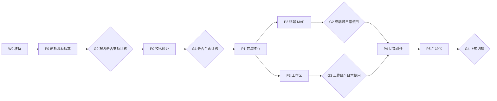

# tTerm GPUI 迁移任务清单

本目录把[迁移计划](../gpui-migration-plan.zh-CN.md)拆成可以交给 agent 独立执行的任务卡。计划回答“为什么迁、按什么路线迁”，这里回答“具体做哪些事、做到什么程度算完成”。

> 2026-11-05：已决定正式迁移，界面目标为与现有版本一致，见[决策 001](decisions/001-formal-migration.md)。选型、界面一致性与验收规则见下表前三个文件，它们与本文冲突时以它们为准。

| 文件                                   | 内容                                       |
| -------------------------------------- | ------------------------------------------ |
| [tech-selection.md](tech-selection.md) | 技术选型、仓库形态、依赖迁移表、打包与更新 |
| [ui-parity.md](ui-parity.md)           | 界面一致性：能与不能、对比工具、通过门槛   |
| [acceptance.md](acceptance.md)         | 验收协议：评估步骤、通用门槛、关卡标准     |
| [p0-validation.md](p0-validation.md)   | W0 准备，P0 剖析现有版本与技术验证         |
| [p1-core.md](p1-core.md)               | P1 抽取共享业务核心，移植前端纯逻辑        |
| [p2-terminal.md](p2-terminal.md)       | P2 原生终端 MVP                            |
| [p3-workspace.md](p3-workspace.md)     | P3 应用外壳、工作区、全局状态与基础组件    |
| [p4-features.md](p4-features.md)       | P4 业务功能与设置界面对齐                  |
| [p5-release.md](p5-release.md)         | P5 平台能力、打包、更新、数据演练与发布    |
| [agent-prompt.md](agent-prompt.md)     | 把任务卡交给其他 agent 时的指令模板        |

任务 ID 的前缀即阶段：`W0-` 准备，`P0-` 到 `P5-` 对应计划第 6 节的阶段，`G` 为需要人决策的关卡。

## 1. 工作方式

1. 执行者每次领取一张任务卡，或任务卡上标明可以同批执行的一组卡。
2. `GPUI` 分支是迁移的集成分支。每张卡一个分支，命名为 `migrate/<任务ID>-<英文短名>`，从 `GPUI` 切出，评估通过后合回 `GPUI`。依赖的卡合回后再开始。不用 `gpui/` 前缀：macOS 的文件系统不区分大小写，已有 `GPUI` 分支时 git 无法再建 `gpui/...` 分支。`GPUI` 何时合入 `dev` 由人决定（见第 8 节 U-03）。
3. 完成后在 `docs/gpui-migration/reports/<任务ID>.md` 写报告，格式见第 6 节。报告与代码在同一分支提交。
4. 评估者（Claude）按任务卡的“验收”和“评估重点”审查分支与报告，给出“通过”“需修改”或“驳回”。需修改时列出具体条目，执行者在同一分支继续。
5. 标为 `[人工]` 的步骤需要真实设备或账号（签名证书、GitHub 设置、物理机），agent 只准备脚本和说明，由人执行并把结果写进报告。
6. `G` 关卡由人根据报告决定是否继续，agent 不越过关卡开始下一阶段。

## 2. 执行规则

这些规则在 [AGENTS.md](../../AGENTS.md) 之上追加，冲突时以更严格者为准。

1. **AGENTS.md 全部适用。** 检查命令、文件与函数大小限制、提交格式、不加 AI 署名，都对新 crate 生效。
2. **重构不改行为。** P1 的卡是重构：Tauri 版必须保持可用，现有前端与 Rust 测试全部通过，事件名、payload、command 签名不变。需要改变行为时，在报告中说明并另开卡。
3. **移动与修改分开提交。** 纯移动代码的提交不夹带任何改动，便于审查 `git diff -M` 的结果。
4. **不改持久化格式。** 数据库结构、配置 JSON、备份格式、钥匙串服务名、应用标识 `com.stone.tTerm`、数据目录都保持不变，除非任务卡明确要求；要求时必须同时提交迁移、回退说明和测试。
5. **不升级核心依赖。** Tauri、russh、portable-pty、rusqlite、keyring 等保持现版本，依赖升级另开卡。新依赖必须使用 [P0-06](p0-validation.md#p0-06-固定依赖组合) 产出的 `pins.md` 中的版本；不得引入其他 GPUI 来源。
6. **第三方代码。**
   - 从 Alacritty、nyaterm 或 gpui-kit 复制的文件，文件头注明来源仓库、提交、原路径和许可，并登记到 `docs/gpui-migration/third-party.md`。
   - 不得复制 Zed 中 GPL 许可的 crate（`terminal`、`terminal_view`、`editor`、`workspace`、`ui` 等）的代码。终端部分按[技术选型第 5 节](tech-selection.md#5-终端)的规则参考 Zed：实现终端的执行者可以阅读 Zed 终端源码，只借鉴思路，不复制代码、注释、测试或私有标识符，报告中列出阅读过的文件（[决策 008](decisions/008-zed-terminal-reading.md)）。
   - 依赖只用官方来源，不引入 git 依赖或个人分支（[决策 007](decisions/007-official-sources-and-terminal-route.md)）。
   - 复制进来的代码同样受大小限制，超限的文件在合回 `GPUI` 之前拆分，不加入基线。只有原样复制的第三方代码可以在 G1 之前暂放不合并的验证分支 `migrate/spike`，见 [P0 说明](p0-validation.md)开头的“验证分支与大小限制”。
   - tTerm 使用 MIT 许可，复制进来的 Apache-2.0 文件仍属 Apache-2.0：保留原许可声明，在文件头注明修改，发行包中附带 Apache-2.0 全文与第三方声明（见 P4-25、P5-02）。来源仓库若有 `NOTICE` 文件，一并保留其内容；nyaterm 在固定提交上没有 `NOTICE`。
7. **不碰真实数据。** GPUI 开发版使用独立的应用标识与数据目录（暂定 `com.stone.tTerm.gpui-dev`），不得读写正式版的 `com.stone.tTerm` 或 Tauri 开发版的 `com.stone.tTerm.dev`，后者存有使用者的真实连接。需要测试数据时，从备份导入到独立目录。
8. **代码位置会变化。** 任务卡中的文件路径与行号来自 2026-11-01 的 `dev`。开始前核对一遍，变化不影响任务目标的，在报告中注明即可。
9. **迁移期间的新功能。** Tauri 版继续开发的新功能，业务逻辑写在 core（P1-09 之前写在可移入 core 的模块中），并登记到 `feature-matrix.md`，避免两个客户端各写一遍。
10. **减少与日常开发的冲突。** P1 的卡按模块推进，一张卡只动一个模块，尽快合并；某个模块的 P1 卡进行期间，避免在该模块上并行开发功能。
11. **任务卡与代码不符时停下。** 写进报告的“偏差”一节，说明发现了什么、建议怎么改卡，不自行扩大范围。
12. **未验证不等于通过。** 没有条件在某个平台或环境验证时，标记为“未验证”，写明缺少什么。
13. **证据可复现。** 报告中的每个数字附上命令、环境与原始输出；界面结果附截图或录屏路径。

## 3. 任务卡格式

```text
### <ID> <标题>
- 依赖：必须先完成的卡
- 规模：S（≤2 人天）、M（3–5 人天）、L（6–10 人天）
- 并行：可与哪些卡同时进行
- 参考：开始前要读的代码与文档
- 工作：要做的事
- 产出：分支中必须出现的文件或结果
- 验收：评估时逐条核对的条件
- 评估重点：评估者会额外关注的风险
- 不做：明确排除的范围
```

规模为 L 的卡，执行者开始前先在报告中把工作拆成若干个可以独立审查的提交或 PR。估算超过 L 时停下，先请求拆卡。

## 4. 架构约定

为了让并行的执行者不各自发明接口，以下约定先行固定。P0 与 P1 的卡可以提出修改，修改需要写决策记录 `docs/gpui-migration/decisions/NNN-<短名>.md`，经评估通过后再改代码。

| 编号 | 约定           | 内容                                                                                                                                                                                                                                                                                                                         |
| ---- | -------------- | ---------------------------------------------------------------------------------------------------------------------------------------------------------------------------------------------------------------------------------------------------------------------------------------------------------------------------- |
| A1   | Workspace 布局 | （2026-11-05 修订）仓库根的 `Cargo.toml` 是 `[workspace]` 根，成员为 `src-tauri` 与 `crates/*`。新 crate 放在 `crates/`，清单见[技术选型第 2.1 节](tech-selection.md#21-workspace-布局修订-readme-约定-a1)。所有 cargo 命令从仓库根执行，并加 `--workspace`。各卡中写作 `src-tauri/crates/<名>` 的路径一律指 `crates/<名>`。 |
| A2   | 服务容器       | `tterm_core::AppServices` 持有各领域服务的 `Arc`。Tauri 端用 `manage(Arc<AppServices>)`，command 只做参数转换和调用。GPUI 端在启动时创建同一个 `AppServices`。                                                                                                                                                               |
| A3   | 事件           | `tterm_core::events::AppEvent` 是类型化的业务事件枚举，经 `EventSink` trait 发出。Tauri 适配器把每个变体映射回现有的事件名与 payload，前端无感知。GPUI 适配器把事件送入通道，由界面实体订阅。                                                                                                                                |
| A4   | 交互式提示     | 主机密钥、认证、ProxyCommand、用户验证等需要用户回应的流程，统一为 `PromptBroker`：请求 ID、提示数据、一次性回复通道、超时与取消。                                                                                                                                                                                           |
| A5   | 会话输出       | `ChannelContext` 不再持有 `AppHandle`，改为持有 `Arc<dyn SessionSink>`。字节输出、状态变化与确认（ack）背压语义保持现状：未确认约 1 MiB 时暂停发送。                                                                                                                                                                         |
| A6   | 运行时         | Tokio 运行时继续由 core 持有（`src-tauri/src/core/runtime.rs`）。GPUI 端通过桥接执行器与通道访问它，界面线程不做阻塞工作。                                                                                                                                                                                                   |
| A7   | 错误           | core 的公开接口沿用 `Result<T, String>`，与现有代码一致，避免只在一个模块引入新错误风格。                                                                                                                                                                                                                                    |
| A8   | 国际化         | `src/i18n/locales/en.json` 与 `zh.json` 仍是唯一的文案来源，两个客户端共用。GPUI 端在构建时或运行时读取，并处理插值与复数（见 P3-03）。                                                                                                                                                                                      |
| A9   | 平台能力       | 打开链接、文件对话框、剪贴板、通知、托盘、单实例、窗口操作等定义为 `tterm-platform` 中的 trait，Tauri 与原生各自实现，启动时注入。                                                                                                                                                                                           |
| A10  | 界面规模       | GPUI 视图沿用 AGENTS.md 对 React 组件的要求：一个视图约 300 行以内，状态与逻辑拆到独立模块，纯逻辑有单元测试。                                                                                                                                                                                                               |

## 5. 阶段与关卡



- 2026-11-05 起，G0 只确认剖析结论与性能基线，不再阻塞 P0-B；P0-06 只依赖 W0-01。
- P1 中的前端逻辑移植（P1-11 系列）在 G1 之后即可与核心解耦并行。
- P2 与 P3 在 P1-12 完成后可以并行。
- P4 的各功能卡彼此基本独立，适合多个执行者同时进行。

## 6. 报告模板

```markdown
# <任务ID> <标题>

## 结论

完成 / 部分完成 / 未完成，一句话说明。

## 改动

- 提交列表（哈希与摘要）。
- 主要文件及其职责。

## 验收

| 验收条件（照抄任务卡） | 结果                   | 证据                         |
| ---------------------- | ---------------------- | ---------------------------- |
| ...                    | 通过 / 未通过 / 未验证 | 命令与输出、测试名、截图路径 |

## 检查

贴出 AGENTS.md 规定的检查命令及其结果摘要。

## 偏差

与任务卡不一致之处、原因与建议。

## 遗留问题

未解决的问题、发现的新风险、建议新增的卡。
```

## 7. 评估方式

评估者对每张卡检查：

1. 改动范围与任务卡一致，没有夹带无关修改或未声明的行为变化。
2. 在本地重新运行 AGENTS.md 规定的全部检查。
3. 逐条核对验收条件的证据，抽查数字能否按报告中的命令复现。
4. 重构卡比对重构前后的行为：事件、payload、command 签名、持久化数据。
5. 大小限制、`expect`/`allow` 的使用、第三方来源登记。
6. 测试是否验证行为，而不只是覆盖实现细节。
7. 报告是否如实记录未完成和未验证的部分。

## 8. 持续性工作

这些工作不属于某个阶段，在整个迁移期间定期进行。

- **U-01 上游跟踪**（每月一次，S）：对比 gpui-kit 与 `gpui-pre` 的新版本、`alacritty_terminal` 与 Alacritty 应用层、以及 P0-29 复制进来的 nyaterm 模块，自 `third-party.md` 与 `pins.md` 记录的版本以来的变化，挑出影响已导入代码的修复，每项决定是否升级或移植，结果写入 `reports/U-01-<年月>.md`。
- **U-02 状态维护**（每次评估后）：评估者在 `status.md` 中更新每张卡的状态（未开始、进行中、待评估、需修改、通过）、执行者、分支与报告链接。
- **U-03 与 `dev` 同步**（约每周一次，S）：把 `dev` 合并进 `GPUI`，解决冲突后跑全部检查，结果写入 `reports/U-03-<日期>.md`。冲突集中在某个模块时，提醒避免在该模块上并行开发（执行规则 10）。`GPUI` 合入 `dev` 的时机由人决定。

## 9. 待决定事项

以下问题需要人决定，答案会改变部分任务卡的内容。决定后写入 `decisions/`。

| 问题                                                 | 影响的卡              | 建议                                                              |
| ---------------------------------------------------- | --------------------- | ----------------------------------------------------------------- |
| 原生版的视觉目标：与现有界面一致，还是借迁移重新设计 | P3-05、P3-06、全部 P4 | **已决定：一致**（决策 001，门槛见 ui-parity.md）                 |
| macOS 是否补上代码签名与公证                         | P5-02、P5-03、P5-04   | 补上。原生版签名身份变化时，钥匙串可能反复询问                    |
| 新 crate 的 Rust edition 与工具链版本                | W0-01、P0-06          | 新 crate 使用 2024 edition，仓库加 `rust-toolchain.toml` 固定版本 |
| P0 的深度：做两周左右的验证，还是按本清单完整验证    | P0 全部               | 见第 10 节                                                        |

## 10. 工作量合计

按 S 为 1–2 人天、M 为 3–5 人天、L 为 6–10 人天，对全部任务卡求和（拆分的子卡按子卡计）：

| 阶段                                 | 约（人天）                                              |
| ------------------------------------ | ------------------------------------------------------- |
| W0 与 P0                             | 70–90                                                   |
| P1                                   | 100–140                                                 |
| P2                                   | 70–95                                                   |
| P3                                   | 60–80                                                   |
| P4                                   | 115–150                                                 |
| P5                                   | 40–55                                                   |
| 合计                                 | 约 450–600，即 90–120 人周                              |
| 界面一致性追加（2026-11-05）         | 约 75–125，合计约 105–145 人周，见 ui-parity.md 第 7 节 |
| 终端路线调整（2026-11-05，决策 007） | 约 20–40，合计约 110–155 人周                           |

这个数字明显高于迁移计划第 10 节的 20–35 人周。差距来自两处：计划没有计入设置、SFTP 等大目录的完整对齐，以及 P1 中逐模块解耦与逻辑移植的工作量。以 agent 执行时实际耗时会不同，但评估与人工验收的工作量不会随之减少。

P0 按本清单完整执行约需 14–18 人周，远超计划中的 1–2 人周。只做 G1 必需的卡（P0-01 至 P0-06、P0-08 至 P0-10、P0-13 至 P0-18、P0-21、P0-22，以及新增的 P0-24 至 P0-28）约需 14–18 人周（2026-11-05 按决策 007 重估，终端改为自己搭建），其余推迟到 G1 之后，见 [p0-validation.md](p0-validation.md) 开头的说明。再要压缩，只能减少需要人工的平台矩阵，而这正是迁移风险最大的部分。

## 11. 任务总表

| ID             | 标题                                      | 规模  | 依赖                |
| -------------- | ----------------------------------------- | ----- | ------------------- |
| W0-01          | 建立 Cargo workspace 并让检查覆盖新 crate | M     | —                   |
| W0-02          | 迁移文档骨架与第三方登记                  | S     | —                   |
| W0-03          | 三平台测试环境清单 `[人工]`               | S     | —                   |
| W0-04          | 界面对齐工具链（ui-parity.md）            | L     | W0-01、P0-08        |
| W0-05          | 页面状态清单与夹具（ui-parity.md）        | L     | W0-04               |
| UP-03          | 设计令牌单一来源（ui-parity.md）          | M     | W0-01               |
| P0-01          | 性能基线工具与负载                        | M     | W0-03               |
| P0-02          | macOS 透明窗口与模糊开销                  | S     | P0-01               |
| P0-03          | Linux WebKitGTK 渲染路径                  | S     | P0-01               |
| P0-04          | 前端与 IPC 热点剖析                       | M     | P0-01               |
| P0-05          | 剖析结论                                  | S     | P0-02、P0-03、P0-04 |
| G0             | 剖析结论确认 `[人工]`（不再阻塞 P0-B）    | —     | P0-05               |
| P0-06          | 固定依赖组合                              | M     | W0-01               |
| P0-07          | GPUI 补丁差距评估                         | M     | P0-06               |
| P0-08          | 最小 GPUI 程序                            | S     | W0-01、P0-06        |
| P0-09          | 终端模型（官方 Alacritty）                | L     | P0-06、P0-27        |
| P0-10          | 终端绘制元素                              | L     | P0-09、P0-27、P0-25 |
| P0-11          | 录制字节流回放                            | M     | P0-10               |
| P0-12          | 滚动、滚动条与回滚区锚定                  | L     | P0-10               |
| P0-13          | 原型输入：键盘、选区、剪贴板、输入法      | M     | P0-10、P0-28        |
| P0-14          | 原型接入本地 PTY                          | M     | P0-10、P0-13        |
| P0-15          | 终端兼容性冒烟                            | M     | P0-14               |
| P0-16          | Linux 输入法矩阵 `[人工]`                 | M     | P0-14               |
| P0-17          | 无 GPU 与远程桌面环境 `[人工]`            | M     | P0-14               |
| P0-18          | 输入法、DPI、多屏与显示环境变化 `[人工]`  | M     | P0-14               |
| P0-19          | 文件拖出方案                              | M     | P0-07、P0-08        |
| P0-20          | 远程编辑器方案                            | M     | P0-08               |
| P0-21          | 原型性能对比                              | M     | P0-14、P0-01        |
| P0-22          | P0 结论与重新估算                         | S     | P0-15 至 P0-21      |
| P0-23          | 供 agent 使用的界面自动化与截图           | M     | P0-08               |
| P0-24          | UI 原语还原验证（ui-parity.md）           | M     | W0-04、P0-08、UP-03 |
| P0-25          | GPUI 绘制能力核实（ui-parity.md）         | S     | P0-06               |
| P0-26          | 打包与更新衔接可行性（tech-selection.md） | M     | P0-08               |
| P0-27          | 终端净室设计说明（参考 Zed）              | M     | W0-02               |
| P0-28          | 移植 Alacritty 的输入协议与内置字形       | L     | P0-09               |
| P0-29          | nyaterm 模块挑选与质量关卡                | M     | P0-09               |
| G1             | 是否全面迁移 `[人工]`                     | —     | P0-22               |
| P1-01          | 应用路径注入                              | M     | G1                  |
| P1-02          | 事件接口与 Tauri 适配器                   | M     | G1                  |
| P1-03          | 迁移非 SFTP 模块的事件                    | L     | P1-02               |
| P1-04          | 迁移 SFTP 的事件                          | L     | P1-02               |
| P1-05          | PromptBroker                              | L     | P1-02               |
| P1-06          | 会话输出接口                              | L     | P1-02               |
| P1-07a–d       | AppServices 与 command 变薄（四组）       | L×4   | P1-03 至 P1-06      |
| P1-08          | 平台能力 trait                            | L     | P1-01               |
| P1-09          | 代码移入 tterm-core                       | L     | P1-07、P1-08        |
| P1-10          | WebView 本地存储迁入后端                  | M     | G1                  |
| P1-11a–g       | 前端纯逻辑移植到 Rust（七组）             | M–L   | G1、W0-01           |
| P1-12          | 无界面集成测试与原型接入 SSH              | M     | P1-09               |
| P1-13          | 导入代码按仓库规范拆分并合并              | L     | G1                  |
| P2-01 至 P2-25 | 终端 MVP                                  | 见 p2 | P1-12、P1-13        |
| P3-01 至 P3-16 | 工作区                                    | 见 p3 | P1-12               |
| P4-01 至 P4-27 | 功能对齐                                  | 见 p4 | G2、G3              |
| P5-01 至 P5-10 | 产品化                                    | 见 p5 | P4                  |
