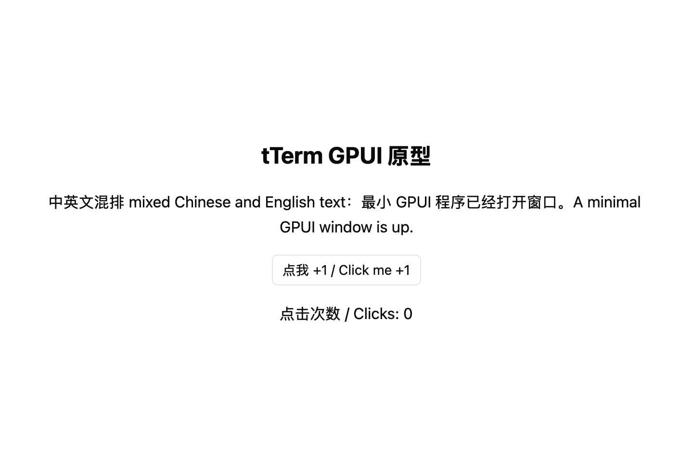
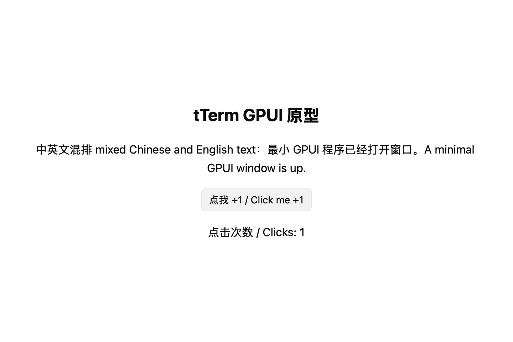

# P0-08 最小 GPUI 程序

## 结论

完成。`crates/tterm-gpui` 打开一个显示中英文混排文本与 `gpui-kit` 按钮的窗口，关闭窗口与 Cmd+Q 都能退出；第一次把 GPUI 接进 workspace 的锁文件变化单独成提交（722 → 1170 个包，替换 15 个现有包）；macOS 开发运行脚本为它生成独立的应用包；无界面样例测试在本机通过。Windows 与 Linux 没有本机，CI 因不推送无法运行，按[决策 006](../decisions/006-w0-01-ci-waiver.md)记为未验证；Linux 另用 Docker 做了真实编译（见“检查”）。

环境：macOS 27.2，Apple M4（10 核），Xcode 26.6，rustc 1.99.1，node 24.20.0，pnpm 11.25.0。本会话沙箱不允许写 `~/.cargo`，所有 cargo 命令带 `CARGO_HOME=/tmp/p008/cargo-home`（P0-06 缓存的副本），见“偏差”。Linux 编译在 Docker（Ubuntu 24.04，arm64，OrbStack）里做。

## 改动

分支 `migrate/P0-08-minimal-gpui`，从 `GPUI`（`427d566`）切出，不推送、不合并。本报告是最后一个提交。

| 提交      | 摘要                                                                 |
| --------- | -------------------------------------------------------------------- |
| `0c82d04` | `:heavy_plus_sign:` 新建 `tterm-gpui` crate，单独记录锁文件变化      |
| `afc4cb2` | `:sparkles:` 打开 P0-08 的窗口：中英文混排文本、gpui-kit 按钮、退出 |
| `8d4c726` | `:white_check_mark:` 用 gpui-kit test-support 写无界面样例测试       |
| `2e6ef1e` | `:wrench:` 让 tterm-gpui 在 macOS 上从独立的 GPUI 开发应用包运行     |
| `69a8a3d` | `:construction_worker:` 三平台构建 tterm-gpui，Linux 补系统依赖      |
| `a2ba96a` | `:memo:` README 补上 Docker 的 Linux 编译结果                         |

主要文件及其职责：

| 文件                                      | 职责                                                                                              |
| ----------------------------------------- | ------------------------------------------------------------------------------------------------- |
| `crates/tterm-gpui/Cargo.toml`            | 二进制 `tterm-gpui`；edition 2024、license MIT、publish = false、`[lints] workspace = true`；依赖只写 `gpui-kit.workspace = true`，开发依赖另开 `test-support` |
| `crates/tterm-gpui/src/main.rs`           | 入口，转到 `app::run`                                                                             |
| `crates/tterm-gpui/src/app.rs`            | 窗口内容、`Increment` 与 `Quit` 动作、`cmd-q` 绑定、关闭最后窗口时退出、`open_window` 的错误处理  |
| `crates/tterm-gpui/src/app/tests.rs`      | 无界面测试：打开窗口、派发动作、点击按钮，断言可见计数变化                                        |
| `crates/tterm-gpui/README.md`             | 开发环境依赖、构建、运行、测试与 macOS 应用包说明                                                 |
| `scripts/macos-dev-bundle.sh`             | 同时识别 `tTerm` 与 `tterm-gpui`；后者用固定标识、独立包目录、不读 `TAURI_CONFIG`                |
| `.cargo/config.toml`                      | runner 的注释补上 `cargo run -p tterm-gpui`                                                       |
| `.github/workflows/check.yml`              | 三平台增加 `cargo build -p tterm-gpui`；Ubuntu 安装 GPUI 的 X11/Wayland/字体/Vulkan 依赖           |
| `docs/gpui-migration/reports/assets/P0-08-macos*.png` | macOS 渲染截图（见“验收”）                                                             |

### 锁文件

第一次有成员使用 GPUI 时 Cargo 重解析整棵树。这次变化放在单独的提交 `0c82d04`，该提交只含 crate 的 `Cargo.toml`（依赖声明）、一个占位的 `src/main.rs` 和 `Cargo.lock`；窗口实现与测试在其后的提交里。

- 包数：722 → **1170**。其中 42 个来自开发依赖启用的 `test-support`（`proptest`、`criterion`、`gpui-fast` 系列等）。不启用 `test-support` 时为 1122。
- P0-06 报的 1128 是探针同时依赖 `alacritty_terminal` 的数字（本卡不依赖它）；用相同方法复算：`gpui-kit` + `alacritty_terminal` = 1128。见“偏差”。
- 替换 15 个现有包（`cargo` 最小更新，不是 `cargo update`）：

| 包                    | 旧版本                    | 新版本                    |
| --------------------- | ------------------------- | ------------------------- |
| `icu_collections`     | 2.3.0                     | 2.4.0                     |
| `icu_locale_core`     | 2.3.0                     | 2.4.0                     |
| `icu_normalizer`      | 2.3.0                     | 2.4.0                     |
| `icu_normalizer_data` | 2.3.0                     | 2.4.0                     |
| `icu_properties`      | 2.3.0                     | 2.4.0                     |
| `icu_properties_data` | 2.3.0                     | 2.4.0                     |
| `icu_provider`        | 2.3.1                     | 2.4.0                     |
| `proc-macro-crate`    | 1.3.1, **2.0.2**, 3.5.0   | 1.3.1, **2.0.0**, 3.5.0   |
| `tinystr`             | 0.8.4                     | 0.8.5                     |
| `toml`                | **0.8.2**, 1.1.6+spec-1.1.0 | **0.8.23**, 1.1.6+spec-1.1.0 |
| `toml_datetime`       | **0.6.3**, 1.1.1+spec-1.1.0 | **0.6.11**, 1.1.1+spec-1.1.0 |
| `yoke`                | 0.8.3                     | 0.8.4                     |
| `yoke-derive`         | 0.8.3                     | 0.8.4                     |
| `zerovec`             | 0.11.8                    | 0.11.9                    |
| `zerovec-derive`      | 0.11.6                    | 0.11.7                    |

“旧版本 / 新版本”列里同时列出的多个版本表示该包本来就有多份；加粗的是本次被替换的那一份。核对方法：用 Python 的 `tomllib` 把两个锁文件读成 `(name, version)` 集合再求差，`removed 15`、`added 463`；没有运行 `cargo update`，其余包的版本没有变化。

- `grep -c 'source = "git+' Cargo.lock` → `0`。
- `cargo tree -p tterm-gpui` 里没有 `gpui-fast`：锁文件会列出可选依赖的包，但构建图里没有它，`Cargo.toml` 也没有开启 `gpui-fast` 特性。

## 验收

| 验收条件（照抄任务卡与任务要求） | 结果 | 证据 |
| --- | --- | --- |
| 三平台 CI 构建与样例测试通过 | 未验证 | CI 不推送就无法运行，按决策 006 豁免；改动见 `.github/workflows/check.yml`。Linux 用 Docker 单独编译通过（见“检查”），Windows 没有条件。 |
| 本地在 macOS、Windows、Linux 至少各运行一次并截图 | 通过（macOS）；Windows 与 Linux 未验证 | macOS：窗口在屏幕上以 `720×512 @ (120,120)` 存在（`swift` 调 `CGWindowListCopyWindowInfo` 的输出），渲染截图 `reports/assets/P0-08-macos.png`、点击按钮后的截图 `reports/assets/P0-08-macos-clicked.png`。Windows/Linux 缺少机器，见“偏差”。 |
| macOS 应用包能连到局域网内的 SSH 主机 | 未验证 | 应用包是真实 `.app`，`Info.plist` 带 `NSLocalNetworkUsageDescription`；但 P0-08 不含 SSH 功能（任务卡“不做：任何业务功能”），无法发起连接测试。 |
| 新建 `crates/tterm-gpui`，二进制名 `tterm-gpui`，edition 2024，license MIT，`publish = false`，`[lints] workspace = true` | 通过 | `crates/tterm-gpui/Cargo.toml`；`cargo metadata` 成功，包名与目标名均为 `tterm-gpui`。 |
| 依赖写 `gpui-kit.workspace = true`，不写版本号 | 通过 | 同上；版本固定在仓库根 `Cargo.toml`。 |
| 不启用 `gpui-fast`，不直接依赖任何 `gpui-pre-*` crate，不引入 git 依赖 | 通过 | `Cargo.toml` 只有 `gpui-kit`；`cargo tree -p tterm-gpui` 无 `gpui-fast`、无 `gpui-pre-*` 直接依赖；`grep -c 'source = "git+' Cargo.lock` → `0`。 |
| 打开一个窗口，显示中英文混排文本与一个 gpui-kit 按钮，能正常退出（关闭窗口和 Cmd+Q） | 通过 | 截图；`app.rs` 里的 `Button::new("increment")`；临时测量装置分别用 `remove_window()` 与 `Keystroke::parse("cmd-q")` + `dispatch_keystroke` 验证两条退出路径，进程都以退出码 0 结束（见“检查”的 `quit` 两段）。 |
| `open_window` 返回的 `Result` 要处理，不得 unwrap/expect | 通过 | `app.rs` 用 `match` 处理 `Ok`/`Err`，失败时打印并 `cx.quit()`；`grep -rn "unwrap\|expect" crates/tterm-gpui/src` 除测试外只有一行注释（“production binary must not unwrap it”），没有调用。 |
| 锁文件变化单独作为一个提交，只含 Cargo.toml 依赖声明与 Cargo.lock | 通过 | `git show --stat 0c82d04` 只列 `Cargo.lock`、`crates/tterm-gpui/Cargo.toml`、占位的 `crates/tterm-gpui/src/main.rs`（没有源文件时 Cargo 无法解析目标）。 |
| 报告列出 15 个被替换包的新旧版本 | 通过 | 上文“锁文件”表。 |
| 确认 Tauri 版（`src-tauri`）仍能编译 | 通过 | `cargo clippy --workspace --all-targets` 与 `cargo test --workspace` 覆盖 `src-tauri`；另跑 `cargo build -p tTerm`（见“检查”）。 |
| `cargo test --workspace` 通过 | 通过（1 个已知环境失败除外） | 见“检查”的失败清单：只有 `terminal::foreground::tests::follows_a_real_shell_handing_its_terminal_to_a_command`，原因是沙箱不允许 `openpty`（`PermissionDenied`），与本卡无关。 |
| 不得运行 `cargo update`，不得改动其他依赖版本 | 通过 | 只做了最小解析；两个锁文件的 `(name, version)` 集合差异是 removed 15 / added 463，没有其他版本变化；`cargo update` 没有运行。 |
| `grep -c 'source = "git+' Cargo.lock` 为 0 | 通过 | 输出 `0`。 |
| 扩展 `scripts/macos-dev-bundle.sh`：`tterm-gpui` 用 `com.stone.tTerm.gpui-dev`、`tTerm GPUI Dev`、独立应用包目录、不读 `TAURI_CONFIG`，`Info.plist` 以 `src-tauri/Info.plist` 为底 | 通过 | 生成包 `target/debug/bundle/dev-gpui/tTerm GPUI Dev.app`；`plutil -p` 显示标识、显示名、`NSLocalNetworkUsageDescription`；脚本对 `tterm-gpui` 不调用 `config_value`。 |
| 名为 `tTerm` 的二进制行为必须完全不变 | 通过 | 用同一个假可执行文件分别跑改动前后的脚本，`Info.plist` 逐字节相同（默认与 `TAURI_CONFIG` 两组，diff 为空）；`git diff` 里 `tTerm` 分支的包路径、键、可执行名都没有变。 |
| `*/deps/*`、`*/build/*` 下的测试二进制仍然直接运行 | 通过 | 见“检查”的脚本复现：两个路径都直接执行假二进制，没有生成 `.app`；无关名字同样直通。 |
| macOS 应用包使用 `src-tauri/icons/icon.icns` | 通过 | 生成的包 `Contents/Resources/icon.icns` 与源文件同大小（521,434 字节）；`CFBundleIconFile` 为 `icon`。 |
| Windows/Linux 嵌入图标若需要新增依赖就不做，写进偏差 | 通过 | 没有添加任何 Windows/Linux 图标依赖；见“偏差”。 |
| CI 让三平台构建 `tterm-gpui`，Linux 的 apt 行补 GPUI 系统依赖 | 通过（改动）；三平台运行未验证 | `.github/workflows/check.yml`：`Build the GPUI prototype` 步骤 + apt 行；Linux 的依赖清单用 Docker 实测（见“检查”）。 |
| 在 dev-dependencies 启用 `gpui-kit` 的 `test-support`，写无界面样例测试（打开窗口、发送动作、断言状态变化），macOS 本机通过 | 通过 | `cargo test -p tterm-gpui` → `app::tests::increment_updates_the_visible_counter ... ok`。 |
| 在真实窗口里比较依赖 opt-level 2 与 0：首次构建、增量构建、拖动/缩放是否卡顿 | 通过 | 见“开发构建优化级别实测”。 |
| 不改 profile，只报告 | 通过 | 仓库 `Cargo.toml` 的 profile 未改；测量时的临时改动已还原（`git diff` 为空）。 |
| 全部检查通过 | 通过（1 个环境失败除外） | 见“检查”。 |
| 不改 `docs/gpui-migration/status.md`，不做任何业务功能 | 通过 | `git diff --stat GPUI..HEAD` 不含 `status.md`；crate 里只有窗口、按钮与计数。 |

截图（macOS，`VisualTestAppContext` 的 Metal 离屏渲染，2× 输出 1440×960；第一张是初始状态，第二张是点击按钮后）：





## 检查

全部在 worktree 根目录执行，分支 `migrate/P0-08-minimal-gpui`，提交 `a2ba96a`（报告提交之前）。`CARGO_HOME=/tmp/p008/cargo-home`。

### 前端与仓库检查

```text
$ pnpm lint           → 退出码 0（eslint src）
$ pnpm format:check   → All matched files use Prettier code style!
$ pnpm check:tokens   → 退出码 0
$ pnpm typecheck      → 退出码 0
$ pnpm test           → Test Files  167 passed (167); Tests  1252 passed (1252)
$ pnpm check:size     → file-size: 921 files within their limits
```

### Rust 检查

```text
$ cargo fmt --all --check                                       → 退出码 0，real 0.68s
$ cargo clippy --workspace --all-targets -- -D warnings          → 退出码 0，real 75.36s，无 warning
$ cargo test --workspace                                        → 退出码 101，见下
    test result: FAILED. 816 passed; 1 failed; 52 ignored; 0 measured; 0 filtered out; finished in 13.23s

    failures:
      terminal::foreground::tests::follows_a_real_shell_handing_its_terminal_to_a_command
        panicked at src-tauri/src/terminal/foreground.rs:127:14:
        open pty: failed to openpty: Os { code: 1, kind: PermissionDenied, message: "Operation not permitted" }
```

这是任务卡允许的唯一失败：沙箱不允许打开真实 PTY。分支没有改动 `src-tauri/src/terminal/`，失败点在 `openpty` 系统调用，与 W0-02、P0-06 报告里同一个测试、同一个原因。没有用 `#[ignore]`、`#[allow]` 或放宽检查绕过。

为了确认“只有这一个”，另跑了一次 `cargo test --workspace --no-fail-fast`：所有 target 里仍是同一个失败，其余 target 的结果是 `0 passed`（空测试目标）与 `1 passed`（`tterm-gpui` 的无界面测试）、`6 passed`（`tterm-ui`），没有别的失败。

Tauri 版用新锁文件单独编译：

```text
$ cargo build -p tTerm                                          → 退出码 0
    Finished `dev` profile [unoptimized + debuginfo] target(s) in 4m 34s
```

### Linux（Docker，Ubuntu 24.04 arm64）

用 CI 的 apt 行在容器里装依赖，然后编译 GPUI crate：

```text
$ apt-get install -y --no-install-recommends \
    build-essential pkg-config curl ca-certificates \
    libfontconfig-dev libfreetype-dev libwayland-dev libxkbcommon-dev libxkbcommon-x11-dev \
    libx11-dev libxcb1-dev libxcb-render0-dev libxcb-shape0-dev libxcb-xfixes0-dev \
    libvulkan-dev libgl1-mesa-dev libegl1-mesa-dev libdbus-1-dev
$ cargo check -p tterm-gpui --locked
    Checking tterm-gpui v0.1.0 (/work/crates/tterm-gpui)
    Finished `dev` profile [unoptimized + debuginfo] target(s) in 3m 58s
```

同一个容器里再跑 `cargo check -p tterm-gpui --all-targets --locked`（包含 dev-dependencies 的 `test-support` 与测试目标），也通过：`Finished ... in 17.77s`（大部分依赖已缓存）。这仍只是 `cargo check`，且没有显示服务器；CI 的 clippy、`cargo test` 与窗口运行仍未验证。

### macOS 应用包与退出路径

生成的包：

```text
$ plutil -p target/debug/bundle/dev-gpui/"tTerm GPUI Dev.app"/Contents/Info.plist
{
  "CFBundleDisplayName" => "tTerm GPUI Dev"
  "CFBundleExecutable" => "tterm-gpui"
  "CFBundleIconFile" => "icon"
  "CFBundleIdentifier" => "com.stone.tTerm.gpui-dev"
  "CFBundleName" => "tTerm GPUI Dev"
  "CFBundlePackageType" => "APPL"
  "NSHighResolutionCapable" => true
  "NSLocalNetworkUsageDescription" => "tTerm needs access to devices on the local network ..."
}
$ ls target/debug/bundle/dev-gpui/"tTerm GPUI Dev.app"/Contents/Resources/icon.icns
    521434 字节，与 src-tauri/icons/icon.icns 相同
$ codesign -dv ... → Identifier=com.stone.tTerm.gpui-dev, Signature=adhoc
```

窗口在屏幕上的存在（`CGWindowListCopyWindowInfo`）：

```text
44342   tTerm GPUI Dev   ["Width": 720, "Y": 120, "Height": 512, "X": 120]
```

客户端区 480 像素加 32 像素标题栏，与请求的 720×480 一致。

两条退出路径（用临时 `perf` 特性在真实窗口里触发生产代码）：

```text
$ TTERM_GPUI_PERF=cmdq  cargo run -q -p tterm-gpui --features perf  → exit=0 elapsed=3s；应用进程消失
$ TTERM_GPUI_PERF=close cargo run -q -p tterm-gpui --features perf  → exit=0 elapsed=3s；应用进程消失
```

`cmdq` 走 `window.dispatch_keystroke(Keystroke::parse("cmd-q"))` → 键绑定 → `Quit` 动作 → `cx.quit()`；`close` 走 `window.remove_window()` → `on_window_closed` → `cx.quit()`。临时代码已删除，复现方法见附录。

### 无界面样例测试

```text
$ cargo test -p tterm-gpui
running 1 test
test app::tests::increment_updates_the_visible_counter ... ok
```

### 脚本前后对比

临时目录里放结构相同的 `repo/scripts/{before,after}.sh`、`repo/src-tauri/{Info.plist,icons/icon.icns}`，以及两个假的 shell 脚本 `bin/tTerm` 与 `bin/tterm-gpui`（只打印参数）。`before.sh` 是 `git show GPUI:scripts/macos-dev-bundle.sh` 的内容。

```text
### before, tTerm
fake tTerm alpha beta
### before, tterm-gpui (无 TAURI_CONFIG)
fake tterm-gpui alpha beta
### before bundles
bin/bundle/dev/tTerm Dev.app                  ← tterm-gpui 没有包，直接执行
### after, tTerm
fake tTerm alpha beta
### after, tterm-gpui
fake tterm-gpui alpha beta
### after bundles
bin/bundle/dev/tTerm Dev.app
bin/bundle/dev-gpui/tTerm GPUI Dev.app        ← 新的独立包
### after, deps/build/无关二进制
fake tterm-gpui                               ← */deps*、*/build* 与无关名字都直通
fake tTerm
fake tterm-gpui
### bundles after those runs (expected none): 0
```

`Info.plist` 对比：

```text
$ diff -u before/tTerm.Info.plist after/tTerm.Info.plist               → 无输出（逐字节相同）
$ diff -u before/tTerm-custom.Info.plist after/tTerm-custom.Info.plist → 无输出（带 TAURI_CONFIG 时也相同）
$ diff -u /dev/null after/tterm-gpui.Info.plist                       → 新增文件，内容见上“macOS 应用包”
```

`before/tTerm-custom` 指 `TAURI_CONFIG='{"identifier":"com.example.custom","productName":"Custom Dev"}'` 下的包，用来证明 `tTerm` 仍读取该变量；`tterm-gpui` 的包名与标识不受它影响（上面 after 的两组）。

### 依赖

```text
$ grep -c 'source = "git+' Cargo.lock                    → 0
$ cargo tree -p tterm-gpui --depth 1
tterm-gpui v0.1.0
└── gpui-kit v0.9.0
[dev-dependencies]
└── gpui-kit v0.9.0 (*)
$ cargo tree -p tterm-gpui | grep -c gpui-fast          → 0
$ python3（tomllib 对比旧/新锁文件的 (name, version)）  → removed 15, added 463
```

## 开发构建优化级别实测

决策 002 第 4 条留下的待测项。环境同上，测量时机器上的其它负载见本节末尾。

- **构建时间。** `/usr/bin/time -p cargo build -p tterm-gpui`，每组用独立的空 target 目录做冷构建；增量是 `touch crates/tterm-gpui/src/app.rs` 后重建。opt-level 0 的一组在测量期间把根 `Cargo.toml` 的 `[profile.dev.package."*"]` 临时改成 `opt-level = 0`，测完立即还原；仓库里没有留下改动（`git diff Cargo.toml` 为空）。
- **真实窗口帧间隔。** 用 `cargo run` 启动应用包，连续渲染 300 帧，视图每帧请求下一帧；每 30 帧在 720×480、1100×760、480×360 之间改一次窗口尺寸（`resize=1`），另做一组不改尺寸的对照（`resize=0`）。记录相邻两帧的间隔，取 p50/p95/max 与超过 16.7ms、33.3ms 的帧数。
- **帧内 CPU 时间。** 用 `VisualTestAppContext`（真实 macOS 平台与 Metal 渲染器）在离屏窗口里循环 resize 并调用 `render_frame`，对 300 帧的 `render_frame` 计时。它含布局、排版与绘制，不含 vsync 等待，用来隔离优化级别对 CPU 工作的影响。

| 项目 | 依赖 opt-level 2（现有 profile） | 依赖 opt-level 0 |
| --- | --- | --- |
| 首次构建，冷 target | **143.59 s**（user 1050.86 s，sys 47.76 s） | **72.68 s**（user 260.54 s，sys 31.53 s） |
| 增量构建（touch `app.rs`） | 1.25 s | 1.58 s |
| 帧内 CPU 时间（300 帧，含 resize） | p50 55 µs / p95 58 µs / max 75 µs | p50 453 µs / p95 553 µs / max 787 µs |
| 真实窗口帧间隔，`resize=1` | p50 13.33 ms / p95 14.70 ms / max 66.84 ms；>16.7ms 12/300；>33.3ms 1/300 | p50 13.33 ms / p95 13.74 ms / max 66.43 ms；>16.7ms 11/300；>33.3ms 1/300 |
| 真实窗口帧间隔，`resize=0` | p50 13.33 ms / p95 13.40 ms / max 78.52 ms；>16.7ms 2/300；>33.3ms 1/300 | p50 13.37 ms / p95 40.02 ms / max 61.41 ms；>16.7ms 75/300；>33.3ms 38/300 |

帧间隔的含义与噪声：

- 显示器刷新周期是 13.33ms（75Hz），所以两种配置的 p50 都是 13.33ms，帧间隔不能低于它。
- `opt0 resize=0` 那组 75 个超 16.7ms 的帧集中在最后 75 帧（位置 225–299），对应 33.3ms 的间隔；`opt2 resize=1` 的尾段（位置 288–299）也是同样的模式。这是窗口在测量中途失去激活后 GPUI 默认的 30fps 非活动上限（`inactive_frame_interval`），不是优化级别造成的。两组的 p50 相同，超预算帧数不能当作 profile 的信号。原始 CSV 的列是 `frame,interval_us`，没有提交。
- `resize=1` 的 `max` 是每次改尺寸后的一两帧（66–78ms），两种配置都有；它是窗口尺寸变化本身的一次性成本，不是持续卡顿。
- 拖动窗口由 macOS 移动窗口，GPUI 不重绘内容，因此没有可测的 GPUI 帧；“拖动是否卡顿”在本卡无法用帧数据回答。

结论，对照决策 002 第 4 条的预期：

- **首次构建的差别成立**：依赖 opt-level 0 的首次构建快 70.91 秒（143.59 → 72.68，约 2 倍）；增量构建两者都在 1.5 秒左右，不受影响。这与 P0-06 探针的 135 s / 48 s 方向一致。
- **“opt-level 0 会让开发构建明显卡顿”在本卡的窗口上没有出现**：帧内 CPU 时间从 55 µs 涨到 453 µs（约 8 倍），但仍只占 75Hz 帧预算（13.33ms）的 3.4%（p95 0.553ms / 13.33ms），真实窗口的帧间隔中位数两种配置都是 13.33ms。因此就 P0-08 这个文本很少的窗口而言，**决策 002 的预期被推翻**。
- 这个结论只适用于当前的简单窗口。终端视图的绘制量（逐行排版、背景色块、光标、选区）比这里大几个数量级，8 倍的 CPU 差可能在那时变得重要；P0-10 的绘制基准与 P0-21 的原型性能对比应该在同一口径下重测，再决定是否给 GPUI 依赖单独降 opt-level。按任务要求，本卡没有改 profile。

测量时机器上还有其它常驻负载（`uptime` 的 1 分钟平均负载约 5），两个 profile 在同一时段相邻测量，构建时间的对比受此影响但方向不受影响；帧间隔取的是中位数与分位数，突发负载会让长帧变多，不会让 p50 变小。

## 偏差

1. **只验证了 macOS。** Windows 与 Linux 没有本机；CI 不推送就无法运行（[决策 006](../decisions/006-w0-01-ci-waiver.md) 仍然适用）。Linux 用 Docker 做了真实编译，但这是 cargo check，不是 CI 的 clippy + 测试矩阵，也没有桌面环境跑窗口。Windows 完全没有验证。
2. **截图是 GPUI 的离屏 Metal 渲染，不是屏幕录制。** 本会话没有屏幕录制权限：`screencapture -x` 与 `screencapture -l <窗口号>` 都报 `could not create image from display/window`，提升到 `danger-full-access` 后结果相同。截图由临时工具用 `VisualTestAppContext`（真实 macOS 平台与 Metal 渲染器）把同一个 `Hello` 视图按 720×480（2× 输出 1440×960）渲染成 RGBA 再转 PNG；窗口本身的在屏存在用 `CGWindowListCopyWindowInfo` 证明（`tTerm GPUI Dev`，720×512，标题栏占 32 像素）。需要真实屏幕截图时，验证人给终端/DSH 授予“屏幕录制”权限后可补一张。
3. **Windows/Linux 的图标没有嵌入。** macOS 应用包用 `icon.icns`；Windows 需要 `.ico`、Linux 需要窗口图标，都要新增依赖或转换步骤，按任务要求留给 P0-26。
4. **包数与 P0-06 的 1128 不同。** 本卡只依赖 `gpui-kit`，且开发依赖启用了 `test-support`：1122（无 `test-support`）或 1170（有）。P0-06 的探针同时依赖 `alacritty_terminal`；我用同样的最小解析复算为 1128，说明差异来自这两处，不是解析方式不同。
5. **开发构建优化级别的测量在临时副本的 target 目录里做。** 为了不改仓库 profile，opt-level 0 的两条命令期间临时把根 `Cargo.toml` 的 `[profile.dev.package."*"]` 改成 `opt-level = 0`，跑完立即还原；仓库里没有留下改动。数字见“开发构建优化级别实测”。
6. **Cmd+Q / 关闭窗口的验证方式。** 没有 UI 自动化权限（`osascript` 访问 System Events 报 `privilege violation`），所以用临时 `perf` 特性在真实窗口里分别调用 `window.remove_window()` 与 `window.dispatch_keystroke(Keystroke::parse("cmd-q"))`，进程都以 0 退出；键绑定与 `Quit` 处理是生产代码，临时代码只负责触发，测量后已删除。真实键盘的 Cmd+Q 留给验证人确认。
7. **`CARGO_HOME` 指向 `/tmp/p008/cargo-home`。** 本会话沙箱不允许写 `~/.cargo`（P0-06 的同一限制）；首次会重新下载约 1,100 个 crate，仓库与 CI 不受影响。
8. **`pnpm-workspace.yaml` 没有提交。** 干净检出上 `pnpm install --frozen-lockfile` 报 `ERR_PNPM_IGNORED_BUILDS: esbuild`，执行 `pnpm approve-builds --all` 后生成该文件；它不属于本卡，保持未跟踪。评估者复跑时需要同样处理一次。
9. **没有更新 `status.md`。** 按 README 第 8 节 U-02，状态表由评估者维护。
10. **CI 的 Linux 依赖清单来自 Docker 实测，不是 CI 运行。** Docker 里只装 CI 列出的包就能 `cargo check -p tterm-gpui`；但这不能代替三平台 CI 的 clippy、测试与 Windows 编译。

## 遗留问题

1. **CI 首次运行。** `GPUI` 第一次推送时，`check.yml` 的三平台任务必须先跑通（决策 006 的期限）；Linux apt 行、Windows 链接与 macOS 的 test-support 测试都要在那时确认。
2. **屏幕截图。** 验证人可在授予屏幕录制权限后补一张真实窗口截图，替换或补充离屏渲染的 `reports/assets/P0-08-macos.png`。
3. **Windows 输入法与 Linux 显示环境** 不在本卡范围，P0-13、P0-16、P0-17 处理。
4. **两个 HTTP 客户端与体积** 仍是 P0-06 的遗留项，P0-26 复测；本卡没有改变它。
5. **锁文件里会出现构建图之外的可选包。** `Cargo.lock` 含 `gpui-fast` 系列，但 `cargo tree` 里没有；以后核对依赖时以 `cargo tree` 为准，不看锁文件的包列表。

## 附录：测量与退出路径的临时装置

下面两段代码**不在分支里**，是测量时临时加入、测完删除的；重现时按说明加回。它们不参与 `cargo test`，也不影响默认构建。为节省篇幅，这里删掉了测量时的诊断输出（`eprintln!`）与 CSV 表头。

`crates/tterm-gpui/src/perf.rs`（`Cargo.toml` 临时加 `[features] perf = []`，`main.rs` 加 `#[cfg(feature = "perf")] mod perf;`）：

```rust
use std::cell::RefCell;
use std::time::{Duration, Instant};

use gpui_kit::{AnyWindowHandle, App, Context, Keystroke, Window, px, size};

use crate::app::Hello;

const FRAMES: usize = 300;

enum Mode { Frames, Close, Cmdq }

#[derive(Default)]
struct Frames {
    last: Option<Instant>,
    intervals: Vec<Duration>,
    count: usize,
    csv: String,
    resize: bool,
}

thread_local! {
    static MODE: RefCell<Option<Mode>> = const { RefCell::new(None) };
    static FRAMES_STATE: RefCell<Frames> = RefCell::new(Frames::default());
}

fn requested_mode() -> Option<Mode> {
    match std::env::var("TTERM_GPUI_PERF").ok()?.as_str() {
        "frames" => Some(Mode::Frames),
        "close" => Some(Mode::Close),
        "cmdq" => Some(Mode::Cmdq),
        _ => None,
    }
}

fn frames_mode() -> bool {
    MODE.with(|mode| matches!(mode.borrow().as_ref(), Some(Mode::Frames)))
}

pub fn start(cx: &mut App, handle: AnyWindowHandle) {
    let Some(mode) = requested_mode() else { return; };
    let close = matches!(mode, Mode::Close);
    let frames = matches!(mode, Mode::Frames);
    cx.activate(true);
    MODE.with(|slot| *slot.borrow_mut() = Some(mode));
    if frames {
        FRAMES_STATE.with(|state| {
            let mut state = state.borrow_mut();
            state.csv = std::env::var("TTERM_GPUI_PERF_CSV")
                .unwrap_or_else(|_| "/tmp/p008/frames.csv".into());
            state.resize = std::env::var("TTERM_GPUI_PERF_RESIZE").unwrap_or_else(|_| "1".into()) != "0";
        });
        return;
    }
    cx.spawn(async move |cx| {
        cx.background_executor().timer(Duration::from_secs(1)).await;
        let _ = handle.update(cx, |_, window, cx| {
            if close {
                window.remove_window();
            } else {
                let keystroke = Keystroke::parse("cmd-q").expect("cmd-q parses");
                window.dispatch_keystroke(keystroke, cx);
            }
        });
    })
    .detach();
}

pub fn on_frame(window: &mut Window, cx: &mut Context<Hello>) {
    if !frames_mode() { return; }
    let now = Instant::now();
    let mut done = None;
    FRAMES_STATE.with(|state| {
        let mut state = state.borrow_mut();
        if let Some(last) = state.last {
            state.intervals.push(now - last);
        }
        state.last = Some(now);
        state.count += 1;
        if state.count <= FRAMES {
            if state.resize && state.count % 30 == 0 {
                let step = (state.count / 30) % 3;
                let size = match step {
                    0 => size(px(720.), px(480.)),
                    1 => size(px(1100.), px(760.)),
                    _ => size(px(480.), px(360.)),
                };
                window.resize(size);
            }
            window.on_next_frame(|_, cx| cx.refresh_windows());
        } else {
            done = Some((std::mem::take(&mut state.intervals), state.csv.clone()));
        }
    });
    if let Some((intervals, csv)) = done {
        let mut micros: Vec<u64> = intervals.iter().map(|d| d.as_micros() as u64).collect();
        micros.sort_unstable();
        let pick = |q: f64| micros[((micros.len() - 1) as f64 * q).round() as usize];
        println!(
            "frames={} p50={:.2}ms p95={:.2}ms max={:.2}ms over16.7={} over33.3={}",
            micros.len(), pick(0.50) as f64 / 1000.0, pick(0.95) as f64 / 1000.0,
            micros.last().copied().unwrap_or(0) as f64 / 1000.0,
            micros.iter().filter(|&&v| v > 16_667).count(),
            micros.iter().filter(|&&v| v > 33_333).count(),
        );
        let _ = std::fs::write(csv, micros.iter().enumerate().map(|(i, v)| format!("{i},{v}
")).collect::<String>());
        cx.quit();
    }
}
```

`app.rs` 里两处临时钩子（`#[cfg(feature = "perf")]`）：

```rust
// Render::render 开头
crate::perf::on_frame(window, cx);
// open_window 的 Ok 分支
crate::perf::start(cx, handle);
```

CPU 帧时间用一个临时的示例（`crates/tterm-gpui/examples/perf.rs`，同时把 `Hello::new` 临时改为 `pub`）：

```rust
#[path = "../src/app.rs"]
mod app;

use std::time::Instant;
use gpui_kit::prelude::*;
use gpui_kit::test::TestWindowExt as _;
use gpui_kit::{Bounds, VisualTestAppContext, WindowBounds, WindowOptions, point, px, size};

fn main() {
    let mut cx = VisualTestAppContext::new(gpui_kit::platform::current_platform(false));
    cx.update(gpui_kit::init);
    let handle = cx.update(|cx| {
        gpui_kit::open_window(WindowOptions {
            window_bounds: Some(WindowBounds::Windowed(Bounds {
                origin: point(px(-10000.), px(-10000.)),
                size: size(px(720.), px(480.)),
            })),
            focus: false,
            ..WindowOptions::default()
        }, cx, |_, cx| cx.new(app::Hello::new))
    }).expect("open").0;
    let mut times = Vec::new();
    for frame in 0..300 {
        if frame % 30 == 0 {
            let target = match (frame / 30) % 3 {
                0 => size(px(720.), px(480.)),
                1 => size(px(1100.), px(760.)),
                _ => size(px(480.), px(360.)),
            };
            cx.update_window(handle, |_, window, _| window.resize(target)).expect("resize");
        }
        let start = Instant::now();
        cx.update_window(handle, |_, window, cx| window.render_frame(cx)).expect("render");
        times.push(start.elapsed().as_micros() as u64);
    }
    times.sort_unstable();
    let pick = |q: f64| times[((times.len() - 1) as f64 * q).round() as usize];
    println!("cpu-frame-us n={} p50={} p95={} max={}", times.len(), pick(0.50), pick(0.95), times.last().copied().unwrap_or(0));
}
```

命令：

```text
# 帧间隔与退出路径（在 opt2 与 opt0 的 target 目录各跑一次）
$ CARGO_TARGET_DIR=/tmp/p008/target-opt2 TTERM_GPUI_PERF=frames TTERM_GPUI_PERF_RESIZE=0 \
    TTERM_GPUI_PERF_CSV=/tmp/p008/buildbench/opt2-resize0.csv \
    cargo run -q -p tterm-gpui --features perf
$ CARGO_TARGET_DIR=/tmp/p008/target-opt0 ...（把 opt0 的 profile 打开，同上）
# CPU 帧时间
$ CARGO_TARGET_DIR=/tmp/p008/target-opt2 cargo run -q -p tterm-gpui --example perf
$ CARGO_TARGET_DIR=/tmp/p008/target-opt0 cargo run -q -p tterm-gpui --example perf
```
