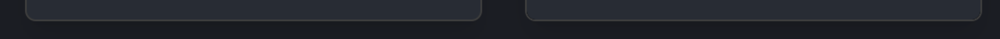
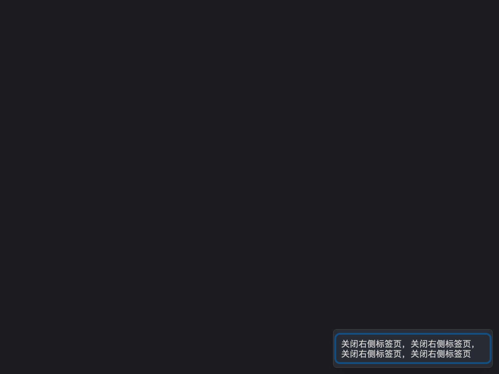

# P0-24 第二批：右键菜单（macOS）

状态：**完成待评估**。第 5 轮已修复焦点环在鼠标移动后消失的问题，保留键盘操作期间的 hover 背景，改为显式初始化键位，并从行高推算文字区域。干净工作区在沙箱外重生成参照，深浅两种主题均 **10/10 屏通过**，全部屏幕颜色超限为 0；E-001 继续只用于已批准的容器阴影，已补齐 wrapped 实测与人工核对。详见本报告“第 5 轮”。

## 范围与生产语义

已通读 `src/components/ContextMenu.tsx` 与 `src/types/tab.ts` 的 `TabContextMenuAction`。

| 项目类型 | 生产支持情况 |
| --- | --- |
| 普通项 | label、action，可有 icon；触发 onAction 后 onClose。 |
| 分隔线 | separator: true；1px border 色，垂直 margin 4px；跳过键盘导航。 |
| 禁用项 | disabled；不触发，导航跳过。Button 的 disabled:opacity-50 最终生效，原色保留。 |
| 勾选项、子菜单 | 类型无 checked 或 children 字段，组件未实现。 |
| 快捷键 | shortcut 是 KeymapActionId；useShortcutLabel 从 KeymapContext 解析；kbd 为 muted foreground、12px、左 padding 12px、靠右且不收缩。 |
| 危险项 | 无 destructive 字段或专用样式；关闭/删除类仍为 ghost Button。 |

真实菜单来源是 `src/components/TabBar/TabItem.tsx` 中未拆分的页面标签分支（TabBar 使用它）。选择 settings、logs 两个标签中的第一个：New Tab、Reopen Closed Tab、分隔线、Close Tab、Close Other Tabs、禁用的 Close Tabs to the Left、Close Tabs to the Right。与真实调用一样使用 `getReopenClosedTabMenuAction` 和 `getTabCloseMenuActions`。

## 做法与理由

核对 gpui-component 0.9.0 的 PopupMenu：其项目选中背景、边框、圆角与快捷键使用 ActiveTheme 全局主题，且 selected 的实心高亮不同于本菜单的 Button focus-visible 空心 ring。采用 GPUI 实体、局部主题与自绘部件，沿用第一批 `surface`、`css_color`、`css_opacity` 和空心 ring，不修改全局 Theme。没有复制 Zed 代码。

- `context_menu.rs` 管状态与回调，`context_menu/view.rs` 管真实渲染，`placement.rs` 在测量菜单之后按窗口坐标定位。外部 action、close 回调接收 Window/App，可更新业务状态；激活只回调一次，随后关闭。
- 容器宽度是 min(256, viewport width - 20)，再施加 208px 最小宽度；popover 背景、border 1px、radius 6px；外层上下 padding 4px，body 四边 padding 4px。捕获实际为 (534,395) 256×195。
- `surface.rs::shadow_lg` 对应 CSS `0 10px 15px -3px rgb(0 0 0 / .1), 0 4px 6px -4px rgb(0 0 0 / .1)`；GPUI sigma 为 7.5/3。按 CSS 层序反向提交 GPUI shadow slice，黑色通过同一 CSS 8 位颜色量化函数。单元测试覆盖 sigma、offset、spread 与颜色。
- 本菜单各行实际 28px，图标 16px、gap 6px；有图标的 Button 因 has-svg 规则实际水平 padding 12px，无图标为 8px。文字 14px/400，kbd 12px/400，label 高 16px、kbd 高 13px，垂直居中。保留 CSS 声明的 16.8/13.8 行高，部件布局框使用实际测得的高度，快照与绘制同源。
- 初始键盘高亮第一个可用项，使用 3px 空心 ring；第二屏高亮第二项。hover 独立使用 accent（深色 alpha .5），disabled 不进入 hover 或触发分支。
- 两端有 21 个一一对应的布局部件：容器、body、6 行、3 图标、6 label、3 shortcut、1 separator。React 添加 data-slot 和可选 data-parity 属性，不改生产 CSS。GPUI `PartObserver` 从真实 prepaint bounds 回报槽位及实际绘制声明，不是手填坐标。
- 只为这两屏生成 Plus、RotateCcw、X，沿用 `generate-lucide-icons.mjs` 读取已安装 Lucide 的方法；来源、版本和 ISC 许可补入 third-party.md。

参照夹具真实挂载 ConfigProvider、KeymapProvider；配置加载由 parity pending 返回保持默认值。`contextMenuFixture.ts` 使用生产英文资源和默认 resolver 生成 macOS/Windows 标签，`generate-context-menu-fixture.mjs` 导出 GPUI JSON；Vitest 验证 JSON 与生产 helper/default resolver 一致。没有手写 ⌘T 等字符串。manifest 屏幕数量断言已改为 9。

## 定位与交互证据

React 的规则是平移，不是围绕指针翻转：仅当 x+width > innerWidth 时令 x=innerWidth-width-10；y 同理；最后两轴 max(10)。GPUI 测量当前菜单的真实尺寸后应用相同严格大于比较。单元测试覆盖右侧、下侧、右下角、恰好不溢出及负坐标。

完整 workspace 测试包含以下新增真实 GPUI 窗口测试，全部通过（[完整日志](assets/P0-24-context-menu/workspace-tests.log)）：

| 测试 | 证据 |
| --- | --- |
| keys_wrap_skip_disabled_and_separators_then_enter_calls_action_before_close | 上下键循环，跳过 separator 和 disabled；Enter 依次记录 action、closed；再次 Enter 不重复。 |
| escape_and_click_outside_close_without_action | 分别模拟 Esc 和菜单外单击，只关闭、不触发。 |
| pointer_activation_closes_once_and_disabled_click_does_nothing | 点击禁用项无事件，点击可用项触发后关闭一次。 |
| hover_tracks_enabled_rows_without_changing_keyboard_selection | 鼠标移动到普通项产生 hover，移到禁用项清除；键盘选择保持独立。 |
| rendering_two_themes_in_one_window_preserves_global_theme | 同一真实窗口放 DARK/LIGHT 两个实体，render_frame 后检查两种 popover 填色确实被绘制；前后序列化全局 Theme 完全相等。 |

另外支持 Home/End、Tab/ShiftTab、Space，关闭时若焦点仍在菜单或无焦点则恢复打开前的焦点。第 4 轮已补 Tab/ShiftTab、Home/End、Space 的真实 Root 测试。

## macOS 对比

Mac mini M4、macOS Apple Silicon，800×600 逻辑像素、DPR 2。本轮对比前先提交 `ac2eaf6f0b4f38dd891c9fa70fac2fba98dd9c9b`，`git status --porcelain` 输出为空。两次均提升权限在沙箱外执行，参照目录分别是：

- 深色：`target/parity/reference/ac2eaf6f0b4f38dd891c9fa70fac2fba98dd9c9b`
- 浅色：`target/parity/reference/ac2eaf6f0b4f38dd891c9fa70fac2fba98dd9c9b-light`

```sh
UPDATE_REFERENCE=1 PARITY_PLATFORM=macos PARITY_THEME=dark CARGO_BUILD_JOBS=3 cargo run -p tterm-parity -- compare
cp target/parity/report/result.json target/parity/report-dark.json
# 在浅色运行前，将 result.json 和两张 GPUI 截图一起另存至 target/parity/context-menu-r3-dark/。
UPDATE_REFERENCE=1 PARITY_PLATFORM=macos PARITY_THEME=light CARGO_BUILD_JOBS=3 cargo run -p tterm-parity -- compare
cp target/parity/report/result.json target/parity/report-light.json
# 立即将 result.json 和两张 GPUI 截图一起另存至 target/parity/context-menu-r3-light/。
```

两份原始结果：[深色 result.json](assets/P0-24-context-menu/round3/dark/result.json)、[浅色 result.json](assets/P0-24-context-menu/round3/light/result.json)。每屏的 `exceptions` 字段均存在，使用情况如下；内部图片相对路径仍对应 target 产物。

| 屏幕 | 深色 | 浅色 | 两主题使用的例外 |
| --- | --- | --- | --- |
| example.button-input.default | 通过，屏幕颜色 0 px | 通过，屏幕颜色 0 px | 无（[]） |
| ui.button.variants | 通过，屏幕颜色 0 px | 通过，屏幕颜色 0 px | 无（[]） |
| ui.button.sizes | 通过，屏幕颜色 0 px | 通过，屏幕颜色 0 px | 无（[]） |
| ui.input.default | 通过，屏幕颜色 0 px | 通过，屏幕颜色 0 px | 无（[]） |
| ui.password.default | 通过，屏幕颜色 0 px | 通过，屏幕颜色 0 px | 无（[]） |
| ui.select.default | 通过，屏幕颜色 0 px | 通过，屏幕颜色 0 px | 无（[]） |
| ui.switch.default | 通过，屏幕颜色 0 px | 通过，屏幕颜色 0 px | E-001（原登记，outset 3） |
| ui.context-menu.default | 通过，屏幕颜色 0 px | 通过，屏幕颜色 0 px | E-001（本轮扩展，outset 25） |
| ui.context-menu.highlighted | 通过，屏幕颜色 0 px | 通过，屏幕颜色 0 px | E-001（本轮扩展，outset 25） |

| 新增屏幕 | 深色 macOS | 浅色 macOS |
| --- | --- | --- |
| ui.context-menu.default | 屏幕颜色最大 ΔE00 0，超限 0；布局 21/21 通过，最大偏差 .97px；遮文字 SSIM .999937、整屏 .987345；3/3 图标通过，最大墨量差 .02912、重心 .013px、笔画 ΔE .5572 | 屏幕颜色最大 ΔE00 0，超限 0；布局 21/21 通过，最大偏差 .97px；遮文字 SSIM .999804、整屏 .985483；3/3 图标通过，最大墨量差 .02454、重心 .01363px、笔画 ΔE 0 |
| ui.context-menu.highlighted | 屏幕颜色最大 ΔE00 0，超限 0；布局 21/21 通过，最大偏差 .97px；遮文字 SSIM .999937、整屏 .987383；图标同上 | 屏幕颜色最大 ΔE00 0，超限 0；布局 21/21 通过，最大偏差 .97px；遮文字 SSIM .999802、整屏 .985581；图标同上 |

本轮四张完整 GPUI 截图：[深色默认](assets/P0-24-context-menu/round3/dark/default-gpui.png)、[深色高亮](assets/P0-24-context-menu/round3/dark/highlighted-gpui.png)、[浅色默认](assets/P0-24-context-menu/round3/light/default-gpui.png)、[浅色高亮](assets/P0-24-context-menu/round3/light/highlighted-gpui.png)。旧轮 JSON 与截图保留在原 assets/dark、assets/light 目录作为历史证据。

### 已登记例外 E-001

评估者复核第 2 轮像素证据后，决策人 stone 于 2026-11-09 批准把 E-001 扩展至右键菜单容器；第 5 轮确认同组件的 `ui.context-menu.wrapped` 也在批准范围内，与 default、highlighted 一并登记。`outset` 为 25，即 shadow-lg 第一层 y 偏移 10px + CSS 模糊 15px。只排除容器 border box 外的阴影区域，元素内部仍参与比较；原因与人工判定方法沿用 E-001 原文。没有改动 E-001 标题、编号或原有 Switch 段落。

干净复跑后的深色两屏菜单框外均有 **4632 个物理像素差 1 级、4 个差 2 级**（按距圆角 border box 外 >1 至 50 个物理像素的区域统计，避开既有 1px 边缘带）。本轮两主题的参照与旧轮参照像素逐字节一致，深色两张 GPUI 截图也与旧轮逐字节一致；因此旧门槛审计中的 **642 个超限像素、其中 y=1185 一行 474 个**仍可复核，见 [原始门槛像素记录](assets/P0-24-context-menu/dark/gate-pixels.txt)。该行位于菜单下沿外约 2.5 CSS px。应用已批准的扩展后，深浅两屏计入门槛的超限像素均为 **0**。

这属于 E-001 的低透明度模糊阴影尾部取整，不是图标或 ring 的抗锯齿说明。像素样本仍为：(1065,821) WebKit (27,29,34,255)、GPUI (27,28,34,255)；(1300,1185) WebKit (25,27,31,255)、GPUI (25,26,32,255)。本轮没有继续调整 alpha、sigma 或几何来迎合特定浏览器。

下表记录三个屏幕、两个主题的视觉核对。default/highlighted 保留第 3 轮记录，wrapped 补充第 5 轮证据。使用 PNG 物理像素最近邻 **4 倍放大（400%）**，分别查看菜单下沿左角、直边中段、右角；每个小图均为左参照、右 GPUI。default/highlighted 在相同主题下的下沿截图一致，仍分别查看并记录。

| 屏幕 | 主题 | 400% 核对结论 | 并排证据（左参照，右 GPUI） |
| --- | --- | --- | --- |
| ui.context-menu.default | 深色 | 阴影向下延伸，范围与深浅一致；无缺失、偏移或明显偏深偏浅；尾部色阶差符合 E-001。 | [左角](assets/P0-24-context-menu/round3/dark/default-inspect-left-4x.png)、[中段](assets/P0-24-context-menu/round3/dark/default-inspect-middle-4x.png)、[右角](assets/P0-24-context-menu/round3/dark/default-inspect-right-4x.png) |
| ui.context-menu.highlighted | 深色 | 阴影方向、范围和深浅一致；键盘高亮不改变容器阴影，符合 E-001。 | [左角](assets/P0-24-context-menu/round3/dark/highlighted-inspect-left-4x.png)、[中段](assets/P0-24-context-menu/round3/dark/highlighted-inspect-middle-4x.png)、[右角](assets/P0-24-context-menu/round3/dark/highlighted-inspect-right-4x.png) |
| ui.context-menu.default | 浅色 | 阴影方向、范围和深浅一致；圆角附近可见栅格边缘差，未见阴影缺失、错位或明显深浅差。 | [左角](assets/P0-24-context-menu/round3/light/default-inspect-left-4x.png)、[中段](assets/P0-24-context-menu/round3/light/default-inspect-middle-4x.png)、[右角](assets/P0-24-context-menu/round3/light/default-inspect-right-4x.png) |
| ui.context-menu.highlighted | 浅色 | 阴影方向、范围和深浅一致；与默认屏容器阴影相同，符合 E-001。 | [左角](assets/P0-24-context-menu/round3/light/highlighted-inspect-left-4x.png)、[中段](assets/P0-24-context-menu/round3/light/highlighted-inspect-middle-4x.png)、[右角](assets/P0-24-context-menu/round3/light/highlighted-inspect-right-4x.png) |
| ui.context-menu.wrapped | 深色 | 已查看 400% 下沿左角、中段、右角；阴影向下延伸，方向、范围和深浅一致，无缺失或偏移，符合 E-001。 | [左角](assets/P0-24-context-menu/round5/dark/wrapped-bottom-left-4x.png)、[中段](assets/P0-24-context-menu/round5/dark/wrapped-bottom-middle-4x.png)、[右角](assets/P0-24-context-menu/round5/dark/wrapped-bottom-right-4x.png) |
| ui.context-menu.wrapped | 浅色 | 已查看 400% 下沿左角、中段、右角；阴影范围和深浅一致，圆角尾部有栅格差，未见阴影缺失、偏移或明显深浅差，符合 E-001。 | [左角](assets/P0-24-context-menu/round5/light/wrapped-bottom-left-4x.png)、[中段](assets/P0-24-context-menu/round5/light/wrapped-bottom-middle-4x.png)、[右角](assets/P0-24-context-menu/round5/light/wrapped-bottom-right-4x.png) |

下沿完整裁剪使用 PNG 坐标 `(1040,1156)..(1600,1200)`，即菜单底边 y=1180 上方 24px 和下方可见的 20px；截图到窗口底部为止。每张从 560×44 放大至 2240×176，未调色或插值平滑。并排图各半保持相同 4 倍比例，原尺寸查看可核对：

| 主题/屏幕 | 参照裁剪 ×4 | GPUI 裁剪 ×4 | 并排（左参照，右 GPUI） |
| --- | --- | --- | --- |
| 深色默认 | [参照](assets/P0-24-context-menu/round3/dark/default-bottom-reference-4x.png) | [GPUI](assets/P0-24-context-menu/round3/dark/default-bottom-gpui-4x.png) | [并排](assets/P0-24-context-menu/round3/dark/default-bottom-pair-4x.png) |
| 深色高亮 | [参照](assets/P0-24-context-menu/round3/dark/highlighted-bottom-reference-4x.png) | [GPUI](assets/P0-24-context-menu/round3/dark/highlighted-bottom-gpui-4x.png) | [并排](assets/P0-24-context-menu/round3/dark/highlighted-bottom-pair-4x.png) |
| 浅色默认 | [参照](assets/P0-24-context-menu/round3/light/default-bottom-reference-4x.png) | [GPUI](assets/P0-24-context-menu/round3/light/default-bottom-gpui-4x.png) | [并排](assets/P0-24-context-menu/round3/light/default-bottom-pair-4x.png) |
| 浅色高亮 | [参照](assets/P0-24-context-menu/round3/light/highlighted-bottom-reference-4x.png) | [GPUI](assets/P0-24-context-menu/round3/light/highlighted-bottom-gpui-4x.png) | [并排](assets/P0-24-context-menu/round3/light/highlighted-bottom-pair-4x.png) |




## 全量检查

全部在沙箱外执行，cargo 命令均从本 worktree 根目录运行、CARGO_BUILD_JOBS=3、使用本地 target，无共享 CARGO_TARGET_DIR。

```sh
pnpm lint && pnpm format:check && pnpm check:tokens && pnpm typecheck && pnpm test && pnpm check:size
CARGO_BUILD_JOBS=3 cargo fmt --all --check
CARGO_BUILD_JOBS=3 cargo clippy --workspace --all-targets -- -D warnings
CARGO_BUILD_JOBS=3 cargo test --workspace
```

第 3 轮重新执行以上全部检查，均通过。前端：175 文件、1295 测试；[大小检查](assets/P0-24-context-menu/size.log) 1049 文件通过。[Clippy](assets/P0-24-context-menu/round3/clippy.log) 通过，格式检查通过。[完整 Rust 测试](assets/P0-24-context-menu/round3/workspace-tests.log) 通过，tterm-ui 36、tterm-parity 76、terminal-view 137，Tauri 817 通过。命令没有过滤测试或添加跳过；Tauri 原有 52 个源码标记 ignored 保持原样，没有本轮新增 ignore。开发 bundle/capture 自动关闭，进程核对没有本 worktree 的 Vite、Playwright 或 tterm-parity 残留。未运行正式或 Tauri 开发版、未读写两个受保护应用标识目录。

## 偏差、未验证与 [人工] 项

- 提示词写的是 14px，实测生产为 16px，评估者已确认按 16px。原先停止记录及图标证据保留在 d4b2588d 和 assets 下，本报告更新为继续实施后的结论。
- 深色 shadow-lg 的尾部取整已按 stone 批准登记 E-001，干净工作区复跑及 400% 视觉核对通过；没有待确认事项。
- 第 4 轮已解除单行标签限制，中文长标签通过真实两端 parity；Windows 字体换行仍需 Windows 验证。
- Windows 通道：未验证（需 Windows）。
- [人工] 真实 Tauri 窗口与 WebKit 参照的交叉截图；实际鼠标打开标签、终端、SFTP 菜单的端到端使用体验未验证。
- 未合并、未 push；未修改 status.md、共享 P0-24.md、生产 CSS 或依赖版本。


## 第 4 轮（2026-11-09）：真实应用行为修复

本轮先以 `98ad6e0a` 单独提交纯拆分：把原 148 行的 row 拆成 row_style、row_content 和 row，不改行为；随后提交行为修复和独立的 inline 行盒修正。没有新依赖、全局主题修改或生产 CSS 修改。

### 1. 菜单浮层

`view.rs` 使用 `deferred(anchored().position(0,0).child(PlacedMenu))`，延迟绘制优先级为 gpui-base 的 POPUP_PRIORITY，card 使用 `.occlude()`。deferred 不继承祖先 content mask，PlacedMenu 仍使用原 `fit_in_viewport` 规则和窗口绝对坐标。

测试 `deferred_menu_escapes_clipping_occludes_later_sibling_and_owns_escape` 在真实 Base Root 内把宿主放进 12×12、overflow_hidden 的容器，并在后面绘制全窗口 mouse-down 监听兄弟元素；点击容器外的菜单第一项仍触发一次 action，兄弟元素计数为 0。

### 2. Root 下的按键优先级

选择菜单自身 key context + action，而不是 focus_trap：菜单只有一个实际 FocusHandle，选择索引由菜单管理，action 可以保留这一结构，并与 Root 的 Tab、祖先 Dialog 的 Escape 使用相同的 GPUI 分发规则。`keyboard.rs` 注册 TTermContextMenu context 下的 SelectNext、SelectPrev、First、Last、Confirm、Cancel，绑定上下键、Tab/ShiftTab、Home/End、Enter/Space、Escape。注册有全局哨兵避免重复绑定，但不写主题。

全部渲染测试的宿主现在均像 `gpui_kit::open_window` 一样包在 `base::Root::new` 内。`root_tab_shift_tab_home_end_and_space_stay_in_menu` 逐项验证索引和焦点仍在菜单，Space 触发 action 后关闭；原有上下键/Enter 测试继续通过。`deferred_menu_escapes_clipping_occludes_later_sibling_and_owns_escape` 同时在祖先绑定 Escape，验证菜单关闭、祖先计数仍为 0。

### 3. 回调借用

action 与 close 回调克隆后通过 `window.defer(cx, ...)` 排队，当前实体 update 完成后才调用；action 排在 close 前，open 状态先置为 false，避免重入二次激活。没有使用会再次借用菜单的 defer_in。测试 `callbacks_can_read_and_update_the_menu_after_entity_borrow_ends` 在两个回调内都读取菜单，action 内还 update 菜单，不 panic，并验证 action、close 顺序。

### 4. 快照与绘制同源

PartStyle 增加 ancestor_opacity、font_family、font_weight。row_style 产生真实行 opacity；子部件从父 PartStyle 累乘祖先 opacity，实际样式声明和观测均由 view.rs 的相同字段产生。parity 侧直接使用 `part.opacity * part.ancestor_opacity`，删除从 fixture.disabled 猜测 .5 的逻辑；字体族与字重也直接取 part 字段。深浅两主题所有禁用行及子槽位样式检查通过，`rendering_two_themes_in_one_window_preserves_global_theme` 仍验证两种主题确实绘制且全局 Theme 不变。

### 5. 定位和高亮测试缺口

- `right_bottom_and_corner_use_measured_size_with_ten_pixel_inset` 新增 300×200 菜单放进 100×80 窗口的用例，必须得到 (10,10)，可发现 max/clamp 顺序错误。
- `measured_placement_clamps_once_and_only_repositions_when_origin_changes` 通过真实 prepaint 的 PartObserver 读取容器框，验证初次贴近窗口右下角的坐标等于纯函数结果；窗口缩小后 origin 保持，再调用 set_origin 才重新测量定位。
- 删除只为夹具提供的 initial_highlight。React 夹具发真实 Home，highlighted 再发 ArrowDown；GPUI 夹具在初次绘制后经 `window.dispatch_keystroke` 分发 Home、Down，走同一生产 action 绑定。最终布局数据中默认屏 item-0 ringSpread=3、item-1=0，高亮屏相反。

### 6. focus-visible 输入来源

第 4 轮直接使用 Window 的 `last_input_was_keyboard()`，鼠标打开时无 ring；真实键盘事件后显示，指针事件后隐藏。该实现会在鼠标移动时过早隐藏 ring，第 5 轮改为记录焦点变化的输入来源，并以真实绘制测试替换原来的样式断言。两端 parity 的焦点环证据范围见第 5 轮第 5 项。

### 7. 一次定位与传播

PlacedMenu 把初次 fit 结果保存在实体持有的 Rc<Cell<Option<Point>>>；set_origin 仅在 x/y 真正变化时清空，窗口 resize 或文字布局重算不会重新 clamp。上面的真实渲染定位测试覆盖该行为。原始 on_key_down 与显式 stop_propagation 已移除；菜单使用 action 消费绑定，没有对原始键盘事件调用 stop_propagation。Root/祖先绑定优先级由 GPUI 的焦点上下文匹配解决。

### 8. 长标签换行

行改为 min-height 28、按内容增高；label 可收缩并按可用宽度排版。新增 MenuText 使用 GPUI 文字 shaping/wrap 结果测量和绘制，在 14px 字体下保留 WebKit 实测的 16px inline 行盒（computed line-height 仍为 16.8），避免 GPUI 通用 Text 把它 round 到 17px。逐行文字范围也从同一次 shaping 的 wrap boundaries 导出，背景测量保留每行末端空白，不把整个多行 label 都当作文字遮罩。

`chinese_label_wraps_and_expands_row_from_its_minimum_height` 验证长中文使行和 label 增高且文字不越出水平 padding。新增 `ui.context-menu.wrapped` 两端均使用生产组件，文案来自中文 i18n 的真实标签操作资源，重复形成长标签；fixture 生成和一致性测试沿用真实生产 resolver。该屏没有新图标，容器阴影沿用 E-001/outset 25。manifest 屏幕数量断言更新为 10。

新屏实际两端均为：菜单 (534,528) 256×62，行 (539,537) 246×44，label (547,543) 230×32。深色截图见下；[浅色截图](assets/P0-24-context-menu/round4/light/wrapped-gpui.png)。



### 第 4 轮干净工作区对比

行为修复及文字修正均先提交，再确认 `git status --porcelain` 为空。前端参照键为 `92c46435623fb16caed6e93400e47d00dfdbca0e`：后续 `1fc9b3a1` 只改 Rust，因此前端缓存键仍为前一次前端提交。两主题结果均 `dirty: false`；目录为该键和该键加 `-light`，均不带 `-dirty`。每次均使用 UPDATE_REFERENCE=1，在沙箱外重新生成参照；深色结果和 actual 截图在浅色运行前另存至 context-menu-r4-dark，浅色另存 context-menu-r4-light。

```sh
UPDATE_REFERENCE=1 PARITY_PLATFORM=macos PARITY_THEME=dark CARGO_BUILD_JOBS=3 cargo run -p tterm-parity -- compare
UPDATE_REFERENCE=1 PARITY_PLATFORM=macos PARITY_THEME=light CARGO_BUILD_JOBS=3 cargo run -p tterm-parity -- compare
```

| 屏幕 | 深色 / 浅色结果 | 颜色门槛超限（深 / 浅） | 例外（两主题） |
| --- | --- | --- | --- |
| example.button-input.default | 通过 / 通过 | 0 / 0 | 无 |
| ui.button.variants | 通过 / 通过 | 0 / 0 | 无 |
| ui.button.sizes | 通过 / 通过 | 0 / 0 | 无 |
| ui.input.default | 通过 / 通过 | 0 / 0 | 无 |
| ui.password.default | 通过 / 通过 | 0 / 0 | 无 |
| ui.select.default | 通过 / 通过 | 0 / 0 | 无 |
| ui.switch.default | 通过 / 通过 | 0 / 0 | E-001 |
| ui.context-menu.default | 通过 / 通过 | 0 / 0 | E-001 |
| ui.context-menu.highlighted | 通过 / 通过 | 0 / 0 | E-001 |
| ui.context-menu.wrapped | 通过 / 通过 | 0 / 0 | E-001 |

| 菜单屏 | 深色：遮文字 / 整屏 SSIM | 浅色：遮文字 / 整屏 SSIM | 最大布局偏差 |
| --- | --- | --- | --- |
| default | .999937 / .993386 | .999804 / .992203 | .97px |
| highlighted | .999937 / .993386 | .999802 / .992202 | .97px |
| wrapped | .999936 / .996595 | .999796 / .995948 | 0px |

原有 9 屏均继续通过；default/highlighted 的图标独立检查仍各 3/3 通过。原始结果：[深色](assets/P0-24-context-menu/round4/dark/result.json)、[浅色](assets/P0-24-context-menu/round4/light/result.json)；round4 各主题目录还保存三屏截图与实际 layout.json，可检查槽位、文字区域和 ring 状态。所有门槛不变，没有新增例外编号或修改比较器。

### 第 4 轮全量检查和未验证项

AGENTS.md 全部检查均在沙箱外通过；cargo 从 worktree 根运行，CARGO_BUILD_JOBS=3，使用本地 target，无共享 CARGO_TARGET_DIR。前端 175 文件、1295 测试通过，[大小检查](assets/P0-24-context-menu/round4/size.log) 1051 文件通过；cargo fmt --all --check 通过，[clippy --workspace --all-targets -- -D warnings](assets/P0-24-context-menu/round4/clippy.log) 通过；[不筛选的 cargo test --workspace](assets/P0-24-context-menu/round4/workspace-tests.log) 通过，tterm-ui 42、tterm-parity 76、terminal-view 137、Tauri 817（原有 52 ignored 未改）。菜单 12 个测试全部通过；没有添加 ignore/allow 或跳过失败项。

Windows 仍为未验证（需 Windows）。[人工] 真实 Tauri 窗口交叉截图与标签、终端、SFTP 调用处端到端体验仍待验证。长标签换行已验证，不再列作未实现限制。本轮 Vite/Playwright/GPUI 捕获均退出；核对到同名对比进程属于 Tabs worktree，没有触碰。没有运行受保护标识的 Tauri 应用，没有合并或 push。


## 第 5 轮（2026-11-09）：焦点可见性与初始化收尾

### 1. 按焦点变化记录输入来源，保留 hover

打开菜单时从 `window.last_input_was_keyboard()` 记录 `focus_visible`；ArrowUp/Down、Tab/ShiftTab、Home/End 移动高亮时记为键盘。绘制只读这个记录，MouseMove 不修改它；卡片上的左键/右键 mouse-down 清除记录。这样键盘导航后的鼠标移动不会移除 ring，指针点击仍会清除。测试 `keyboard_ring_survives_mouse_move_until_pointer_press` 每一步调用 `render_frame` 后检查实际 `painted_quads`：初始无 ring，Down 后有 ring，MouseMove 后 ring 图元数量不变，点击卡片内边距后无 ring；没有直接调用 row_style。

用真实生产 React 菜单、Playwright WebKit 的受信任 `page.keyboard.press('ArrowDown')` 核实：鼠标仍在第一个菜单项时，按键前后的 `:hover` 均为 true，背景均为 `oklab(0.544629 -0.049777 -0.157557 / 0.5)`，见 [探测记录](assets/P0-24-context-menu/round5/react-hover-probe.json)。GPUI 菜单行改为 `HoverListenerMode::InputModalityIndependent`。测试 `hovered_background_survives_keyboard_navigation` 渲染后检查真实 hover 背景图元，确认键盘操作不会清掉它。

### 2. 显式注册键位，支持重载

删除 Global 懒注册标记与构造函数内的注册，新增公开的 `context_menu::init(cx)`，按 gpui-component 的方式直接绑定全部菜单 action。新增 `tterm_ui::init(cx)` 入口并写明调用约定：在 `gpui_kit::init` 后调用，重建键位表时再次调用。当前实际使用菜单的 parity 初始化入口和所有菜单测试均走此入口；尚未依赖 tterm-ui 的 tterm-gpui 没有新增依赖。

`explicit_init_restores_menu_bindings_after_keymap_reload` 在生产 Base Root 下清空 key bindings，再调用 `tterm_ui::init`，验证 Tab、ShiftTab、Down 移动以及 Esc 关闭，避免旧 Global 标记导致菜单绑定永久丢失。

### 3. 文字高度从行高推算

`context_menu/text.rs` 首行、总高度及文字区域统一使用声明行高向下取整后的值，不再硬写 16px。注释说明 WebKit 实测的对应关系：16.8px 声明行高得到 16px inline 行盒，两行得到 32px。测量、prepaint 的文字区域和 paint 均按同一规则计算。已有 `chinese_label_wraps_and_expands_row_from_its_minimum_height` 继续通过；default、highlighted、wrapped 两主题 SSIM 与第 4 轮相同，布局偏差也未增大。

### 4. 补齐 E-001 与 wrapped 人工核对

E-001 右键菜单扩展明确列出三屏共同的 `ui.context-menu` 容器与 shadow-lg，outset 保持 25。移除会过时的屏幕总数说明，换成本轮三屏两主题的实测数字。统计仍取圆角 border box 外 >1 至 50 个物理像素，避开既有边缘带；表中“差 N 级”为 RGBA 通道绝对差的最大值，见 [原始统计](assets/P0-24-context-menu/round5/shadow-audit.json)。这些是例外区域的审计数字，不是计入门槛的超限计数。

| 屏幕 | 深色阴影区域差异像素 | 浅色阴影区域差异像素 | 应用 E-001 后颜色门槛超限（深 / 浅） |
| --- | --- | --- | --- |
| default | 差 1 级：4632；差 2 级：4 | 差 1/2/3/4/5 级：20788/2566/40/4/2 | 0 / 0 |
| highlighted | 差 1 级：4632；差 2 级：4 | 差 1/2/3/4/5 级：20788/2566/40/4/2 | 0 / 0 |
| wrapped | 差 1 级：2466；差 2 级：4 | 差 1/2/3/4 级：11306/938/36/6 | 0 / 0 |

已在“已登记例外 E-001”的人工核对表补上 wrapped 深浅两行。六张并排证据分别覆盖左角、中段、右角，左参照、右 GPUI，最近邻放大 4 倍；源 PNG 裁剪 y=1156..1200，x 分别为 1040..1160、1240..1360、1480..1600。400% 检查确认方向、范围和深浅一致，无缺失或偏移。原有 Switch 段落、例外编号、遮罩与门槛未改。

### 5. 焦点环 parity 证据的边界

React parity 夹具通过 `document.dispatchEvent` 发出的按键是不受信任的事件，WebKit 未必会因此切换输入方式。因此两端截图中的焦点环一致，靠的是程序设置焦点时的规则，不能证明两边判断焦点可见的方式一致。第 1 项的 GPUI 实际绘制测试单独验证键盘导航、鼠标移动和指针点击的状态；受信任的 WebKit 探测单独验证 hover 在键盘操作时保留。

### 第 5 轮干净工作区对比

代码先提交，确认工作区干净后在沙箱外执行深浅两次 UPDATE_REFERENCE=1。深色运行时 HEAD 为 86cf0020；之后仅调整测试的 ring 图元数量断言并提交 80681ff3，浅色运行时 HEAD 为 80681ff3，两次生产绘制代码相同。参照键仍为最后一次前端提交 `92c46435623fb16caed6e93400e47d00dfdbca0e`，两份 result.json 均为 `dirty: false`，参照目录不带 `-dirty`。每次完成后立即将 result.json、GPUI 三屏 PNG 和 layout.json 另存，深色未被浅色覆盖。

| 屏幕 | 深色 / 浅色 | 颜色门槛超限（深 / 浅） | 使用的例外（两主题） |
| --- | --- | --- | --- |
| example.button-input.default | 通过 / 通过 | 0 / 0 | 无（[]） |
| ui.button.variants | 通过 / 通过 | 0 / 0 | 无（[]） |
| ui.button.sizes | 通过 / 通过 | 0 / 0 | 无（[]） |
| ui.input.default | 通过 / 通过 | 0 / 0 | 无（[]） |
| ui.password.default | 通过 / 通过 | 0 / 0 | 无（[]） |
| ui.select.default | 通过 / 通过 | 0 / 0 | 无（[]） |
| ui.switch.default | 通过 / 通过 | 0 / 0 | E-001 |
| ui.context-menu.default | 通过 / 通过 | 0 / 0 | E-001 |
| ui.context-menu.highlighted | 通过 / 通过 | 0 / 0 | E-001 |
| ui.context-menu.wrapped | 通过 / 通过 | 0 / 0 | E-001 |

| 菜单屏 | 深色：遮文字 / 整屏 SSIM | 浅色：遮文字 / 整屏 SSIM | 最大布局偏差 |
| --- | --- | --- | --- |
| default | .999937 / .993386 | .999804 / .992203 | .97px |
| highlighted | .999937 / .993386 | .999802 / .992202 | .97px |
| wrapped | .999936 / .996595 | .999796 / .995948 | 0px |

两主题均 **10/10**。default/highlighted 图标各 3/3 通过。原始结果：[深色](assets/P0-24-context-menu/round5/dark/result.json)、[浅色](assets/P0-24-context-menu/round5/light/result.json)。同目录保存各屏 GPUI PNG、layout.json 和 wrapped 阴影并排裁剪；运行时还另存 `target/parity/report-dark.json` 与 `report-light.json`。

### 第 5 轮全量检查和未验证项

AGENTS.md 全部检查均在沙箱外、干净工作区通过；cargo 从本 worktree 根目录运行，CARGO_BUILD_JOBS=3，使用本 worktree 的 target。pnpm lint、format:check、check:tokens、typecheck、test、check:size 均通过，前端 175 文件、1295 测试；[大小检查](assets/P0-24-context-menu/round5/size.log) 1051 文件通过。cargo fmt --all --check、[clippy --workspace --all-targets -- -D warnings](assets/P0-24-context-menu/round5/clippy.log)、[cargo test --workspace](assets/P0-24-context-menu/round5/workspace-tests.log) 均通过，Rust 共 **1173 通过、0 失败**，其中 tterm-ui 44 项、菜单 14 项。未筛选或新增跳过测试；Tauri 原有 52 个源码标记 ignored 未改。

既有真实双主题绘制测试 `rendering_two_themes_in_one_window_preserves_global_theme` 继续通过。Windows 通道仍为**未验证（需 Windows）**。[人工] 真实 Tauri 窗口交叉截图及标签、终端、SFTP 调用处端到端使用体验仍待验证。本轮捕获及 hover 探测结束时关闭其 Vite、WebKit、GPUI 进程；未运行受保护标识的 Tauri 应用，未合并、未 push。

## 评估（2026-11-09，macOS）

- 结论：**通过，合并到 GPUI**。右键菜单在 macOS 深浅两种主题下达标，用到 E-001 的右键菜单扩展（决策人 stone 同意，2026-11-09）。
- 本卡共五轮：
  - 第 1 轮停下来确认图标尺寸：提示词写的 14px 是评估者误读，按实测的 16px 还原；
  - 第 2 轮完成组件；
  - 第 3 轮登记例外，并在干净的工作区里复跑；
  - 第 4、5 轮修复评估者代码审查发现的问题：菜单改为 `deferred` 浮层并 occlude，键位改为 action 绑定以压过 Root 和祖先元素，回调延后执行，焦点环按 focus-visible 语义绘制，hover 不再受输入方式影响，键位改为显式的 `tterm_ui::init`，支持长标签换行。
- 复核：
  - 第 4、5 轮的修复由评估者另开一个审查逐条核对，并论证每个测试在修复撤回后都会失败；
  - 评估者在本机、沙箱外重跑了 AGENTS.md 的全部检查：前端检查全部通过，`cargo test --workspace` 1173 项通过、0 项失败、52 项为原有的 ignored；
  - `UPDATE_REFERENCE=1` 深色、浅色两次对比都是 10/10，参照取自干净提交 `92c46435`。
- 遗留问题：
  - Windows 通道深浅两种主题的对比：未验证，属于 G1 门槛；
  - [人工]：真实 Tauri 窗口的交叉截图，以及标签栏、终端、SFTP 三处调用的端到端体验；
  - React parity 夹具发的是不受信任的按键事件，所以两端焦点环一致，不能证明两端的输入方式判定相同；
  - 正式接入时，应用启动要在 `gpui_kit::init` 之后调用 `tterm_ui::init`。
