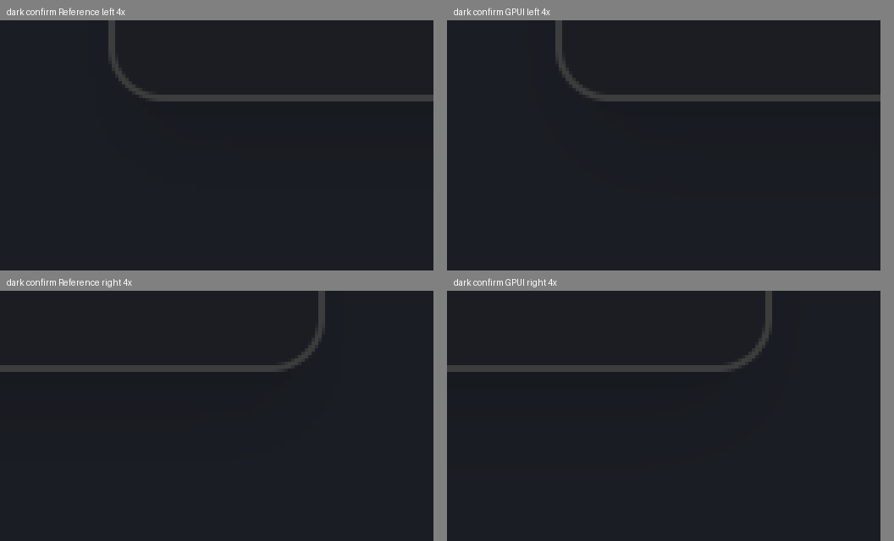
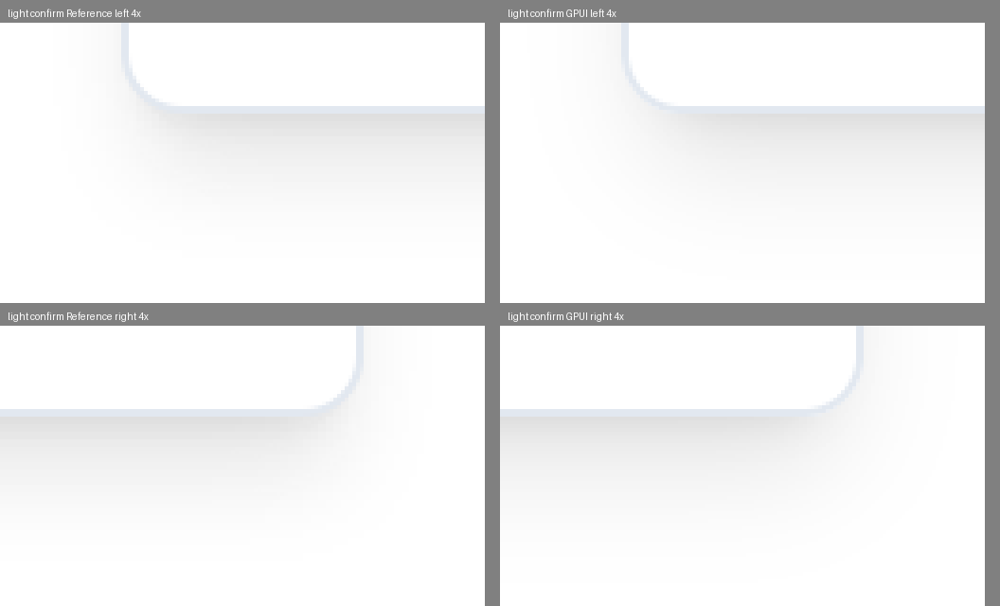

# P0-24 Dialog（macOS）

## 结论

**完成待评估。** 第 3 轮按 stone 于 2026-11-09 的授权扩展 E-001，先提交，再从干净工作区在沙箱外重新生成深浅参照并运行完整 compare。两种主题均 **10/10 屏通过**，每屏 `screenColors.pixelsAboveOne=0`，已有屏没有退步。参照提交为 `1eafb1440972baf67308485600c0d8ba1f024857`，两份结果均为 `dirty:false`，缓存目录不带 `-dirty`。完整检查通过；三屏的阴影人工核对和本轮证据见文末。

## 范围与导出部件

本轮按 `src/components/ui/dialog.tsx` 与 `src/components/ui/app-dialog.tsx` 实现 Dialog。React 导出部件及 className 如下：

| 部件                | `data-slot`          | className                                                                                                                                                                                                                   |
| ------------------- | -------------------- | --------------------------------------------------------------------------------------------------------------------------------------------------------------------------------------------------------------------------- |
| `Dialog`            | —                    | context provider，无 DOM                                                                                                                                                                                                    |
| `DialogTrigger`     | `dialog-trigger`     | 原生 button；`asChild` 时透传到子节点                                                                                                                                                                                       |
| `DialogPortal`      | —                    | portal 到 `document.body`                                                                                                                                                                                                   |
| `DialogOverlay`     | `dialog-overlay`     | `bg-background/80 fixed inset-0 z-50 backdrop-blur-sm`                                                                                                                                                                      |
| `DialogContent`     | `dialog-content`     | `bg-background pointer-events-auto fixed top-[50%] left-[50%] z-[200] grid w-full max-w-[calc(100%-2rem)] translate-x-[-50%] translate-y-[-50%] grid-cols-1 gap-4 rounded-lg border p-6 shadow-lg outline-none sm:max-w-lg` |
| `DialogClose`       | `dialog-close`       | 默认无 class；关闭按钮在 Content 中为 `absolute top-4 right-4 rounded-xs opacity-70`，focus ring `ring-2 ring-offset-2`                                                                                                     |
| `DialogHeader`      | `dialog-header`      | `flex flex-col gap-2 text-center sm:text-left`                                                                                                                                                                              |
| `DialogFooter`      | `dialog-footer`      | `flex flex-col-reverse gap-2 sm:flex-row sm:justify-end`                                                                                                                                                                    |
| `DialogTitle`       | `dialog-title`       | `text-lg leading-none font-semibold`                                                                                                                                                                                        |
| `DialogDescription` | `dialog-description` | `text-muted-foreground text-sm`                                                                                                                                                                                             |

`app-dialog.tsx` 的 `useConfirmDialog` 使用 Header、Title、Description、Footer 和 outline/default 或 destructive Button；`usePromptDialog` 在 Header 后组合生产 Input，并使用同一 Footer。GPUI 端 Dialog 生产组件复用 tterm-ui Button/Input，部件以同名 slot 构建。

## 做法与修正

沿用第一批的局部主题自绘方式；Input 继续复用 gpui-component 的编辑状态，Button 复用 tterm-ui 生产组件。Dialog 的状态与行为位于 `components/dialog.rs`，绘制位于 `dialog/presentation.rs`，真实事件测试位于 `dialog/tests.rs`。没有修改 gpui-component 全局 Theme、React 生产 CSS、设计令牌或依赖。

本轮修复了前轮实现中的实际问题：

- React 夹具改为调用生产 `useConfirmDialog` / `usePromptDialog`，在 hook 打开 portal 后只添加标记，不修改样式。破坏性确认框包含生产 `AlertTriangle` 图标。
- 宽度按 app-dialog 的 `sm:max-w-md` 为 448px，窗口较小时取 viewport 减 32px；居中由真实 viewport 的 flex 布局计算，删除 800×600 坐标常量。
- 遮罩使用背景 token 的 80% alpha，先量化 sRGB token，再用整数执行 8-bit premultiplication。避免 GPUI 浮点合成时背景多差一个通道等级；两端透明度声明仍为 0.8。
- `surface.rs::shadow_lg` 按 Tailwind v4 原值绘制两层：`0 10px 15px -3px black/10` 与 `0 4px 6px -4px black/10`；GPUI sigma 分别为 7.5px 和 3px。`shadow_lg_converts_both_css_layers_to_sigma` 校验偏移、spread 与 sigma。
- 标题 18px/600/18px；描述 14px/400/16.8px，布局块按 WebKit 当前实际高度 16px 排布，避免 GPUI 向上取整成 17px 后使整框和 X 偏半像素。当前夹具为单行描述；多行描述的排版仍需后续覆盖。
- Footer 水平、右对齐、gap 8px。GPUI 在本机系统字体把 500 匹配为 Regular，导致自动宽度丢失；Dialog 使用 400 与 600 的 advance 中值估算 500 的 intrinsic width，不使用 fixture 文本对应的宽度常量。当前最大布局偏差为 0.25px。
- X 使用脚本生成的 Lucide SVG，实际按钮为 16×16、距内容框 padding-box 顶/右 16px、opacity 0.7；删除原来的 ghost 32px 按钮。破坏性 TriangleAlert 同样来自生成脚本，来源已登记。
- 每个内部 slot 的实际 prepaint bounds 由生产组件 observer 提供；快照的字号、颜色、边框、padding 与绘制共享 `PartStyle`。两端包含 overlay、content、header、title、description、footer、close、cancel、confirm，Prompt 另含 input。

## 第 2 轮历史对比（扩展 E-001 前）

环境：Mac mini M4，macOS Apple Silicon，800×600 逻辑像素，DPR 2，WebKit 2191，100% UI scale。使用 GPUI dev bundle 的独立 `com.stone.tTerm.gpui-dev`，未运行 Tauri 正式版或访问真实数据目录。参考端 `reducedMotion=reduce`，截图禁用动画，只比较静止态。

在沙箱外依次执行，cargo 均 `CARGO_BUILD_JOBS=3`，不设置共享 target：

```sh
UPDATE_REFERENCE=1 PARITY_THEME=dark CARGO_BUILD_JOBS=3 cargo run -p tterm-parity -- compare
cp target/parity/report/result.json target/parity/report-dark.json
UPDATE_REFERENCE=1 PARITY_THEME=light CARGO_BUILD_JOBS=3 cargo run -p tterm-parity -- compare
cp target/parity/report/result.json target/parity/report-light.json
```

compare 两次均退出 1。完整原始 JSON、截图和热力图提交在 [assets/P0-24-dialog](assets/P0-24-dialog/)；本地保留 `target/parity/report-dark.json`、`target/parity/report-light.json` 及 `target/dialog-{dark,light}-compare.log`。参考缓存键为 `b649cda56f162934db144528201d5a1faceb51a6[-light]-dirty`，均用 `UPDATE_REFERENCE=1` 重新生成。

| 屏幕                    | 深色 macOS                                                                                                     | 浅色 macOS                                                                                        |
| ----------------------- | -------------------------------------------------------------------------------------------------------------- | ------------------------------------------------------------------------------------------------- |
| `ui.dialog.confirm`     | 失败：布局 9 元素、最大 0.17px、0 failure；颜色门槛 **2288px**；full 0.994687、masked 0.999949；图标 1/1 通过  | 失败：布局最大 0.17px、0 failure；颜色门槛 **2px**；full 0.994139、masked 0.999585；图标 1/1 通过 |
| `ui.dialog.destructive` | 失败：布局 9 元素、最大 0.25px、0 failure；颜色门槛 **2288px**；full 0.994007、masked 0.999946；图标 2/2 通过  | 失败：布局最大 0.25px、0 failure；颜色门槛 **2px**；full 0.993470、masked 0.999543；图标 2/2 通过 |
| `ui.dialog.prompt`      | 失败：布局 10 元素、最大 0.14px、0 failure；颜色门槛 **2496px**；full 0.990410、masked 0.999927；图标 1/1 通过 | 失败：布局最大 0.14px、0 failure；颜色门槛 **2px**；full 0.989855、masked 0.999543；图标 1/1 通过 |
| 已有 7 屏               | **7/7 通过**，每屏 screenColors.pixelsAboveOne=0                                                               | **7/7 通过**，每屏 screenColors.pixelsAboveOne=0                                                  |

第 2 轮仅使用原有 E-001 的 Switch 范围；第 3 轮已按授权扩展到 Dialog。例外登记正确位置是仓库根目录 [parity/exceptions.md](../../../parity/exceptions.md)。

## 第 2 轮阴影失败诊断（第 3 轮已获授权）

先读取 `screenColors.pixelsAboveOne`，再使用比较器的 `text_mask`、`screen_mask`、`icons::mark_icons` 相同调用链列出真正计入门槛的像素。诊断源代码与输出分别保存在 `assets/P0-24-dialog/gate-pixels-source.rs.txt` 和两主题的 `gate-pixels.txt`，未改比较器。

- 深色确认框例：物理坐标 **(349,489)**，React `(26,29,34,255)`，GPUI `(26,28,34,255)`，ΔE00 **1.164110**。直边下方也存在连续 4 个物理像素高的尾部色阶差异，不能称为“单像素圆弧抗锯齿”。内容框原点、尺寸和两层阴影参数一致；overlay 远离阴影处两端均 `(26,29,35)`，排除了遮罩整体颜色错误。残差是 GPUI 圆角阴影解析近似与 WebKit 模糊后量化不同。
- 浅色确认框只有 **(366,747)** 与 **(1233,747)** 两点：React `(234,234,234,255)`，GPUI `(239,239,239,255)`，ΔE00 **1.060197**。它们位于内容框下圆角外侧阴影，未落在现有元素边缘带。
- 深色的成带差异已核对两层 `shadow-lg` 的 offset、negative spread 与 blur/2；没有靠改变 CSS 参数、换更深浅的阴影或主题特判拟合 WebKit。

这些像素不属于决策 013 的无模糊 ring，也不属于决策 014 的图标。第 2 轮因 E-001 当时仅授权四个 Switch 而停下；第 3 轮 stone 已明确批准扩展，现按原人工判定方法核对 Dialog 阴影，并保留本节作为授权前的诊断证据。

截图：[深色 actual](assets/P0-24-dialog/dark/confirm-actual.png)、[深色 reference](assets/P0-24-dialog/dark/confirm-reference.png)、[深色热力图](assets/P0-24-dialog/dark/confirm-heatmap.png)；[浅色 actual](assets/P0-24-dialog/light/confirm-actual.png)、[浅色 reference](assets/P0-24-dialog/light/confirm-reference.png)、[浅色热力图](assets/P0-24-dialog/light/confirm-heatmap.png)。另外两屏的对应三张图也在同目录。

## 交互与主题隔离证据

以下均为 `#[gpui_kit::test]`，通过 `TestAppContext` / `VisualTestContext` 渲染真实 Dialog，再派发按键或鼠标事件；没有以常量断言替代交互。

| 行为                                        | 测试名                                                     |
| ------------------------------------------- | ---------------------------------------------------------- |
| Esc 关闭                                    | `escape_closes_dialog`                                     |
| 点击遮罩关闭                                | `overlay_click_closes_dialog`                              |
| onInteractOutside.preventDefault 阻止关闭   | `outside_hook_can_prevent_dismissal`                       |
| 点击内容不关闭                              | `content_click_keeps_dialog_open`                          |
| X 点击关闭                                  | `close_button_closes_dialog`                               |
| Tab 与 Shift+Tab 环绕、不逃逸               | `tab_and_shift_tab_cycle_focus`                            |
| Prompt 输入、Shift+Tab 到 X、Tab 回到 Input | `prompt_tab_cycle_includes_editable_input`                 |
| 关闭后归还 opener 焦点                      | `closing_restores_the_saved_focus_handle`                  |
| Enter 激活取消/确认/X                       | `keyboard_activates_each_dialog_button`                    |
| 同窗口深浅 Dialog 渲染且全局 Theme 不变     | `rendering_two_dialog_themes_does_not_mutate_global_theme` |

GPUI 打开时从 `window.focused(cx)` 保存真实 handle，Prompt 初始 focus 输入，否则 focus 内容；关闭时恢复。React `restoreFocus` 还包含终端焦点栈/DOM 活性判断，GPUI 当前没有该应用级后备栈，恢复的是仍存在的 handle。React 原始 Dialog 并未实现 Tab trap；本轮按明确要求在 GPUI 的 capture-key 边界实现循环，报告该行为差别。

主题隔离测试前后序列化全局 Theme，在同一窗口放置 DARK/LIGHT 两个真实 Dialog，observer 确认两个 content 均以各自背景主题完成 prepaint，然后断言全局 Theme 完全相同。

## 检查

沙箱外完整前端检查：lint、format:check、check:tokens、typecheck、test、check:size。Vitest **174 文件、1294 测试通过**，无跳过。完整 Rust `cargo fmt --all --check`、`cargo clippy --workspace --all-targets -- -D warnings` 和 `cargo test --workspace`，cargo 均带 `CARGO_BUILD_JOBS=3`；原始日志在 `target/dialog-clippy-final.log`、`target/dialog-workspace-tests-final.log`。应用枚举 `macos_lists_the_applications_for_text_with_icons` 在沙箱外通过。

没有给 `cargo test --workspace` 传过滤器、skip 或 ignored 参数。仓库本来标记的 52 个需要外部服务/真实设备的 ignored 测试仍由默认 cargo 行为保留；不能宣称它们已执行。本轮没有新增 ignored 测试。最终 tterm-ui 为 **40/40** 通过；完整 Rust 原始输出也附在 `assets/P0-24-dialog/workspace-tests.log`，clippy 输出附在同目录 `clippy.log`。

## 偏差、未验证与 [人工]

- Windows 通道：未验证（需 Windows）。
- `[人工]` 淡入/缩放动画未实现；当前 React Dialog 本身也未提供这两项入场动画 class，静止比较不包含动画。
- `[人工]` 真实键盘中文输入法、系统辅助功能及 Tauri 真窗口交叉截图；自动化交互测试已执行，不再标为未验证。
- 多行描述与较窄窗口的完整视觉矩阵尚未覆盖。当前描述高度按单行 WebKit 的实际 16px 处理，扩展多行需单独校验；本轮不把这点掩饰为通用完整排版。

## 第 3 轮：E-001 扩展与干净工作区复跑

2026-11-09，决策人 stone 已授权 E-001 扩展到三个 Dialog 的内容框外 25px。`parity/exceptions.md` 保留原有标题与段落，追加授权范围；manifest 只为三屏引用 E-001，不修改门槛或通用遮罩。

浅色旧结果的两点均在授权范围内：确认框/破坏性确认框底边 y=372 CSS px，超限物理坐标 (366,747)、(1233,747) 对应逻辑坐标 (183,373.5)、(616.5,373.5)，在底边外 1.5px，处于 outset 25 内。Prompt 底边 y=398，对应两点物理坐标为 (366,799)、(1233,799)，同样在底边外 1.5px。复跑时重新验证门槛结果。

### 干净参照与执行结果

先提交 `1eafb144`（`:white_check_mark: extend approved shadow exception to dialog content`），提交例外、三屏 manifest 引用及本节初始说明。两次 compare 开始前均执行 `test -z "$(git status --porcelain)"`，两次之间只保存 `target/` 中的结果，没有修改已跟踪文件。两次均退出 0，执行命令与上方相同，均使用 `UPDATE_REFERENCE=1`、`CARGO_BUILD_JOBS=3` 并在沙箱外运行。

- 深色参照目录：`target/parity/reference/1eafb1440972baf67308485600c0d8ba1f024857/`。
- 浅色参照目录：`target/parity/reference/1eafb1440972baf67308485600c0d8ba1f024857-light/`。
- 两份 JSON 均记载 `reference.frontendCommit=1eafb1440972baf67308485600c0d8ba1f024857`、`reference.dirty=false`；没有 `-dirty` 参照。
- 每次运行后分别保存 `target/parity/report-dark.json`、`target/parity/report-light.json`。提交的原始结果：[深色 JSON](assets/P0-24-dialog/round3/report-dark.json)、[浅色 JSON](assets/P0-24-dialog/round3/report-light.json)；原始命令日志：[深色](assets/P0-24-dialog/round3/compare-dark.log)、[浅色](assets/P0-24-dialog/round3/compare-light.log)。JSON 中图像相对路径保留工具输出；本轮 Dialog 原始截图及布局另存于证据目录的 `dark/`、`light/`。

下表直接取本轮 JSON 的 `passed`、`screenColors.pixelsAboveOne` 和 `exceptions`，不以元素颜色诊断数代替屏幕门槛计数。

| 屏幕                           | 深色结果 / 门槛像素 | 浅色结果 / 门槛像素 | 深浅两端使用的例外 |
| ------------------------------ | ------------------- | ------------------- | ------------------ |
| `example.button-input.default` | 通过 / 0            | 通过 / 0            | 无                 |
| `ui.button.variants`           | 通过 / 0            | 通过 / 0            | 无                 |
| `ui.button.sizes`              | 通过 / 0            | 通过 / 0            | 无                 |
| `ui.input.default`             | 通过 / 0            | 通过 / 0            | 无                 |
| `ui.password.default`          | 通过 / 0            | 通过 / 0            | 无                 |
| `ui.select.default`            | 通过 / 0            | 通过 / 0            | 无                 |
| `ui.switch.default`            | 通过 / 0            | 通过 / 0            | E-001              |
| `ui.dialog.confirm`            | 通过 / 0            | 通过 / 0            | E-001              |
| `ui.dialog.destructive`        | 通过 / 0            | 通过 / 0            | E-001              |
| `ui.dialog.prompt`             | 通过 / 0            | 通过 / 0            | E-001              |

Dialog 的细项如下（布局单位 CSS px；full / masked 为 SSIM）：

| 屏幕                    | 布局（深浅一致）              | 深色 full / masked  | 浅色 full / masked  | 深浅图标 |
| ----------------------- | ----------------------------- | ------------------- | ------------------- | -------- |
| `ui.dialog.confirm`     | 9 元素，最大 0.17，0 failure  | 0.994687 / 0.999967 | 0.994139 / 0.999692 | 1/1 通过 |
| `ui.dialog.destructive` | 9 元素，最大 0.25，0 failure  | 0.994007 / 0.999964 | 0.993470 / 0.999649 | 2/2 通过 |
| `ui.dialog.prompt`      | 10 元素，最大 0.14，0 failure | 0.990410 / 0.999952 | 0.989855 / 0.999678 | 1/1 通过 |

应用 E-001 后，三屏 screenColors.maxDeltaE 深色均为 0.6928、浅色均为 0.9965。内容框本身继续参加布局、样式和像素比较；只排除 manifest 中对应内容框 border box 外的 25 CSS px，未修改比较器、通过门槛、文字遮罩或通用边缘带。

### 阴影像素复核

本轮原图重新统计内容框 border box 外、outset 25 内的 RGB 通道最大差：深色 confirm/destructive 每屏差 1 级的 **10,030** 个、差 2 级的 **24** 个；prompt 差 1 级的 **10,862** 个、差 2 级的 **24** 个，与前轮相同。授权前诊断最大 CIEDE2000 为 **1.49**；本轮阴影截图与前轮逐像素相同。这里的 RGB 差异数量不是应用例外后的门槛计数。

浅色前述两点本轮仍分别为参照 `(234,234,234)`、GPUI `(239,239,239)`；三屏均在底边外 1.5 CSS px、outset 25 内，没有范围外遗留点。浅色框外还有未达到 ΔE00 门槛的微小差异，不能把“2 个超限像素”误读为“仅 2 个像素不同”。坐标、范围、RGB 差值分布及裁剪参数保存在 [crop-metadata.json](assets/P0-24-dialog/round3/crop-metadata.json)。原因及判定规则沿用 [E-001](../../../parity/exceptions.md)，不另设标准。

### 人工核对

逐屏查看本轮深浅原图的内容框下沿，并按 E-001 方法以最近邻放大到 **400%（每个物理像素变为 4×4）** 核对：阴影方向向下、范围和深浅与参照一致，未见缺失、位置偏移或明显偏深偏浅。并排图左为 Reference / WebKit，右为 GPUI；全宽图覆盖内容框左右各 25 CSS px、底边内 12px 至底边外 25px。另存左右圆角局部图，便于在报告内按原分辨率查看；未做颜色增强、平滑插值或对齐平移。

| 屏幕                    | 深色 400% 核对                      | 浅色 400% 核对                      | 全下沿并排图                                                                                                                                  | 圆角并排图                                                                                                                              |
| ----------------------- | ----------------------------------- | ----------------------------------- | --------------------------------------------------------------------------------------------------------------------------------------------- | --------------------------------------------------------------------------------------------------------------------------------------- |
| `ui.dialog.confirm`     | 方向、范围、深浅一致，按 E-001 通过 | 方向、范围、深浅一致，按 E-001 通过 | [深色](assets/P0-24-dialog/round3/dark/confirm-lower-edge-4x.png)、[浅色](assets/P0-24-dialog/round3/light/confirm-lower-edge-4x.png)         | [深色](assets/P0-24-dialog/round3/dark/confirm-corners-4x.png)、[浅色](assets/P0-24-dialog/round3/light/confirm-corners-4x.png)         |
| `ui.dialog.destructive` | 方向、范围、深浅一致，按 E-001 通过 | 方向、范围、深浅一致，按 E-001 通过 | [深色](assets/P0-24-dialog/round3/dark/destructive-lower-edge-4x.png)、[浅色](assets/P0-24-dialog/round3/light/destructive-lower-edge-4x.png) | [深色](assets/P0-24-dialog/round3/dark/destructive-corners-4x.png)、[浅色](assets/P0-24-dialog/round3/light/destructive-corners-4x.png) |
| `ui.dialog.prompt`      | 方向、范围、深浅一致，按 E-001 通过 | 方向、范围、深浅一致，按 E-001 通过 | [深色](assets/P0-24-dialog/round3/dark/prompt-lower-edge-4x.png)、[浅色](assets/P0-24-dialog/round3/light/prompt-lower-edge-4x.png)           | [深色](assets/P0-24-dialog/round3/dark/prompt-corners-4x.png)、[浅色](assets/P0-24-dialog/round3/light/prompt-corners-4x.png)           |

示例（全分辨率并排证据见表中链接）：





### 本轮完整检查

在沙箱外运行 AGENTS.md 的全部检查：`pnpm lint && pnpm format:check && pnpm check:tokens && pnpm typecheck && pnpm test && pnpm check:size`，均通过，Vitest **174 文件、1294 测试通过**。Rust 的 `cargo fmt --all --check`、`cargo clippy --workspace --all-targets -- -D warnings`、`cargo test --workspace` 均通过，均带 `CARGO_BUILD_JOBS=3`，没有使用共享 target。Rust 共 **1169 passed、0 failed、52 ignored**（仓库原有 ignored，无新增或命令行跳过），tterm-ui **40/40** 通过；`macos_lists_the_applications_for_text_with_icons` 在沙箱外通过。交互与主题隔离测试名沿用上表，本轮完整 workspace 测试再次覆盖。

本轮日志：[clippy](assets/P0-24-dialog/round3/clippy.log)、[workspace tests](assets/P0-24-dialog/round3/tests.log)、[文件大小](assets/P0-24-dialog/round3/size.log)。本轮没有修改生产组件，报告与证据在对比结束后提交。没有合并或 push。Windows、动画和人工输入法等未覆盖项仍按上方“偏差、未验证与 [人工]”保留；本机静止对比、交互测试、主题隔离及完整检查均已验证。
