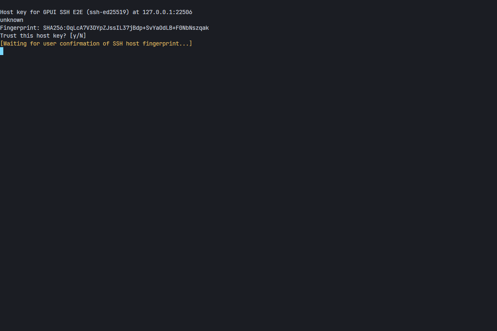
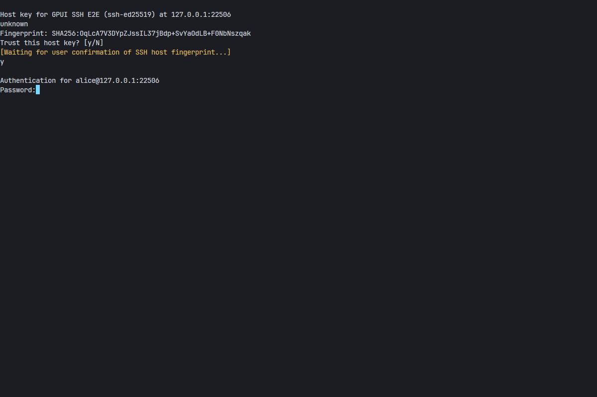
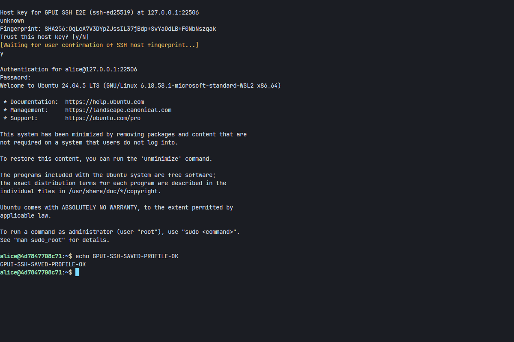

# P1-12 无界面集成测试与原型接入 SSH

- 执行者：Codex
- 当前分支：`codex/P1-12-runtime-prototype`，本轮从 `2dd150fc` 接续
- 相关提交：`5a61e2ff`、`fafe68b3`、`9bd9f020`
- 本机：Windows 11，使用仓库固定的 Rust 与 pnpm 工具链

## 结论

**完成（Windows）。** GPUI 原型现在使用与 Tauri 客户端相同的生产 `AppServices`
建立本地和 SSH 会话，可以直接打开隔离 GPUI 数据库中的已保存连接，在终端内完成
主机密钥确认和密码认证，并正常关闭。真实两跳 SSH 集成测试已在 Windows 通过。
macOS 真机验收按[决策 016](../decisions/016-mac-windows-either.md)记为待补；Linux
桌面验证推迟到 Linux 发布之前。

## 改动

### 提交

| 提交       | 内容                                                         |
| ---------- | ------------------------------------------------------------ |
| `5a61e2ff` | `:white_check_mark: Route PTY lifecycle through AppServices` |
| `fafe68b3` | `:recycle: Share saved SSH profile connection mapping`       |
| `9bd9f020` | `:sparkles: Route the GPUI terminal through AppServices`     |

### 生产服务启动与隔离数据

`crates/tterm-gpui/src/terminal_demo/runtime.rs` 在打开窗口前组装完整
`AppServices`，而不是复用测试启动器。启动顺序为：

1. 安装版本信息并从 `AppPaths::native` 解析 GPUI 开发版路径。
2. 初始化配置目录、数据库和 `AppIdentity`。
3. 建立 Tokio 多线程运行时、事件 sink、`PromptBroker`、密钥状态与 key vault。
4. 建立 session、SFTP 和 app 级服务，并处理原生通知。
5. 把事件接收端和运行时生命周期交给 GPUI 窗口。

GPUI 使用独立应用标识 `com.stone.tTerm.gpui-dev`。配置、数据库、日志、
缓存和本地数据都由这个标识派生，因此原型与 Tauri 版不会同时写同一组文件。未接入
GPUI 的托盘、文件拖出、剪贴板、打开文件、更新器和系统验证由
`runtime/platform.rs` 中明确的 unavailable adapter 返回错误，避免静默成功。

### 已保存连接与提示

`crates/tterm-core/src/profiles/connection.rs` 成为两个客户端共用的 profile
到 `PtyConnectionOptions` 映射。它保留已保存密码忽略开关、agent forwarding、
编码、shell integration、会话日志、跳板和 proxy 选择。

GPUI 的命令行行为现在是：

- 无参数时通过 `AppServices` 启动自动选择的本地 shell。
- `--exec <program> [args...]` 通过同一个本地会话入口运行固定工作负载。
- `--ssh <id-or-name>` 从隔离数据库读取已保存 profile。ID 优先；名称匹配不区分
  大小写，重名时要求改用 ID。

`session.rs`、`pipeline.rs`、`prompt.rs` 和 `window.rs` 把会话建立、输入、resize、
输出解析、退出和关闭生命周期接到 `AppServices`。输出进入容量为 8 个 chunk 的
有界队列，再按最多 64 KiB 批量写入终端模型；查询回复按解析顺序经
`AppServices::write_pty` 返回。主机密钥和认证提示直接画进终端。没有已保存密码时
改用交互认证；Ctrl+C 取消当前提示并把后续输入交还会话。

GPUI crate 已移除对 `portable-pty` 和 `async-channel` 的直接依赖。自动化与 replay
改用 Tokio channel，原型不再启动系统 `ssh`，也不再自行创建 PTY、子进程或专属
writer 线程。

### 主要文件

| 文件                                                      | 职责                                                |
| --------------------------------------------------------- | --------------------------------------------------- |
| `crates/tterm-gpui/src/terminal_demo/runtime.rs`          | 生产 `AppServices` 启动、隔离路径、运行时与事件通道 |
| `crates/tterm-gpui/src/terminal_demo/runtime/platform.rs` | 原生通知与尚未接入平台的显式适配器                  |
| `crates/tterm-gpui/src/terminal_demo/command.rs`          | 本地 shell、`--exec`、保存 profile 的选择与连接参数 |
| `crates/tterm-gpui/src/terminal_demo/session.rs`          | `AppServices` 会话、sink、退出与关闭                |
| `crates/tterm-gpui/src/terminal_demo/pipeline.rs`         | 有界输出队列、终端解析、输出确认和查询回复          |
| `crates/tterm-gpui/src/terminal_demo/prompt.rs`           | 主机密钥与认证提示的终端输入状态机                  |
| `crates/tterm-gpui/src/terminal_demo/window.rs`           | 终端视图、事件泵、窗口标题和会话所有权              |
| `crates/tterm-core/src/profiles/connection.rs`            | Tauri 与 GPUI 共用的保存 profile 映射               |
| `crates/tterm-core/src/services/tests/session.rs`         | 本地与两跳 SSH 的 `AppServices` 集成测试            |

## 验收

| 验收条件（照抄任务卡）                                                                                   | 结果 | 证据                                                                                                                                                                                                                                                                                                                                                     |
| -------------------------------------------------------------------------------------------------------- | ---- | -------------------------------------------------------------------------------------------------------------------------------------------------------------------------------------------------------------------------------------------------------------------------------------------------------------------------------------------------------- |
| 集成测试在 macOS 或 Windows 上通过，附运行输出（决策 016；Linux 由 CI 编译与运行不需要测试主机的部分）。 | 通过 | Windows 上执行 `cargo test -p tterm-core --lib services::tests::session::app_services_ssh_through_jump_hosts_uses_prompts_and_round_trips -- --ignored --nocapture`，设置 `P1_12_ORBSTACK=1` 后为 **1 passed**。链路包含两个跳板和目标，依次处理 3 个主机密钥提示与 3 个认证提示，完成命令往返，关闭输出并等待全部任务结束。macOS 记为待补（决策 016）。 |
| 原型中可以打开一个保存在 tTerm 数据库中的 SSH 连接，完成主机密钥确认和密码认证，并正常关闭。             | 通过 | 自动化驱动实际 GPUI 窗口，从隔离数据库载入一次性 `GPUI SSH E2E` profile；窗口显示 fingerprint，接受 `y`，显示密码提示，认证后执行 `echo GPUI-SSH-SAVED-PROFILE-OK` 并得到同字符串，随后关闭窗口。截图见下方。                                                                                                                                            |
| Tauri 版与原型不同时写同一个数据库：原型使用隔离的数据目录，报告说明做法。                               | 通过 | 原型固定使用 `com.stone.tTerm.gpui-dev`，由 `AppPaths::native` 派生自己的配置目录与 `tterm.db`；Tauri 使用正式应用标识。启动时只初始化这套 GPUI 路径和数据库。                                                                                                                                                                                           |

实际保存 profile 窗口流程：







开发自动化先验证了 focus、文本输入、窗口标题、截图、关闭和 token 清理，截图见
[gpui-automation.png](assets/P1-12/gpui-automation.png)。一次性容器、网络、镜像和测试
profile 在验证后均已删除。

## 检查

最终工作树从仓库根执行了 AGENTS.md 要求的全部检查：

```sh
pnpm lint && pnpm format:check && pnpm check:tokens && pnpm typecheck && pnpm test && pnpm check:size
cargo fmt --all --check && cargo clippy --workspace --all-targets -- -D warnings && cargo test --workspace
```

| 检查                                                      | 结果                                                                                               |
| --------------------------------------------------------- | -------------------------------------------------------------------------------------------------- |
| 前端 lint、format、tokens、typecheck、test、size          | 通过。Vitest 183 files / 1354 tests；parity 2 passed；migration 8 passed；1399 files within limits |
| Rust fmt、workspace clippy、workspace tests               | 通过。clippy 使用 `-D warnings`，没有新增 `allow`、`expect` 或 size baseline 条目                  |
| `cargo test -p tterm-gpui --lib`                          | 通过，16 passed                                                                                    |
| `cargo clippy -p tterm-gpui --all-targets -- -D warnings` | 通过                                                                                               |
| Windows 两跳 SSH 集成测试                                 | 通过，1 passed                                                                                     |
| GPUI 自动化 smoke                                         | 通过                                                                                               |
| GPUI 已保存 profile 的主机密钥、密码、命令往返和关闭      | 通过                                                                                               |

首次在文件系统沙箱内运行 `pnpm test` 时，Vite 的 Windows 子进程启动返回
`spawn EPERM`；在仓库要求的本机权限下重跑后完整通过。该失败来自沙箱的进程启动
限制，不是测试或实现失败。

## 偏差

1. `--ssh` 的含义从 P0-14 的“系统 ssh 目标”改为“已保存 profile 的 ID 或唯一名称”。
   这是 P1-12 要求使用生产连接映射和隔离数据库的直接结果；旧目标字符串不再由
   原型解析。
2. 两跳 SSH 测试的每个 hop 使用 `auto` 认证，以覆盖服务器实际提供的密码与
   keyboard-interactive 方法，而不是只强制其中一种方法。测试仍会验证每个 hop
   和目标的提示数量、命令往返、关闭与会话任务结束。
3. 本轮只在 Windows 真机完成 P1-12 验收。macOS 同一流程未运行，按决策 016
   待补；Linux 桌面项推迟，三平台 CI 编译与测试仍属于后续检查。

## 遗留问题

- macOS 需要补跑两跳 SSH 集成测试和实际 GPUI 保存 profile 窗口流程。macOS
  登录 shell 环境也仍需在真机确认；本轮没有 macOS 运行证据。
- GPUI 当前只承载一个终端窗口。多标签、完整平台集成和产品级会话恢复不在本卡
  范围内；未接平台的 adapter 会返回明确错误。
- Windows 的 `--exec` 参数目前不能表示包含双引号的单个参数，会直接报错而不是
  生成可能被 shell 误解析的命令行。该限制只影响原型工作负载入口。

本报告没有修改 `docs/gpui-migration/status.md`，没有合并或推送分支，并保留
`.pi-sessions/`、`P1-11g-g1.pi.jsonl` 与 `pi-task.prompt.md` 为未跟踪文件。
