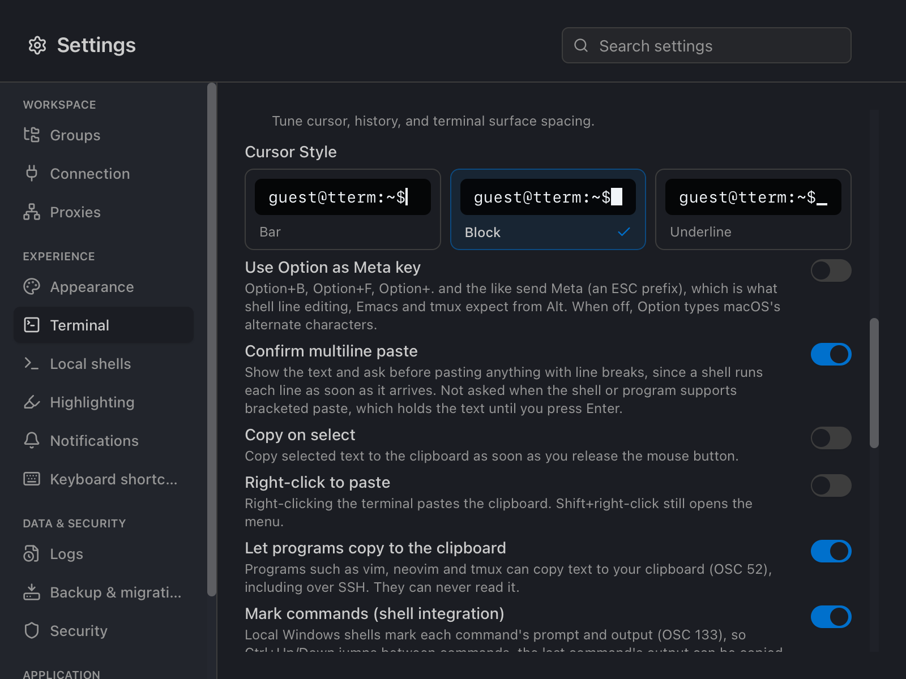
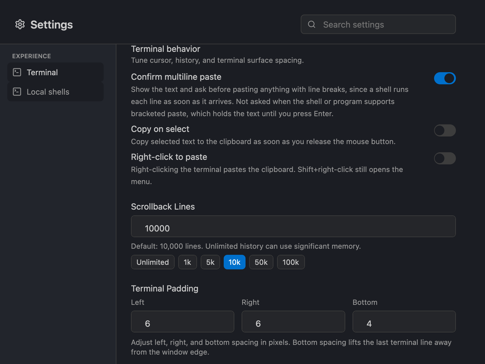

# P4-16 第四批：剪贴板设置与终端手势

从 `3833e580` 开始，按配置文件、设置页、运行时三项派给 pi + DeepSeek v4.1 Flash；核对原版时发现 Shift+右键尚无真实菜单，另派一项补复制/粘贴菜单。沿用整页一次保存，不另设剪贴板保存按钮。终端页累计覆盖 12/18 个字段。

| 路径 | 验收依据 |
| --- | --- |
| 搜索、编辑、保存、重开 | 三个开关支持键盘操作；未保存不改窗格；失败保留草稿可重试。保存合并最新磁盘内容，只更新改过的字段，按写入后的回读结果更新已有、分屏和新建窗格。 |
| 选中即复制 | 仅本地非空选区释放时复制；空选区不清空剪贴板。 |
| 右键 | 开启时普通本地右键粘贴；关闭时或按 Shift 右键打开被点窗格的复制/粘贴菜单。未加修饰的应用鼠标报告不被劫持。Esc 或点击菜单外关闭，不触发粘贴。 |
| 粘贴确认 | 键盘、右键和菜单共用确认路径。普通多行粘贴等待，取消时发送零字节，确认才投递；bracketed paste 不重复询问。改变设置不会自动批准已有请求。 |

| React / WebKit | GPUI 生产设置页 / headless |
| --- | --- |
|  |  |

两端均为英文、dark/classic、100%、800×600 逻辑像素、DPR 2，使用隔离配置。对照图验证开关顺序、标签、默认状态与长文换行，不证明整页像素对齐。右键粘贴的默认值随平台变化（Windows 开，其他平台关）。本批只覆盖菜单的复制与粘贴；Windows、原生桌面真实剪贴板及其他缩放仍待人工验收。

自动验收：六项 pnpm 检查、Rust 格式、全工作区严格 Clippy、截图示例严格 Clippy 与 `cargo test --workspace` 均通过。GPUI 库测试 411 项通过、12 项按配置忽略。独立 release 门两项均通过：30 个后台会话下前台帧 p95 为 **0.140 ms**（预算 16.667 ms），30 MiB 全部应用并确认，用时 **153.945 ms**（上限 500 ms），吞吐 **194.87 MiB/s**。这是本机固定负载测量，不是 Ghostty 对比或桌面验收。
