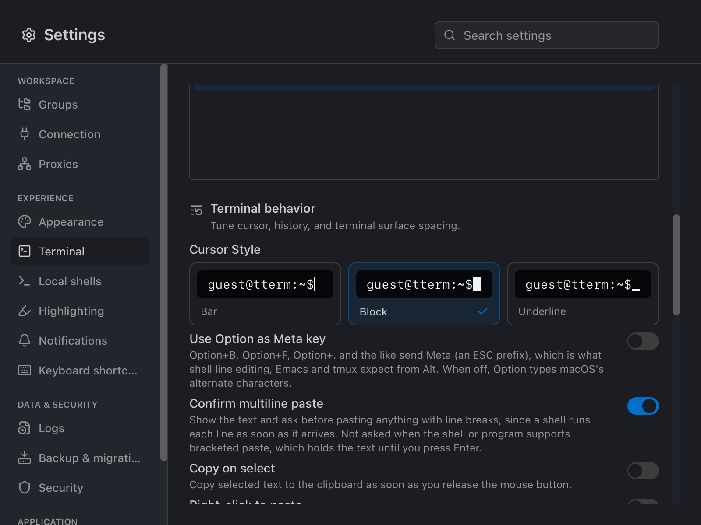
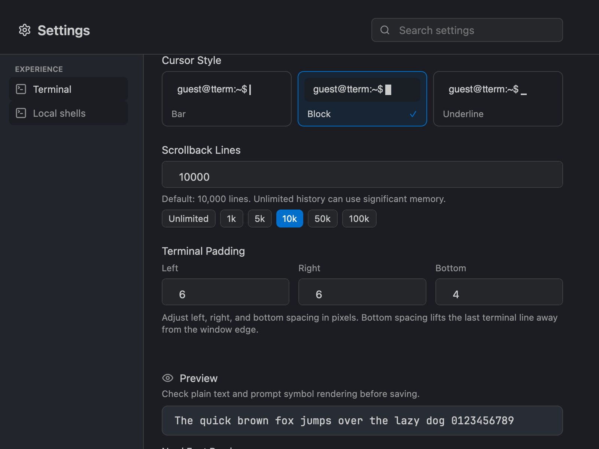
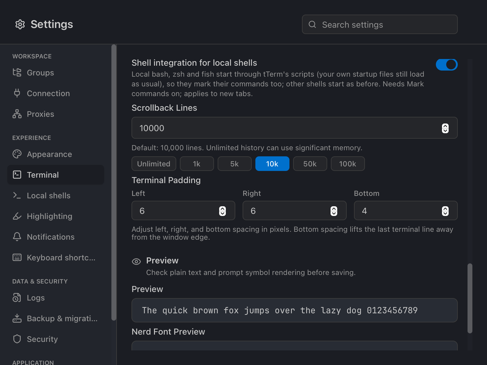
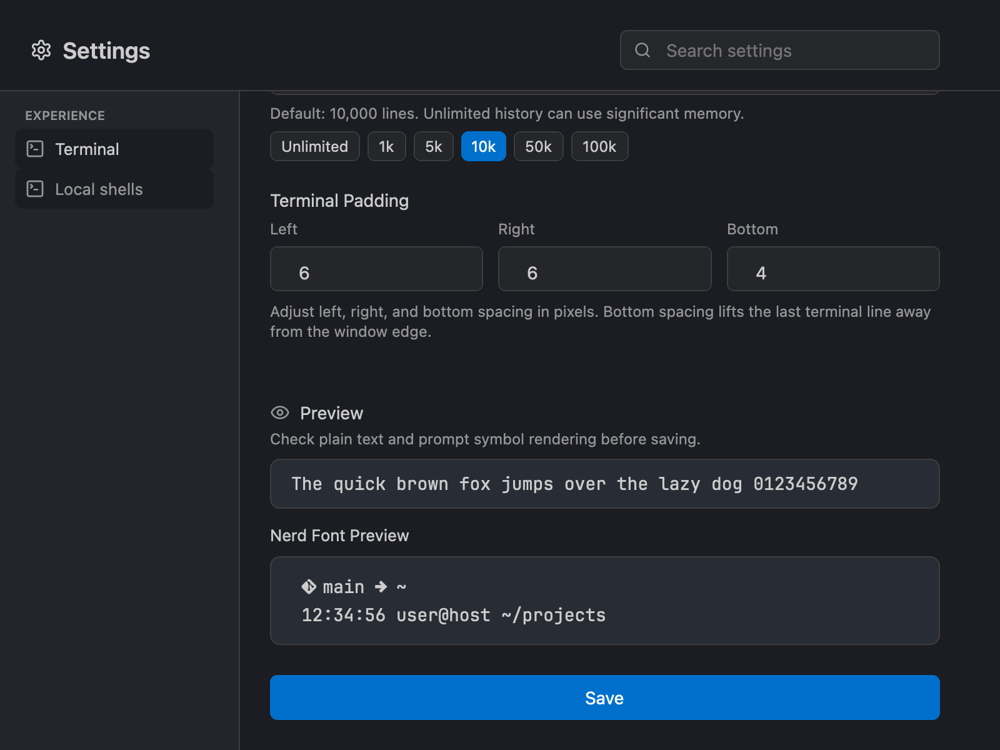

# P4-16 第三批：光标样式与终端内边距

上一批已提交 `9eb24d8b`。本批由三项 pi + DeepSeek v4.1 Flash 任务分别实现配置、设置交互与终端运行时，协调者负责集成验收。终端页覆盖 9/18 个配置字段，不代表整页视觉通过。

## 操作路径与验收范围

- 在「设置 → 终端」搜索光标或内边距。选择块、竖线或下划线；左、右、下边距分别接受 0–80 的整数逻辑像素，默认 6/6/4，没有上边距字段。
- 点击页尾保存，已有及新建的终端使用提交后的设置。程序显式指定的光标优先于用户默认形状，程序重置时恢复默认；程序隐藏光标时不强行绘制。
- 配置文件测试使用临时目录：一次更新仅合并用户改过的字段；非法输入不写文件，磁盘中后来修改但本次未编辑的字段不被覆盖。
- 网格绘制、命中与尺寸采用扣除边距的内容区。视图测试已验证非对称边距、边界、极小窗格，以及修改边距后重新计算网格；指针测试验证在边距内点击不会向终端程序发送单元格事件。

| 状态 | 原版 React / WebKit | GPUI 生产设置页 / headless |
| --- | --- | --- |
| 光标样式 |  |  |
| 内边距 |  |  |

截图条件为英文、dark/classic、100%、800×600 逻辑像素、DPR 2。原版脚本将目标滚入视口，GPUI 通过设置搜索进入目标。截图用于核对控件和默认值；不要求两个视口的滚动位置相同。原生桌面、Windows、多缩放和整页像素对齐仍待验。

## 自动验收结果

- 六项 pnpm 检查、`cargo fmt --all --check`、全工作区严格 Clippy 和 `cargo test --workspace` 全部通过。启用 `automation` 的 `settings_capture` 示例另行通过严格 Clippy，并成功生成上表两张 GPUI 截图。
- 保存后重开设置、非法边距保留草稿、分屏和新建窗格采用已保存值、应用覆盖或隐藏光标及重置后的恢复，均有通过的用例。
- 本机 macOS arm64 独立 release 测量：30 个后台会话全部在采样期间推进，前台加载帧 p95 为 **0.985 ms**（预算 16.667 ms）；独立吞吐测量中 30 MiB 全部应用并确认，用时 **176.071 ms**（上限 500 ms），吞吐 **170.39 MiB/s**。这不是原生桌面验收或与 Ghostty 的对比测量。
