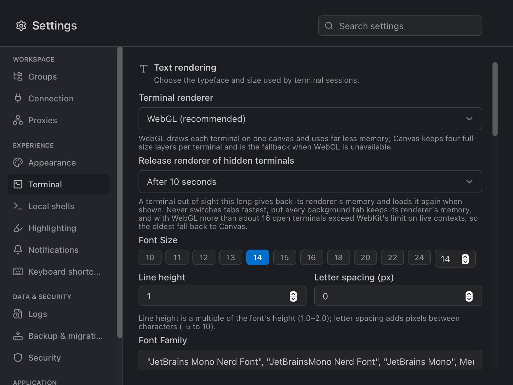
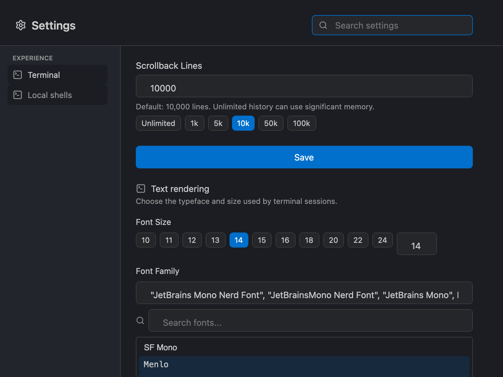

# P4-16 首批：终端字体、字号和预览

2026-11-25，macOS，`GPUI` 本地工作树。执行分为三个 pi + DeepSeek v4.1 Flash 任务：设置控件、共享配置写入、终端视图。协调者集成、实跑回归、对照截图。结论：**字体操作流程可用；设置整页尚未对齐。**

## 用户路径与验证

1. 打开「设置 → 终端」，在「文字渲染」手输字体系列或搜索并选中系统字体。字号支持预设及 6–72 逻辑像素。普通文字与提示符预览跟随草稿；取消恢复原值，不改终端。
2. 点字体区的保存。测试在有两个真实 PTY 的窗口里经搜索进入输入框，键入字体、字号并保存，断言两个视图采用新配置，重开页面仍读到保存值。模拟写盘失败时原视图字号不变，草稿可重试。
3. 可见分屏重新测量字符网格，模型与会话绑定未更换；后台标签保留新字体，在切回时再测量。重复等价设置不重复测量；新建窗格从已保存的配置初始化。
4. 持久化单独使用临时 `config.json` 验证：写后重新加载得到同一对值，不覆盖不相关的设置或未知字段，不覆盖损坏文件。没有触碰日常配置，也没有把重开页面说成原生双客户端重启实测。

## 同状态完整视口对照

| Tauri 的 React 页面（WebKit） | GPUI 生产页面（headless） |
| --- | --- |
|  |  |

两张截图都是终端页顶部、默认字体链、字号 14、三个夹具字体、英文、深色 classic、100%、800×600 内容视口、2× 采样；未裁切。原版通过侧栏进入，GPUI 打开时焦点在搜索框。原版第一组是文字渲染，包含渲染器、后台释放、字号、行高、字距；GPUI 页首仍是回滚字段及其保存按钮，随后才是字体组。侧栏也只有两个可操作页面。**截图说明结构仍有差异，不是整页像素通过；不是 Windows 或原生桌面截图。**

复现（从仓库根执行；截图配置隔离）：

```sh
node scripts/parity/capture.mjs --screen settings.terminal.font --out target/parity/p416-reference
cargo run -p tterm-gpui --example settings_capture --features automation -- --output target/parity/p416-gpui
```

## 后续

最终工作树通过六项 pnpm 检查、`cargo fmt --all --check`、严格 workspace Clippy 和 `cargo test --workspace`。独立 release 检查：30 个后台会话都有进展，前台 p95 为 **122.875 µs**（上限 16.667 ms）；30 MiB 全部应用并确认耗时 **150.282 ms**（上限 500 ms），即 **199.62 MiB/s**。这是测试夹具测量，不是桌面帧率或与 Ghostty 的对比。

先做行高、字距与同组预览，再对齐原版字段顺序和整页保存语义。Windows 原生字体回退、多缩放、浅色、双客户端互操作与整页桌面验收待补；不是 P4-16 整卡或 G2 签收。
