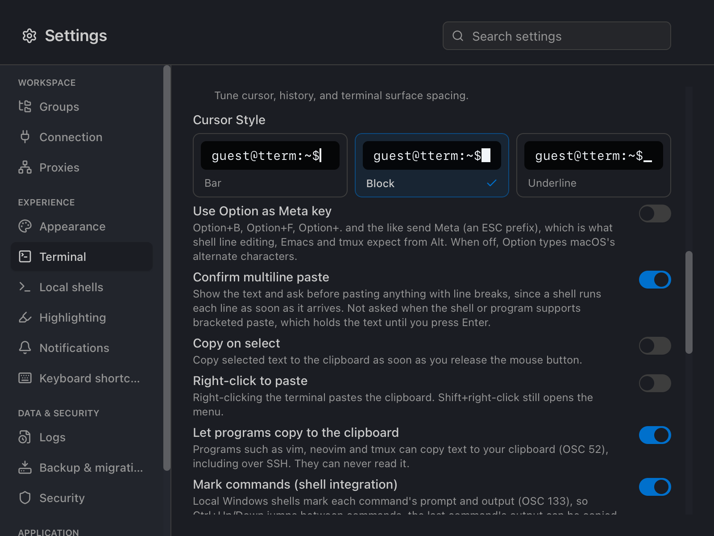
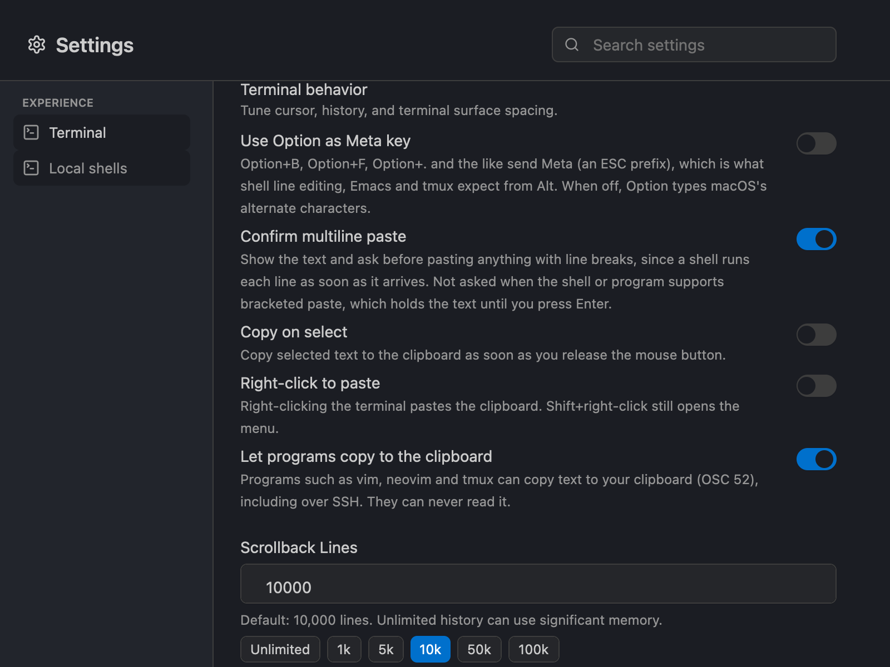

# P4-16 第五批：OSC 52 写权限与 macOS Option 作为 Meta

起点 `a8e5de3e`。配置、设置页和运行时由 pi + DeepSeek v4.1 Flash 分工实施；后续模型路由不可用，协调者完成运行时接线、在途权限检查与验收。

- 一次整页保存，写失败保留旧策略。OSC 52 仅允许程序写普通剪贴板，不能读取。已有会话和以后创建的会话采用保存值；关闭会撤销尚未送达的写入，快速关闭再开启不会重放旧文本。
- Option 开关仅 macOS 可见、可搜索。输入接收端验证：同一个视图中，关闭时 `Option+O` 输入 `ø`，开启时得到 `ESC` + `o`，再关闭恢复组合字符；其他平台沿用原来的 Alt 编码策略。
- 同状态截图：英文、dark/classic、100%、800×600、DPR 2，使用隔离配置。对照用于核对顺序、默认状态及说明，不是整页像素验收或真实系统剪贴板验收。

| React / WebKit | GPUI 生产设置页 / headless |
| --- | --- |
|  |  |

六项 pnpm 检查、Rust 格式、严格工作区 Clippy、截图示例严格 Clippy 和工作区测试均通过。GPUI 库测试 416 项通过、12 项按配置忽略。独立 release 测量：30 个后台会话全部推进，前台帧 p95 为 **0.152 ms**（预算 16.667 ms）；独立 30 MiB 吞吐测试用时 **153.238 ms**（上限 500 ms），**195.77 MiB/s**。以上为本机固定负载结果，不是 G2 桌面验收。
