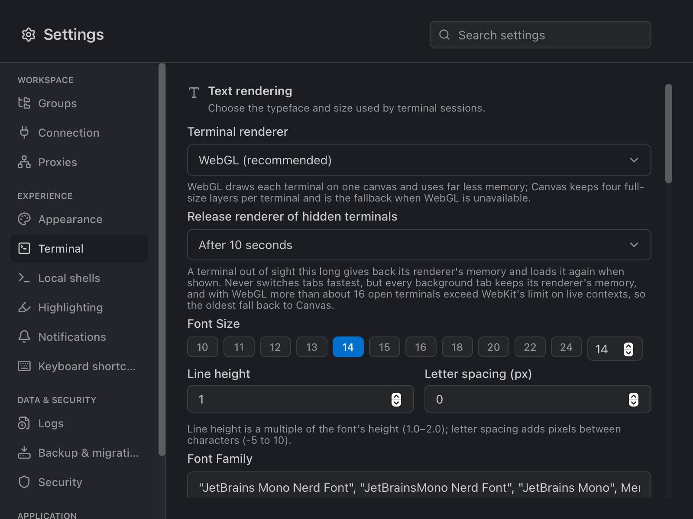
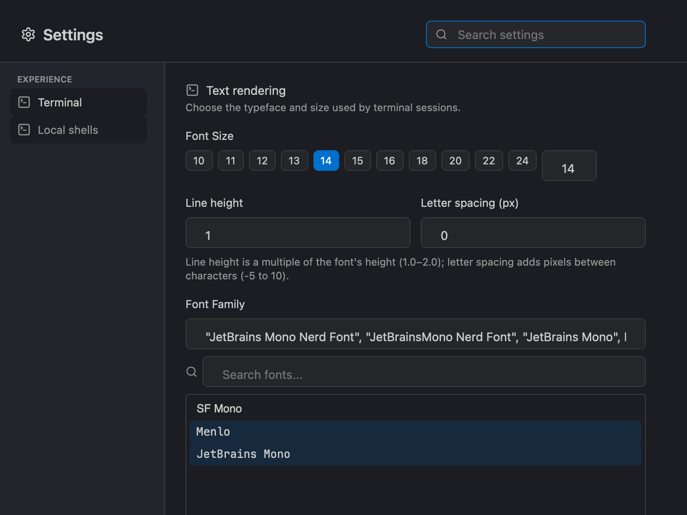
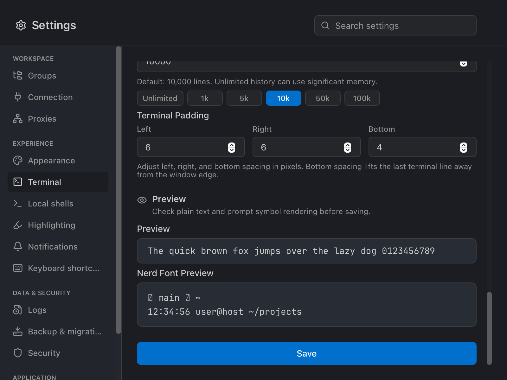
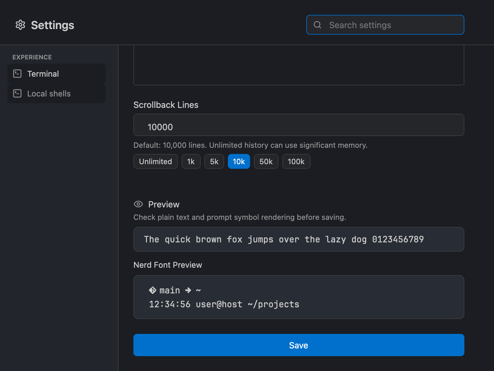

# P4-16 第二批：终端间距与统一保存

2026-11-25，macOS，`GPUI` 工作树，未提交。协调者定义字段、保存与验收契约，三个 pi + DeepSeek v4.1 Flash 任务分别实施编辑器、页面路由及配置持久化。协调者接入运行中的网格、修正搜索跳转与截图，独立复核。

## 可操作的范围

「设置 → 终端」按字号、行高、字距、字体系列、回滚行数、预览的顺序显示，页尾只有一个保存按钮。行高为 1–2 倍，字距为 −5 至 10 的整数像素。普通文本随草稿预览间距；提示符样例按 React 的固定行高显示，不强加正文的字距。保存才改变运行中的终端和回滚容量。

- 从各字段按 Enter 与点击保存走同一条路径；无效输入不写文件。写入失败保留草稿可重试，写入期间拒绝重复提交及关闭页面。标题栏的独立回滚编辑器保留原有行为。
- 从当前配置计算修改的字段，持锁重读磁盘后一次写入。临时文件测试验证保留未知键、无关设置和另一端已改但本次未编辑的字段。文件写入成功后才发布生效值。不是跨进程同时写入的事务保证，也不是双客户端桌面实测。
- 在真实本地 PTY 的无界面窗口里只改行高和字距，行数和列数都减少，模型身份未变；新标签采用同一对值。该测试并未替代人工检查字体观感、远程 SSH 或 Windows 字形回退。

## 完整内容区对照

| 状态 | React / WebKit | GPUI / headless |
| --- | --- | --- |
| 页首 |  |  |
| 页尾 |  |  |

800×600 逻辑像素、2×、英文、深色 classic、默认字号 14，同一组夹具字体。参照截图命令为 `node scripts/parity/capture.mjs --screen settings.terminal.font --screen settings.terminal.preview --out target/parity/p416b-ref`；GPUI 为 `cargo run -p tterm-gpui --example settings_capture --features automation -- --output target/parity/p416b-final`。两侧可见字段顺序和保存位置可以核对，但侧栏仍是 2 页对 14 页，原版渲染器等字段还未迁移；不能据此认定整页像素通过。

## 自动验收

六项 pnpm 检查、Rust 格式检查、严格 workspace Clippy、截图目标 Clippy 和全量 workspace 测试均通过。独立 release 测量中，30 个后台会话均有进展，前台采样 p95 为 **122.625 µs**（预算 16.667 ms）；30 MiB 全部应用并确认耗时 **159.896 ms**（时限 500 ms），即 **187.62 MiB/s**。这是固定负载测量，不等同于桌面帧率或 Ghostty 对比。

## 下一批

建议在当前五字段的保存路径上补光标样式与终端内边距，验证实时视图、边界点击及分屏尺寸，然后补行为开关。详见[14 页清单](../settings-inventory.md)。
